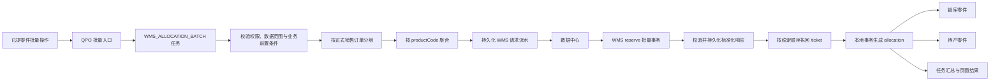
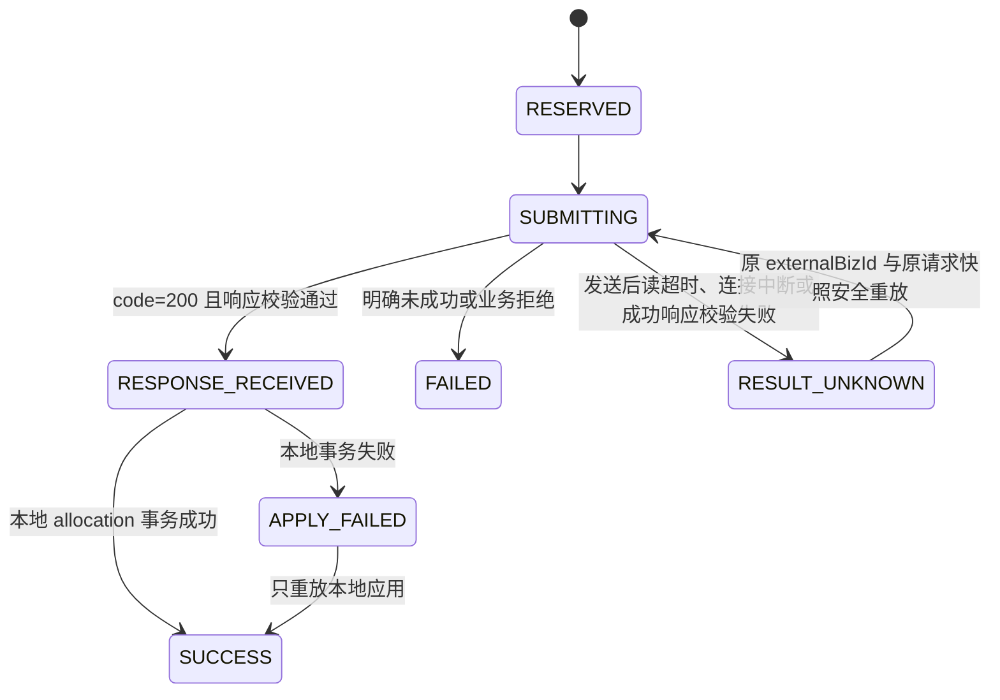

# 已提零件批量获取库存数据重构开发文档

> 编制日期：2026-08-14  
> 文档状态：业务与 WMS 契约已确认，待开发实施  
> 适用范围：QPO 已提零件、锁库零件、待产零件、系统任务、数据中心出站配置  
> 目标链路：`QPO -> 数据中心 -> WMS`  
> 新接口：`POST /api/v1/wms/admin-api/wms/datacenter/sale-lading/reserve`

## 1. 结论摘要

本次不是在旧单条调用上替换 URL，而是把“前端批量、后端逐条调用”的旧实现重构为真实的 WMS 批量锁库调用。

最终口径如下：

1. QPO 前端只保留批量入口：

   ```text
   POST /api/order-delivery/tickets/wms-allocation/batch
   ```

2. QPO 后端只通过数据中心调用 WMS：

   ```text
   POST /api/v1/wms/admin-api/wms/datacenter/sale-lading/reserve
   ```

3. 一个 WMS 请求只能包含一个销售订单号。用户跨销售订单勾选时，QPO 后端按正式销售订单自动拆分为多个 WMS 请求。
4. 同一个 WMS 请求内 `productCode` 不能重复。QPO 按 `saleNo + productCode` 聚合需求数量，再把 WMS 汇总结果稳定拆回各个提单行。
5. 只保留后台任务类型 `WMS_ALLOCATION_BATCH`，删除旧 `WMS_ALLOCATION` 单条任务及其入口。
6. 删除旧请求/响应 DTO、旧直连 WMS client、`ERP_WMS_*` 配置和旧协议解析，不提供兼容层。
7. 保留 `WMS_INVENTORY_ALLOCATE` 作为 QPO 内部功能编码，但其 path、adapter 和契约全部替换为新接口。
8. 新增持久化 WMS 请求流水。网络结果不确定时进入 `RESULT_UNKNOWN`，使用完全相同的请求体和 `externalBizId` 安全重放；禁止换新 ID 重试。
9. WMS 响应中的实际库存冻结量不是 `stockCount`，而是：

   ```text
   stockFrozenCount = frozenCount - inProductionCount
   ```

10. `inProductionCount` 固定作为“在产覆盖量”落为 `IN_PRODUCTION_LOCK`，避免这部分数量再次进入待产零件、重复下发 MES；新口径不再存在“在产单号”概念，相关字段、筛选和旧响应解析全部删除。
11. `items[].remark` 是正式请求字段，每个聚合物料明细都必须传递。
12. WMS 已确认相同 `externalBizId` 返回第一次处理结果，不会重复冻结；QPO 重试必须复用原 ID 和原请求快照。

## 2. 重构目标与非目标

### 2.1 重构目标

- 真实使用 WMS 批量锁库接口，一次传递同一销售订单下的多个物料。
- 支持前端跨销售订单勾选，由后端自动分组，不把外部接口限制泄漏给用户。
- 正确处理同销售订单下重复物料号的聚合与行级回写。
- 正确解释 WMS 的库存、在产、冻结和缺口数量。
- 对重复点击、任务并发、网络超时、本地落库失败提供可追踪且不会盲目重复冻结的状态模型。
- 保持锁库零件和待产零件后续流程可用。
- 权限、数据范围、操作日志和文件日志与新批量链路保持一致。

### 2.2 非目标

- 不保留旧 `/api/wms/inventory/allocate` 协议。
- 不保留 QPO 到 WMS 的直连模式。
- 不保留单个 `ticketId` 的 QPO WMS 提交入口。
- 不把旧响应转换成新响应，也不同时解析两套响应。
- 不在本次重构中清除历史系统任务、历史 allocation 或历史审计记录。
- 不改变 MES 物料号获取和 MES 待生产下发的外部协议。

## 3. 当前实现与问题

### 3.1 当前调用链

当前页面已经使用批量按钮，但后端仍逐条调用旧接口：

```text
DeliveredItemManage.vue
  -> submitWmsAllocationBatch(ticketIds)
  -> POST /api/order-delivery/tickets/wms-allocation/batch
  -> SystemTaskService.submitWmsAllocationBatchTask(...)
  -> DeliveryIntegrationBatchService.allocateWmsBatch(...)
  -> for each ticketId
  -> WmsAllocationService.allocate(ticketId, taskId)
  -> WmsAllocationClient.allocate(singleRequest)
```

因此当前“批量”只发生在 QPO 页面和任务层，外部请求仍是一条提单行一次 HTTP 调用。

### 3.2 当前旧协议

旧请求以 QPO 内部提单行作为外部接口身份：

```json
{
  "ticketId": 123,
  "rfqId": 456,
  "rfqNo": "RFQ-001",
  "customerName": "客户A",
  "materialNo": "SY3004000002",
  "partNo": "P-001",
  "version": "A",
  "internalProjectNo": "IP-001",
  "demandQty": 10
}
```

旧响应依赖单物料、生产订单号和旧布尔成功字段：

```json
{
  "success": true,
  "materialNo": "SY3004000002",
  "inStockLockedQty": 3,
  "inProductionLocks": [
    {
      "productionOrderNo": "MO-001",
      "lockedQty": 4
    }
  ],
  "message": "success",
  "externalTraceId": "trace-001"
}
```

新 WMS 接口与上述协议在请求身份、批量结构、响应包络、数量语义和生产订单字段上均不兼容，不能只修改 path。

### 3.3 当前主要问题

| 问题 | 影响 |
| --- | --- |
| 后端逐条请求 | 没有使用 WMS 批量事务，调用次数多，跨行结果不一致。 |
| 仍有单条 QPO 入口 | 形成两套业务入口和测试口径。 |
| 旧 client 可回退直连 WMS | 违反本次固定的 `QPO -> 数据中心 -> WMS` 链路。 |
| DTO 直接反序列化旧响应 | `DataCenterIntegrationClient` 不会自动解包 `{code,msg,data}`，新响应会解析错误。 |
| 页面提交后立即提示“锁库完成” | 实际只创建了异步任务，用户看到的是错误完成状态。 |
| 没有外部请求流水 | 读超时后无法判断 WMS 是否已经冻结，盲目重试可能重复冻结。 |
| 单行模型依赖在产单号 | 新口径已取消在产单号概念，旧字段、筛选和解析都必须删除。 |

## 4. 测试环境核实结果

2026-08-14 已对测试服务器上的数据中心路由、WMS OpenAPI、部署容器和 WMS 实际编译类进行只读核实。未调用锁库接口，避免在共享测试环境产生真实冻结数据。

### 4.1 路由与配置

- WMS 原始接口：

  ```text
  POST /admin-api/wms/datacenter/sale-lading/reserve
  ```

- 数据中心转发接口：

  ```text
  POST /api/v1/wms/admin-api/wms/datacenter/sale-lading/reserve
  ```

- 数据中心对应 flow 已启用。
- QPO 到 WMS 的数据中心权限已启用。
- 当前测试 QPO 的 `WMS_INVENTORY_ALLOCATE` endpoint path 为空，现状调用会在 QPO 侧因 path 为空失败，尚未到达 WMS。
- 数据中心到 WMS 的超时为 60 秒；QPO 该功能的 timeout 应固定为不低于 `60000ms`。

### 4.2 部署接口真实校验规则

- `saleNo` 必填。
- `externalBizId` 必填。
- `items` 至少一条。
- `items[].productCode` 必填。
- `items[].reserveCount` 为 `BigDecimal`，必填且必须大于 0。
- `items[].remark` 是双方确认的正式请求字段，QPO 每个明细都必须传递。
- `items[].customerProjectNo`、`items[].customerOrderNo` 是 WMS 新增接收字段，QPO 每个明细按销售订单行、销售订单头、提单行快照依次兜底传递。
- 同一个请求内重复 `productCode` 会失败。
- 相同 `externalBizId` 和相同请求内容再次调用时，WMS 返回第一次处理结果，不会重复冻结。
- 整个 reserve 方法使用事务；一个物料失败时，同一个请求中的 WMS 冻结整体回滚。
- WMS 查询 MES 在产数量失败时，整个 WMS 请求回滚。

### 4.3 最终联调口径

用户提供的请求样例包含：

```json
{
  "productCode": "500901000700",
  "reserveCount": 5,
  "remark": "医用防水贴无菌敷贴",
  "customerProjectNo": "CP-0814-001",
  "customerOrderNo": "CO-0814-001"
}
```

WMS 业务方已确认支持 `remark`、`customerProjectNo` 和 `customerOrderNo`。QPO 必须按最终请求契约发送这些字段，联调验收也必须校验数据中心和 WMS 实际收到的明细包含这些字段。

另外，当前 WMS OpenAPI 中存在两个同名内部 `Item` 类的 schema 名称冲突，Swagger 页面显示的明细模型不能作为唯一契约依据。本次开发应以双方确认的 JSON 契约和部署代码联调结果为准。

## 5. 新外部接口契约

> 路径中的 `sale-lading` 是测试环境已部署的实际拼写，QPO 必须原样配置，不得自行改成其他英文拼写。

### 5.1 请求

```http
POST /api/v1/wms/admin-api/wms/datacenter/sale-lading/reserve
Authorization: Bearer <data-center-access-token>
Content-Type: application/json
```

```json
{
  "externalBizId": "QPO-WMS-20260814-01KZZ08THK316WKM13FFENVJD0",
  "saleNo": "SO-20260814-001",
  "items": [
    {
      "productCode": "500901000700",
      "reserveCount": 5,
      "remark": "医用防水贴无菌敷贴",
      "customerProjectNo": "CP-0814-001",
      "customerOrderNo": "CO-0814-001"
    },
    {
      "productCode": "500901000699",
      "reserveCount": 5,
      "remark": "可孚医用纱布块",
      "customerProjectNo": "CP-0814-001",
      "customerOrderNo": "CO-0814-001"
    }
  ]
}
```

字段规则：

| 字段 | 必填 | QPO 取值与规则 |
| --- | --- | --- |
| `externalBizId` | 是 | 每个业务批次唯一，建议 `QPO-WMS-yyyyMMdd-ULID`，入库后再发送；同一批次重试必须复用原值。 |
| `saleNo` | 是 | 正式销售订单 `documentNo` 优先，`salesOrderNo` 兜底。不得使用 RFQ 号或客户订单号代替。 |
| `items` | 是 | 同一 `saleNo` 下按 `productCode` 聚合，至少一条。 |
| `items[].productCode` | 是 | 已提零件的 MES 物料号 `materialNo`。同一请求内唯一。 |
| `items[].reserveCount` | 是 | 同一销售订单和物料号下所有有效 ticket 数量之和，大于 0。 |
| `items[].remark` | 是 | 必须出现在每个请求明细。按稳定 ticket 顺序取首个非空 `ticket.remark`；若为空，依次取 `materialName`、`description`、`partNo`，仍无值时该行校验失败，不发送 WMS。 |
| `items[].customerProjectNo` | 否 | 客户项目号，按销售订单行、销售订单头、提单行快照依次兜底。 |
| `items[].customerOrderNo` | 否 | 客户订单号，按销售订单行、销售订单头、提单行快照依次兜底。 |

同一 `saleNo + productCode` 聚合时，`customerProjectNo` 和 `customerOrderNo` 必须一致；不一致的 ticket 作为行级失败，不发送 WMS。

### 5.2 响应

```json
{
  "code": 200,
  "msg": "",
  "data": {
    "saleOrderNo": "SO-20260814-001",
    "externalBizId": "QPO-WMS-20260814-01KZZ08THK316WKM13FFENVJD0",
    "items": [
      {
        "productCode": "500901000700",
        "reserveCount": 5,
        "stockCount": 3,
        "inProductionCount": 0,
        "frozenCount": 3,
        "surplusCount": 2
      }
    ]
  }
}
```

QPO 必须显式建模根节点 `{code,msg,data}`，不能把 `data` 内字段直接当作 HTTP 根响应。

### 5.3 数量语义

部署版本的实际计算语义为：

```text
inStockQty = min(stockCount, reserveCount)
inProductionQty = min(MES在产数量, reserveCount - inStockQty)
frozenCount = inStockQty + inProductionQty
surplusCount = reserveCount - frozenCount
```

因此：

- `stockCount`：冻结前的可用库存总量，不是本次实际冻结量。
- `inProductionCount`：本次需求中由在产数量覆盖的部分。
- `frozenCount`：库存覆盖量与在产覆盖量之和，名称不等于“WMS 实际冻结库存量”。
- `surplusCount`：库存和在产都无法覆盖、需要新生产的数量。
- WMS 实际库存冻结量：

  ```text
  stockFrozenCount = frozenCount - inProductionCount
  ```

### 5.4 QPO 响应校验

只有全部满足以下规则时，响应才能进入本地 allocation 写入：

1. HTTP 调用成功且响应体不为空。
2. `code == 200`。
3. `data`、`data.saleOrderNo`、`data.externalBizId`、`data.items` 不为空。
4. 返回 `saleOrderNo` 与请求 `saleNo` 完全一致。
5. 返回 `externalBizId` 与请求一致。
6. 返回明细的 `productCode` 唯一，且集合与请求完全一致，不能缺行、增行或重复。
7. 返回 `reserveCount` 与对应请求数量一致。
8. 所有数量非负，且 QPO 当前整数数量模型要求这些 `BigDecimal` 都是精确整数。
9. 每个物料满足：

   ```text
   frozenCount + surplusCount = reserveCount
   0 <= inProductionCount <= frozenCount
   0 <= frozenCount - inProductionCount <= stockCount
   ```

10. 任一校验失败时，整个销售订单批次不写 allocation，不做“尽量写入”；若 WMS 已返回 `code=200`，批次进入 `RESULT_UNKNOWN` 等待核对。

## 6. 方案比较与选择

### 6.1 方案 A：只替换 DTO 和 URL

保留当前逐 ticket 循环，每条 ticket 调一次新 reserve 接口，`items` 永远只有一条。

优点：改动小。

缺点：

- 仍然不是真批量。
- 同一销售订单被拆成大量外部事务。
- 重复物料和并发库存竞争更难控制。
- 无法解决网络超时后的重复冻结风险。

结论：不采用。

### 6.2 方案 B：内存分组后批量调用，不建流水

按销售订单和物料号聚合，调用新接口，但外部请求状态只存在于异步线程内。

优点：能够使用批量接口，数据库改动较少。

缺点：

- 进程重启、读超时或本地落库失败后无法可靠恢复。
- 无法证明某个 `externalBizId` 是否已经发送或成功。
- 若 WMS 不支持相同 ID 返回原结果，网络超时后的恢复风险不可接受。

结论：不采用。

### 6.3 方案 C：真实批量 + 持久化流水 + 本地幂等应用

请求前持久化 `externalBizId`、销售订单、聚合物料和 ticket 映射；收到响应后先持久化标准化结果，再以本地事务生成 allocation。

优点：

- 使用真实批量事务。
- 可区分外部失败、结果未知和本地应用失败。
- 已收到的 WMS 成功结果可以只重放本地写入，不再次调用 WMS。
- 能支撑后续按 `externalBizId` 对账。

代价：新增三张流水表和明确的状态机。

结论：采用方案 C。

## 7. 总体架构



### 7.1 事务边界

- 前端一次提交只创建一个 `WMS_ALLOCATION_BATCH` 系统任务。
- 每个销售订单对应一个独立 WMS 请求和一个独立 WMS 事务。
- 不同销售订单批次允许部分成功，任务结果必须逐批次、逐 ticket 展示。
- 单个 WMS 销售订单批次内，任一物料失败时按 WMS 事务语义整批失败。
- QPO 不在数据库事务中等待外部 HTTP 请求，避免长事务和行锁占用。
- WMS 响应持久化与 allocation 应用分开：已知成功响应先落流水，再执行本地 allocation 事务。

## 8. 销售订单解析、聚合与拆分

### 8.1 正式销售订单解析

复用 MES 待生产下发中已经验证的正式销售订单解析规则：

1. 优先通过 `sales_order_item.source_ticket_id = ticket.id` 找销售订单行。
2. ticket 来源为 `SALES_ORDER` 且有 `source_item_id` 时，同时校验直接来源行。
3. 两种解析结果不一致时视为歧义，禁止发送 WMS。
4. 销售订单行必须关联有效 `sales_order_header`。
5. `saleNo` 使用 `sales_order_header.document_no` 优先、`sales_order_no` 兜底。

缺少或歧义的 ticket 记为行级 `FAILED`，不得用 RFQ 号、客户订单号等字段猜测 `saleNo`。

### 8.2 分组键

外部请求分组键：

```text
salesOrderHeaderId + saleNo
```

物料聚合键：

```text
salesOrderHeaderId + saleNo + productCode
```

同一物料聚合数量：

```text
reserveCount = sum(ticket.qty)
```

### 8.3 稳定拆分规则

WMS 只返回聚合物料结果，不知道 QPO 的 ticket 身份。QPO 按以下稳定顺序把三个数量池拆回 ticket：

```text
sales_order_item.line_no ASC, ticket.id ASC
```

对同一个 `productCode`，先计算：

```text
stockBucket = frozenCount - inProductionCount
inProductionBucket = inProductionCount
surplusBucket = surplusCount
```

然后依次处理每个 ticket：

```text
ticketStock = min(ticket.qty, stockBucket)
remaining = ticket.qty - ticketStock

ticketInProduction = min(remaining, inProductionBucket)
remaining = remaining - ticketInProduction

ticketSurplus = remaining
```

每处理一个 ticket 后，从对应 bucket 扣减数量。处理完成后所有 bucket 必须正好为 0，否则整批本地应用失败。

该规则保证同一输入和同一 WMS 响应始终得到相同 allocation，不受前端勾选顺序影响。

### 8.4 allocation 映射

| WMS 结果 | QPO allocationType | 后续模块 | 说明 |
| --- | --- | --- | --- |
| `frozenCount - inProductionCount` | `IN_STOCK_LOCK` | 锁库零件 | WMS 实际库存冻结量。 |
| `inProductionCount` | `IN_PRODUCTION_LOCK` | 锁库零件 | 已确认的在产覆盖量，不再下发新生产。 |
| `surplusCount` | `PRODUCTION_REQUIRED` | 待产零件 | 需要后续下发 MES 的新增生产需求。 |

新口径不存在在产单号。以下字段和围绕它的查询、筛选、展示全部删除：

```text
order_delivery_ticket_allocation.wms_production_order_no
OrderDeliveryTicketAllocation.wmsProductionOrderNo
LockedItemDTO.wmsProductionOrderNo
LockedItemQueryReq.wmsProductionOrderNo
```

锁库零件页面把“在产库存锁定”统一改为“在产覆盖”，不再展示或筛选在产单号。

## 9. WMS 请求流水与状态机

### 9.1 为什么必须持久化

WMS 已确认相同 `externalBizId` 会返回第一次处理结果，不会再次冻结。这使网络异常后的安全重放成为可能，但前提是 QPO 必须复用完全相同的 ID 和请求内容。

因此 QPO 必须在发送前持久化：

- `externalBizId`；
- 完整请求快照；
- 请求指纹；
- 当前尝试次数和状态。

发生读超时时，QPO 先进入 `RESULT_UNKNOWN`，再使用持久化的原请求快照和原 `externalBizId` 重放。不得从当前 ticket 重新组装请求，也不得生成新 ID。

### 9.2 建议表结构

#### `wms_reservation_batch`

一行代表一次真实的 WMS HTTP 请求。

| 字段 | 类型 | 说明 |
| --- | --- | --- |
| `id` | `BIGSERIAL` | QPO 批次主键。 |
| `external_biz_id` | `VARCHAR(80)` | WMS 外部业务 ID，全局唯一。 |
| `system_task_id` | `BIGINT` | 对应 `system_task.id`。 |
| `sale_order_id` | `BIGINT` | 正式销售订单头 ID。 |
| `sale_order_no` | `VARCHAR(100)` | 发给 WMS 的 `saleNo`。 |
| `request_fingerprint` | `VARCHAR(64)` | `saleNo + 排序后的 items` 规范化 SHA-256。 |
| `request_payload` | `JSONB` | 实际发送的完整请求快照，同 ID 重放时直接复用。 |
| `item_count` | `INTEGER` | 聚合物料数。 |
| `ticket_count` | `INTEGER` | 原始 ticket 数。 |
| `status` | `VARCHAR(30)` | 批次状态。 |
| `attempt_no` | `INTEGER` | 使用同一 `externalBizId` 的发送次数。 |
| `last_error_type` | `VARCHAR(60)` | 最近一次异常分类，用于区分传输未知和响应校验失败。 |
| `response_code` | `VARCHAR(40)` | WMS 业务 code。 |
| `response_msg` | `VARCHAR(500)` | 截断后的业务消息。 |
| `submitted_at` | `TIMESTAMP` | 开始外部发送时间。 |
| `responded_at` | `TIMESTAMP` | 收到完整响应时间。 |
| `completed_at` | `TIMESTAMP` | 本地应用完成时间。 |
| `created_by` | `BIGINT` | 提交用户。 |
| `created_at/updated_at` | `TIMESTAMP` | 审计时间。 |

唯一索引：

```text
UNIQUE (external_biz_id)
```

#### `wms_reservation_item`

一行代表外部请求中的一个唯一 `productCode`。

| 字段 | 类型 | 说明 |
| --- | --- | --- |
| `id` | `BIGSERIAL` | 主键。 |
| `batch_id` | `BIGINT` | WMS 批次。 |
| `product_code` | `VARCHAR(100)` | MES 物料号。 |
| `reserve_count` | `NUMERIC(18,6)` | 聚合需求数量。 |
| `remark` | `VARCHAR(500)` | 实际发送的必传备注。 |
| `stock_count` | `NUMERIC(18,6)` | WMS 返回的冻结前库存。 |
| `in_production_count` | `NUMERIC(18,6)` | 在产覆盖量。 |
| `frozen_count` | `NUMERIC(18,6)` | 库存与在产覆盖总量。 |
| `surplus_count` | `NUMERIC(18,6)` | 待生产缺口。 |
| `status` | `VARCHAR(30)` | 明细状态。 |
| `created_at/updated_at` | `TIMESTAMP` | 审计时间。 |

唯一索引：

```text
UNIQUE (batch_id, product_code)
```

#### `wms_reservation_ticket`

一行代表聚合物料与原始 ticket 的映射，也是本地拆分结果的持久化载体。

| 字段 | 类型 | 说明 |
| --- | --- | --- |
| `id` | `BIGSERIAL` | 主键。 |
| `batch_id` | `BIGINT` | WMS 批次。 |
| `batch_item_id` | `BIGINT` | 聚合物料行。 |
| `ticket_id` | `INTEGER` | 已提零件 ID。 |
| `sales_order_item_id` | `BIGINT` | 正式销售订单行 ID。 |
| `sales_order_line_no` | `INTEGER` | 稳定拆分顺序。 |
| `product_code` | `VARCHAR(100)` | 物料号快照。 |
| `reserve_count` | `NUMERIC(18,6)` | ticket 需求数量快照。 |
| `stock_frozen_count` | `NUMERIC(18,6)` | 拆分后的库存冻结量。 |
| `in_production_count` | `NUMERIC(18,6)` | 拆分后的在产覆盖量。 |
| `surplus_count` | `NUMERIC(18,6)` | 拆分后的待生产量。 |
| `status` | `VARCHAR(30)` | ticket 处理状态。 |
| `message` | `VARCHAR(500)` | 行级结果摘要。 |
| `applied_at` | `TIMESTAMP` | allocation 应用完成时间。 |
| `created_at/updated_at` | `TIMESTAMP` | 审计时间。 |

约束与索引：

```text
UNIQUE (batch_id, ticket_id)
```

对 `RESERVED`、`SUBMITTING`、`RESULT_UNKNOWN`、`RESPONSE_RECEIVED`、`APPLY_FAILED` 状态建立 ticket 活跃唯一索引，阻止同一 ticket 同时进入多个 WMS 请求。

#### allocation 本地幂等键

在 `order_delivery_ticket_allocation` 增加：

```text
wms_reservation_ticket_id BIGINT NULL
```

并建立：

```text
UNIQUE (wms_reservation_ticket_id, allocation_type)
WHERE wms_reservation_ticket_id IS NOT NULL
```

这样 `APPLY_FAILED` 重放本地结果时不会重复插入 allocation。

历史 allocation 的该字段保持 `NULL`，不迁移、不删除。

### 9.3 批次状态



状态说明：

| 状态 | 是否允许再次调用 WMS | 处理方式 |
| --- | --- | --- |
| `RESERVED` | 否 | 请求身份已创建，等待发送。 |
| `SUBMITTING` | 否 | 外部调用进行中。 |
| `RESPONSE_RECEIVED` | 否 | WMS 成功结果已知，只允许本地应用。 |
| `SUCCESS` | 否 | 完成。 |
| `FAILED` | 仅确认未冻结后允许 | 明确业务失败或确定请求未到达 WMS。新请求使用新 ID。 |
| `RESULT_UNKNOWN` | 仅允许原请求重放 | 使用持久化请求快照和原 `externalBizId` 重放；禁止新 ID。响应校验失败时不自动循环重放。 |
| `APPLY_FAILED` | 否 | 重放已持久化的本地 allocation，不再访问 WMS。 |

### 9.4 异常分类

- token 获取失败、path 未配置、DNS/连接建立失败且能证明请求未发出：`FAILED`。
- 收到 HTTP 响应但业务 `code != 200`：`FAILED`。
- 已收到 `code=200`，但响应字段不完整、身份不匹配或数量校验失败：保存响应摘要并标记 `RESULT_UNKNOWN`，不得生成 allocation，也不得自动循环重放；相同 ID 只会返回同一份无效结果，需要 WMS 修正或人工处理。
- 请求体已经写出后发生读超时、连接重置或无法判断是否到达 WMS：先进入 `RESULT_UNKNOWN`，随后可使用原请求快照和原 `externalBizId` 做有限次数的安全重放。
- WMS 成功响应已经持久化，但 QPO allocation 事务失败：`APPLY_FAILED`。

`DataCenterIntegrationClient` 或 WMS 专用 client 必须保留异常阶段和“结果是否确定”的类型信息，不能把所有异常压成同一种 `RuntimeException`。

### 9.5 WMS 幂等最终口径

双方确认的幂等行为：

1. 第一次收到 `externalBizId` 时，WMS 正常执行业务事务并保存结果。
2. 再次收到相同 `externalBizId` 时，WMS 返回第一次处理结果，不重复冻结库存。
3. QPO 对同一个 `externalBizId` 只允许发送持久化的原请求快照。
4. QPO 每次重放前校验请求指纹；指纹不一致时在 QPO 本地拒绝，不能请求 WMS。
5. 单次系统任务最多发送 2 次：首次调用加 1 次同 ID 自动重放；第二次仍无法确定结果时保留 `RESULT_UNKNOWN`。用户再次通过现有批量入口提交该批次任一 ticket 时，后端恢复整个原批次并同 ID 重放，不创建新批次。
6. `RESULT_UNKNOWN`、`RESPONSE_RECEIVED`、`APPLY_FAILED` 和 `SUCCESS` 批次绝不能换新 ID。只有 WMS 明确失败且已确认事务回滚的 `FAILED` 批次，在业务数据修正后才允许创建新的业务批次和新 `externalBizId`。

联调必须验证：第一次请求与同 ID 重放返回相同业务结果，WMS 只产生一次库存冻结。

## 10. 后端改造设计

### 10.1 对外入口

保留：

```text
POST /api/order-delivery/tickets/wms-allocation/batch
```

请求：

```json
{
  "ticketIds": [101, 102, 103]
}
```

响应仍为新建的 `SystemTask`，任务类型固定为：

```text
WMS_ALLOCATION_BATCH
```

该批量入口同时承担安全恢复：

- ticket 没有活跃 WMS 流水时，按销售订单创建新批次和新 `externalBizId`。
- ticket 已属于 `RESULT_UNKNOWN` 批次时，不创建新批次，改为用该批次保存的原请求快照和原 `externalBizId` 重放。
- ticket 已属于 `RESPONSE_RECEIVED` 或 `APPLY_FAILED` 批次时，只重放本地 allocation 应用，不再调用 WMS。
- 任意一个原批次 ticket 被选择恢复时，后端恢复整个原 WMS 批次，并重新校验当前用户对批次内所有 ticket 的数据权限。

删除：

```text
POST /api/order-delivery/tickets/{ticketId}/wms-allocation
```

### 10.2 服务职责

建议拆分为以下职责，名称可按现有包结构微调：

| 类 | 职责 |
| --- | --- |
| `WmsReservationBatchService` | 批量编排、ticket 校验、销售订单分组、汇总任务结果。 |
| `WmsReservationPlanService` | 销售订单解析、物料聚合、稳定拆分和数量校验。 |
| `WmsReservationStateService` | 请求流水预留、状态迁移、标准化响应持久化、本地幂等应用。 |
| `WmsReservationClient` | 只通过 `DataCenterIntegrationClient` 调用新 reserve 接口。 |
| `WmsReservationFingerprintService` | 生成规范化请求指纹。 |

不要求为了形式拆出所有类；若某些职责较短可以合并，但 client、批量编排和事务状态不能继续混在旧单行方法中。

### 10.3 新 DTO

删除：

```text
WmsAllocationReq
WmsAllocationResp
```

新增并按真实 JSON 显式建模：

```text
WmsSaleLadingReserveReq
  externalBizId: String
  saleNo: String
  items: List<RequestItem>

RequestItem
  productCode: String
  reserveCount: BigDecimal
  remark: String
  customerProjectNo: String
  customerOrderNo: String

WmsSaleLadingReserveResp
  code: Integer
  msg: String
  data: Data

Data
  saleOrderNo: String
  externalBizId: String
  items: List<ResponseItem>

ResponseItem
  productCode: String
  reserveCount: BigDecimal
  stockCount: BigDecimal
  inProductionCount: BigDecimal
  frozenCount: BigDecimal
  surplusCount: BigDecimal
```

请求和响应数量字段统一使用 `BigDecimal`。转换到现有 allocation 的 `Integer qty` 时必须使用精确整数转换，禁止静默舍入。

### 10.4 Data Center endpoint

内部功能编码继续使用：

```text
WMS_INVENTORY_ALLOCATE
```

固定定义替换为：

| 配置 | 新值 |
| --- | --- |
| displayName | `WMS销售锁库` |
| targetSystemCode | `WMS` |
| method | `POST` |
| path | `/api/v1/wms/admin-api/wms/datacenter/sale-lading/reserve` |
| timeoutMs | 不低于 `60000` |
| requestAdapter | `WMS_SALE_LADING_RESERVE_V1` |
| responseAdapter | `WMS_SALE_LADING_RESERVE_RESPONSE_V1` |

新增两个顺序执行的 Flyway migration：

```text
V10__wms_batch_reservation_contract.sql
V11__remove_wms_production_order_no.sql
```

`V10` 负责：

- 创建三张 WMS 流水表及约束。
- 给 allocation 增加本地幂等外键。
- 更新 `WMS_INVENTORY_ALLOCATE` 的 path、timeout 和 adapter。
- 不修改已经执行过的旧 Flyway migration。

`V11` 与后端、前端在产单号字段删除代码同阶段提交，负责：

- 删除 `idx_delivery_allocation_wms_order`。
- 删除 `order_delivery_ticket_allocation.wms_production_order_no`。
- 不改写历史 migration；最终版本不保留在产单号字段。

### 10.5 批量执行结果

系统任务结果至少包含：

```json
{
  "taskType": "WMS_ALLOCATION_BATCH",
  "taskId": 9001,
  "ticketCount": 5,
  "batchCount": 2,
  "successCount": 3,
  "failedCount": 1,
  "unknownCount": 0,
  "applyFailedCount": 0,
  "skippedCount": 1,
  "batches": [
    {
      "batchId": 1001,
      "externalBizId": "QPO-WMS-20260814-...",
      "saleOrderNo": "SO-001",
      "status": "SUCCESS",
      "itemCount": 2,
      "ticketCount": 3
    }
  ],
  "results": [
    {
      "ticketId": 101,
      "status": "SUCCESS",
      "stockFrozenCount": 3,
      "inProductionCount": 1,
      "surplusCount": 1,
      "message": "WMS 库存数据获取成功"
    }
  ]
}
```

单个销售订单批次失败不应抹掉其他销售订单的成功结果。`SystemTask.status=SUCCESS` 表示批量编排正常结束，具体业务成功与失败以结果统计为准；只有编排器自身发生未捕获异常时，系统任务才标记 `FAILED`。

## 11. 前端改造设计

### 11.1 提交行为

- 页面仍允许勾选一个或多个已提零件。
- 页面不要求用户先按销售订单筛选，后端负责分组。
- 保留现有批量防重复 key。
- 删除前端 `submitWmsAllocation(ticketId)` API。
- 页面只调用 `submitWmsAllocationBatch(ticketIds)`。

### 11.2 异步结果

当前提交后立即显示“锁库完成”是错误的，应改为：

1. 创建任务成功后提示“WMS 库存任务已提交，任务 ID：xxx”。
2. 复用系统任务查询接口轮询 `WMS_ALLOCATION_BATCH` 结果。
3. 任务返回后展示成功、失败、结果未知、本地应用失败和跳过数量。
4. 刷新已提零件列表。
5. 只有具体 ticket 为 `SUCCESS` 时，才显示“查看锁库结果”。

轮询超时只表示页面暂未拿到任务结果，不得提示 WMS 失败，也不得自动再次提交。

### 11.3 状态展示

已提零件 WMS 状态至少支持：

| 状态 | 页面文案 |
| --- | --- |
| `PENDING` | 待获取 |
| `PROCESSING` | 获取中 |
| `SUCCESS` | 已完成 |
| `FAILED` | 获取失败 |
| `RESULT_UNKNOWN` | 结果待核对 |
| `APPLY_FAILED` | 本地写入待修复 |

锁库零件中：

- `IN_STOCK_LOCK` 显示“库存冻结”。
- `IN_PRODUCTION_LOCK` 显示“在产覆盖”。
- 删除在产单号列、筛选项、详情字段和空值判断。

## 12. 权限与数据范围

### 12.1 权限

继续复用：

```text
market:delivered-item:wms-allocate
```

唯一批量入口必须保留后端：

```java
@RequirePermission("market:delivered-item:wms-allocate")
```

不新增 assignable `common:*` 权限。系统任务读取继续使用现有任务查看能力。

### 12.2 数据范围

- 创建系统任务前，对所有规范化 ticket 执行 `assertCanAccessDeliveryTicket`。
- 空数据范围必须拒绝提交或返回空结果，不能通过只隐藏前端按钮代替后端校验。
- 异步任务执行时再次按 ID 加载业务数据，不能信任前端传入的销售订单号、物料号或数量。
- 销售订单解析结果与 ticket 来源矛盾时，该行失败，不跨数据范围猜测关联订单。

## 13. 操作日志与文件日志

### 13.1 操作日志

保留：

```text
DELIVERY_WMS_ALLOCATION_SUBMIT
DELIVERY_WMS_ALLOCATION_SUCCESS
DELIVERY_WMS_ALLOCATION_FAILED
```

新增：

```text
DELIVERY_WMS_ALLOCATION_RESULT_UNKNOWN
DELIVERY_WMS_ALLOCATION_APPLY_FAILED
DELIVERY_WMS_ALLOCATION_RECONCILED
```

建议目标对象：

- 提交日志目标为 `system_task`。
- 批次结果日志目标为 `wms_reservation_batch`。
- 摘要包含 `taskId`、`batchId`、`externalBizId`、`saleOrderNo`、物料数、ticket 数、状态和数量汇总。

不得把 access token、Authorization header、client secret 或完整请求/响应 JSON 写入操作日志。

### 13.2 文件日志

异步生命周期必须记录：

```text
WMS reservation batch submitted
WMS reservation batch started
WMS reservation group sending
WMS reservation group responded
WMS reservation group applied
WMS reservation group result unknown
WMS reservation batch completed
WMS reservation batch failed
```

关键关联字段：

```text
taskId, batchId, externalBizId, saleOrderNo, ticketCount, itemCount, status, durationMs
```

异常日志必须包含 `taskId` 和堆栈。正常列表读取、任务轮询和健康检查不增加高频文件日志。

## 14. 明确删除范围

本次不做旧协议兼容。实现时必须删除以下内容，而不是保留 deprecated 分支。

### 14.1 后端运行时代码

- 删除 `OrderDeliveryController` 的单条路由：

  ```text
  POST /tickets/{ticketId}/wms-allocation
  ```

- 删除 `SystemTaskService.submitWmsAllocationTask(Integer ticketId)`。
- 删除任务类型 `WMS_ALLOCATION` 的新建和执行分支，只保留历史数据库记录可读。
- 删除 `WmsAllocationService.allocate(Integer ticketId, Long taskId)` 单行编排。
- 删除 `WmsAllocationReq`、`WmsAllocationResp` 及旧响应的 `inProductionLocks/productionOrderNo` 解析。
- 删除 `OrderDeliveryTicketAllocation`、`LockedItemDTO`、`LockedItemQueryReq` 中的 `wmsProductionOrderNo` 字段及 mapper 查询映射。
- 删除 `WmsAllocationClient` 中直连 WMS 的 `RestTemplate`、Bearer token 和 runtime fallback 分支；替换为只走数据中心的新 client。
- 删除 `ExternalIntegrationConfigService` 中 WMS 直连 fallback 的运行时使用。
- 删除后端按 ticket 循环调用外部 WMS 的实现。

### 14.2 配置

删除：

```text
ERP_WMS_BASE_URL
ERP_WMS_AUTH_TOKEN
ERP_WMS_ALLOCATION_PATH
ERP_WMS_TIMEOUT_MS
erp.wms.*
```

同步从以下位置移除：

- `application.yaml`
- `docker-compose.yml`
- `erp.env.example`
- 真实部署 `erp.env`
- 旧 WMS 直连配置服务和相关测试

保留的是数据中心连接配置和当前数据中心 path fallback，例如 `ERP_DATA_CENTER_*`、`ERP_DATA_CENTER_WMS_ALLOCATION_PATH`。这属于新链路配置，不是旧 WMS 直连兼容。

### 14.3 前端

- 删除 `deliveredItemApi.submitWmsAllocation(ticketId)`。
- 删除所有单行 WMS 提交按钮、pending key 和对应测试断言。
- 删除提交任务后立即提示“锁库完成”的逻辑。
- 删除锁库零件页面的在产单号列、筛选项和详情字段。

### 14.4 测试

- 删除或重写 `WmsAllocationTest` 中旧单条入口和旧响应断言。
- 删除或重写 `WmsAllocationClientTest` 中 `ERP_WMS_*`、直连和旧 DTO 断言。
- 更新 `DeliveryIntegrationBatchTaskTest`，断言按销售订单真实批量，而不是逐 ticket 调 service。
- 更新 `DataCenterConfigStage*Test` 中旧 adapter、旧 timeout 和旧 fallback 断言。
- 更新前端 `deliveredItemApi.test.js`、`deliveredItemWmsAllocation.test.js` 等单条 API 断言。
- 保留与材料快照、工艺快照、权限和日志有关的有效回归覆盖，并适配新服务名称。

### 14.5 文档

代码完成后：

- 用本文最终实现口径重写 `04-WMS锁库分配与锁库零件模块开发文档.md`。
- 用新数据中心接口契约重写 `07-提供给WMS的库存锁库接口对接说明.md`。
- 更新 `01-提单需求池与MES-WMS对接需求清单.md`。
- 更新数据中心统一对接、权限清单、部署说明和日志运维文档。
- 删除文档中 `/api/wms/inventory/allocate`、`WMS_ALLOCATION`、`WMS_ALLOCATION_V1`、`ERP_WMS_*` 和单条 QPO 路由的现行说明。

## 15. 测试方案

### 15.1 后端单元测试

- 单 ticket 也构造成一条 `items` 的批量请求。
- 同一销售订单多个物料只发送一次 WMS 请求。
- 跨销售订单选择自动拆成多个 WMS 请求。
- 同一销售订单重复 `productCode` 正确聚合。
- 不同销售订单相同 `productCode` 不跨订单聚合。
- 正式销售订单缺失、歧义或销售订单号为空时不发送 WMS。
- 缺物料号、数量非正、已成功、处理中和结果未知的行按规则处理。
- `externalBizId` 在请求发送前已经持久化且唯一。
- 根响应包络、销售订单号、外部 ID、物料集合和数量恒等式校验。
- `BigDecimal` 非整数结果拒绝落入 `Integer qty`。
- 稳定拆分与前端 ticket 选择顺序无关。
- allocation 三类数量之和等于 ticket 数量。
- 请求每个聚合物料都包含 `remark`，缺少可用备注来源时在调用前失败。
- 新 DTO、entity、mapper 和前端中不存在在产单号字段。
- `APPLY_FAILED` 本地重放不重复插入 allocation。
- 读超时进入 `RESULT_UNKNOWN` 后使用原请求快照和原 `externalBizId` 重放，WMS 只冻结一次。
- 相同 `externalBizId` 但请求指纹不同的重放在 QPO 本地被拒绝。
- 一个销售订单失败不影响其他销售订单批次执行。

### 15.2 权限和数据范围测试

- 无 `market:delivered-item:wms-allocate` 返回 403。
- 有按钮权限但 ticket 不在数据范围内时后端拒绝。
- 前端隐藏按钮不能替代后端权限。
- 空数据范围不泄漏 ticket、销售订单或 WMS 流水。

### 15.3 前端测试

- 只存在批量 API，不存在单条提交 API。
- 单选一条时仍调用批量入口。
- 重复点击只创建一个前端 pending 请求。
- 提交成功提示“任务已提交”，不提示“锁库完成”。
- 轮询后正确展示成功、失败、未知、应用失败和跳过统计。
- 任务轮询暂时无结果时不自动重复提交 WMS。

### 15.4 测试环境联调矩阵

联调前由 WMS 提供可冻结、可清理的专用销售订单和物料数据。共享环境禁止使用生产或无法释放的库存做自动化测试。

| 场景 | 预期 |
| --- | --- |
| 单 ticket、单物料 | 一条批量请求，结果正确落库。 |
| 同销售订单、多物料 | 一次 WMS 调用，所有物料同批事务。 |
| 同销售订单、重复物料 ticket | 请求中物料唯一，数量聚合，返回后稳定拆分。 |
| 跨销售订单 | QPO 一个任务、多个 WMS 批次，结果分别汇总。 |
| 库存完全覆盖 | 只生成 `IN_STOCK_LOCK`。 |
| 库存 + 在产覆盖 | 生成库存冻结与在产覆盖，不重复进入待产。 |
| 存在缺口 | 缺口生成 `PRODUCTION_REQUIRED`。 |
| WMS 业务失败 | 同销售订单批次不写 allocation。 |
| WMS 查询 MES 失败 | WMS 整批回滚，QPO 标记失败。 |
| `remark` 传递 | 每个请求 item 都包含 QPO 组装的 `remark`，WMS 实际接收。 |
| 读超时 | QPO 先标记 `RESULT_UNKNOWN`，再以原请求和原 `externalBizId` 重放；WMS 返回原结果且只冻结一次。 |
| 同 ID、不同请求指纹 | QPO 本地拒绝发送。 |
| QPO 本地写入模拟失败 | 保存响应并标记 `APPLY_FAILED`，本地重放成功。 |
| 重复点击 | 不产生第二个活跃流水。 |

## 16. 发布与迁移

本次不提供双协议兼容，因此前后端、数据库和 endpoint 配置应在维护窗口内作为同一发布批次完成。

### 16.1 发布前

1. 确认没有旧 `WMS_ALLOCATION` 或旧实现的 `WMS_ALLOCATION_BATCH` 任务处于 `PENDING/RUNNING`。
2. 核对并处理长期停留在 `wms_allocate_status=PROCESSING` 的旧 ticket。
3. 备份数据库，尤其是 ticket、allocation、system_task 和 operation_log。
4. 暂停页面 WMS 批量操作权限或进入维护窗口。
5. WMS 确认联调数据清理方式，并准备验证相同 `externalBizId` 返回原结果且不重复冻结。

### 16.2 发布顺序

1. 执行 Flyway migration，创建 WMS 流水与新 endpoint 定义。
2. 部署后端，确认 `WMS_INVENTORY_ALLOCATE` path 和 timeout 生效。
3. 部署前端，确认只调用批量入口。
4. 使用专用销售订单执行最小单物料联调。
5. 执行同订单多物料、重复物料和跨订单联调。
6. 恢复业务权限。

### 16.3 回滚约束

- 一旦新版本已经成功调用 WMS，不得通过回滚后自动重放任务。
- 回滚前必须按 `externalBizId` 记录所有已发送批次及状态。
- 新表和历史字段不在应用回滚时删除。
- 已进入 `RESULT_UNKNOWN` 的批次只能由新版本使用原请求快照和原 `externalBizId` 恢复，不得在旧版本重新点击。

## 17. 验收标准

满足以下条件才算本次重构完成：

- 单选和多选都只通过 QPO 批量入口提交。
- 后端不存在单条 WMS 提交路由和单条任务类型。
- 后端不存在旧 WMS 直连和 `ERP_WMS_*` fallback。
- 数据中心 endpoint 固定为新 reserve path，timeout 不低于 60 秒。
- 同销售订单多个物料只产生一次 WMS 请求。
- 跨销售订单自动拆批，用户无需手工分组。
- 同批重复物料号被聚合，WMS 请求中 `productCode` 唯一。
- 新 `{code,msg,data}` 响应被完整校验。
- 每个请求 item 都传递 `remark`，联调确认 WMS 实际接收。
- `stockCount` 不被误当成本次锁定量。
- allocation 数量严格满足 ticket 需求总量。
- 在产覆盖全链路不存在在产单号字段、筛选或解析。
- `RESULT_UNKNOWN` 只使用原请求快照和原 ID 重放，绝不换新 ID。
- 同 `externalBizId` 重放返回原结果且只产生一次冻结。
- `APPLY_FAILED` 可以只重放本地写入且不重复 allocation。
- 页面不再把“任务已提交”提示成“锁库完成”。
- 权限、数据范围、操作日志和异步文件日志测试通过。
- 旧协议、旧配置和旧文档现行说明完成清理。

## 18. 已确认业务与 WMS 口径

### 18.1 在产数量归类

最终口径：

```text
inProductionCount -> IN_PRODUCTION_LOCK -> 锁库零件中的“在产覆盖”
```

`inProductionCount` 已由 WMS 计入 `frozenCount`，不得再次放入 `PRODUCTION_REQUIRED`，否则会把已在产数量重复下发 MES。

新口径没有在产单号概念。数据库字段、后端属性、接口 DTO、mapper、前端列、筛选项和文档中的在产单号内容全部删除。

### 18.2 `remark` 字段

WMS 已确认支持 `items[].remark`。QPO 每个请求 item 都必须传递该字段，不能因为物料被聚合而省略。

QPO 按稳定 ticket 顺序取首个非空业务备注；为空时按 `materialName`、`description`、`partNo` 依次兜底。全部为空时调用前校验失败。

### 18.3 `externalBizId` 幂等

WMS 已确认：使用相同 `externalBizId` 再次请求会返回第一次处理结果，不重复冻结库存。

QPO 的实现约束：

- 首次发送前保存完整请求快照和指纹。
- 重放时只能使用原请求快照和原 `externalBizId`。
- 请求指纹不一致时 QPO 本地拒绝。
- 传输结果未知时允许同 ID 有限重放。
- 结果未知、已响应或已成功的批次不得换新 `externalBizId`；只有明确失败并确认 WMS 事务回滚后，修正后的再次提交才创建新业务批次。

## 19. 分阶段开发计划

> **执行要求：** 实施时使用 `superpowers:subagent-driven-development` 或 `superpowers:executing-plans` 按阶段推进；下面的复选框作为进度记录。每个阶段必须先写失败测试、确认失败原因正确，再实现、验证并独立提交。

**目标：** 在不保留旧单条协议和 WMS 直连 fallback 的前提下，将已提零件库存获取改为可持久化、可同 ID 安全重放、按销售订单真实批量调用的 WMS reserve 流程。

**架构：** 前端只提交 ticket ID 批量；后端解析正式销售订单，按 `saleNo` 分组并按 `productCode` 聚合。每个销售订单组先持久化请求快照、指纹和 `externalBizId`，再经数据中心调用 WMS；成功响应先持久化，再以本地事务稳定拆分并生成 allocation。

**技术栈：** Java 17、Spring Boot 3.2、MyBatis-Plus、PostgreSQL、Flyway、JUnit 5、Mockito、Vue 3、Element Plus、Vitest、Vite。

### 19.1 全局实施约束

- 最终外部链路只能是 `QPO -> 数据中心 -> WMS`。
- 最终外部 path 固定为 `/api/v1/wms/admin-api/wms/datacenter/sale-lading/reserve`，`sale-lading` 原样保留。
- 只保留 QPO 批量入口和任务类型 `WMS_ALLOCATION_BATCH`。
- `items[].remark` 每行必传，缺少可用值时调用前失败。
- `inProductionCount` 固定落为 `IN_PRODUCTION_LOCK`，页面文案为“在产覆盖”。
- 最终代码和数据库中不保留在产单号字段。
- `RESULT_UNKNOWN` 只能使用持久化的原请求快照和原 `externalBizId` 重放。
- 同 ID 重放前必须校验请求指纹；不得从当前 ticket 重新组装请求。
- 只有 WMS 明确失败并确认事务回滚后，修正数据的再次提交才生成新 ID。
- 不修改已经执行过的 `V1`、`V2` 等历史 Flyway migration。
- 不记录 access token、Authorization header、client secret、服务器凭证或完整请求/响应到文件日志和操作日志。
- 复用权限 `market:delivered-item:wms-allocate`，不新增 assignable `common:*` 权限。
- 阶段提交用于评审和回退，不代表可以单独部署；生产只发布全部阶段完成并通过阶段 8 验收的版本。
- 除步骤中另有说明外，Maven 命令在 `quote-backend` 执行，npm 命令在 `quote-frontend` 执行，Git、`rg` 和 Compose 命令在仓库根目录执行。

### 19.2 阶段总览

| 阶段 | 交付物 | 前置依赖 | 阶段提交建议 |
| --- | --- | --- | --- |
| 0 | 基线确认与变更保护 | 无 | 不提交代码 |
| 1 | WMS 批量流水表、实体、mapper、endpoint 契约 | 阶段 0 | `feat: add WMS reservation persistence model` |
| 2 | 新 reserve DTO、数据中心 client、响应校验和异常分类 | 阶段 1 | `feat: add WMS reserve data center client` |
| 3 | 销售订单解析、物料聚合、remark 和稳定拆分 | 阶段 2 | `feat: plan grouped WMS reservations` |
| 4 | 批次状态机、同 ID 重放、本地幂等 allocation | 阶段 3 | `feat: persist and replay WMS reservation results` |
| 5 | 批量任务编排切换与旧后端入口删除 | 阶段 4 | `refactor: switch WMS allocation to batch orchestration` |
| 6 | 前端任务结果、在产覆盖展示、在产单号全链路删除 | 阶段 5 | `feat: show WMS batch results and remove production order number` |
| 7 | 旧配置、权限日志、测试和现行文档清理 | 阶段 6 | `chore: remove legacy WMS integration` |
| 8 | 全量回归、测试环境联调、发布与回滚演练 | 阶段 7 | `docs: finalize WMS batch reservation rollout` |

### 19.3 文件职责地图

#### 新增后端文件

| 文件 | 职责 |
| --- | --- |
| `quote-backend/src/main/resources/db/migration/V10__wms_batch_reservation_contract.sql` | 创建三张 WMS 流水表、allocation 本地幂等外键和新 endpoint 配置。 |
| `quote-backend/src/main/resources/db/migration/V11__remove_wms_production_order_no.sql` | 删除在产单号索引和数据库列。 |
| `quote-backend/src/main/java/com/machining/quote/dto/wms/WmsSaleLadingReserveReq.java` | 新 reserve 请求包络与 `RequestItem`。 |
| `quote-backend/src/main/java/com/machining/quote/dto/wms/WmsSaleLadingReserveResp.java` | 新 `{code,msg,data}` 响应包络与 `ResponseItem`。 |
| `quote-backend/src/main/java/com/machining/quote/entity/WmsReservationBatch.java` | 一次真实 WMS 请求的持久化状态。 |
| `quote-backend/src/main/java/com/machining/quote/entity/WmsReservationItem.java` | 按 `productCode` 聚合的请求与响应数量。 |
| `quote-backend/src/main/java/com/machining/quote/entity/WmsReservationTicket.java` | 聚合物料与 ticket 的映射及拆分结果。 |
| `quote-backend/src/main/java/com/machining/quote/mapper/WmsReservationBatchMapper.java` | 批次锁定、状态迁移和查询。 |
| `quote-backend/src/main/java/com/machining/quote/mapper/WmsReservationItemMapper.java` | 聚合物料持久化和响应更新。 |
| `quote-backend/src/main/java/com/machining/quote/mapper/WmsReservationTicketMapper.java` | ticket 活跃流水查询和拆分结果更新。 |
| `quote-backend/src/main/java/com/machining/quote/service/DataCenterCallException.java` | 保留出站失败阶段和结果确定性。 |
| `quote-backend/src/main/java/com/machining/quote/service/wms/WmsReservationClient.java` | 只通过 `DataCenterIntegrationClient` 调用新 reserve 接口。 |
| `quote-backend/src/main/java/com/machining/quote/service/wms/WmsReservationContractValidator.java` | 校验包络、身份、物料集合和数量恒等式。 |
| `quote-backend/src/main/java/com/machining/quote/service/wms/WmsReservationFingerprintService.java` | 对规范化请求生成 SHA-256 指纹。 |
| `quote-backend/src/main/java/com/machining/quote/service/wms/WmsReservationPlanService.java` | 正式销售订单解析、分组聚合、remark 和稳定拆分。 |
| `quote-backend/src/main/java/com/machining/quote/service/wms/WmsReservationStateService.java` | 请求预留、状态机、同 ID 重放和本地幂等应用。 |
| `quote-backend/src/main/java/com/machining/quote/service/wms/WmsReservationBatchService.java` | 一个系统任务内的多销售订单批次编排和结果汇总。 |

#### 主要修改或删除文件

| 文件 | 动作 |
| --- | --- |
| `quote-backend/src/main/java/com/machining/quote/service/DataCenterIntegrationClient.java` | 抛出带确定性的 typed exception，不再抹平传输状态。 |
| `quote-backend/src/main/java/com/machining/quote/service/DataCenterEndpointRegistry.java` | 替换 WMS adapter，设置 60 秒最低 timeout。 |
| `quote-backend/src/main/java/com/machining/quote/service/DeliveryIntegrationBatchService.java` | 删除逐 ticket WMS 循环，委托真实批量编排。 |
| `quote-backend/src/main/java/com/machining/quote/service/SystemTaskService.java` | 删除单条任务，只提交 `WMS_ALLOCATION_BATCH`。 |
| `quote-backend/src/main/java/com/machining/quote/controller/OrderDeliveryController.java` | 删除单条路由，保留批量路由及权限。 |
| `quote-backend/src/main/java/com/machining/quote/entity/OrderDeliveryTicketAllocation.java` | 增加 `wmsReservationTicketId`，删除 `wmsProductionOrderNo`。 |
| `quote-backend/src/main/java/com/machining/quote/mapper/OrderDeliveryTicketAllocationMapper.java` | 增加本地幂等查询，删除在产单号映射。 |
| `quote-backend/src/main/java/com/machining/quote/dto/LockedItemDTO.java` | 删除在产单号字段。 |
| `quote-backend/src/main/java/com/machining/quote/dto/LockedItemQueryReq.java` | 删除在产单号筛选。 |
| `quote-backend/src/main/java/com/machining/quote/service/LockedItemService.java` | 删除在产单号查询条件。 |
| `quote-backend/src/main/java/com/machining/quote/service/AuditService.java` | 增加 unknown、apply failed、reconciled 动作标签。 |
| `quote-backend/src/main/java/com/machining/quote/integration/ExternalIntegrationConfigService.java` | 删除 WMS 直连 runtime fallback。 |
| `quote-backend/src/main/resources/application.yaml` | 删除 `erp.wms.*`，保留数据中心配置。 |
| `quote-backend/src/main/java/com/machining/quote/dto/wms/WmsAllocationReq.java` | 删除。 |
| `quote-backend/src/main/java/com/machining/quote/dto/wms/WmsAllocationResp.java` | 删除。 |
| `quote-backend/src/main/java/com/machining/quote/service/wms/WmsAllocationClient.java` | 删除，由新 client 替代。 |
| `quote-backend/src/main/java/com/machining/quote/service/wms/WmsAllocationService.java` | 删除，由 plan/state/batch service 替代。 |
| `quote-frontend/src/services/deliveredItemApi.js` | 删除单条 API，保留批量 API 和任务查询。 |
| `quote-frontend/src/components/DeliveredItemManage.vue` | 轮询并展示 WMS 批量结果。 |
| `quote-frontend/src/components/LockedItemManage.vue` | 显示“在产覆盖”，删除在产单号 UI。 |
| `docker-compose.yml`、`erp.env.example` | 删除 `ERP_WMS_*`。 |

### 19.4 阶段 0：基线确认与变更保护

**目标：** 确认当前分支可测试、工作区变更边界清晰，并记录旧逻辑的准确搜索基线。

- [x] **步骤 1：确认工作区与分支**

  运行：

  ```powershell
  git status --short --branch
  git log -5 --oneline
  ```

  预期：明确当前分支；发现其他任务改动时只记录，不覆盖、不回退。

- [x] **步骤 2：运行后端旧 WMS 与关联模块基线测试**

  在 `quote-backend` 运行：

  ```powershell
  .\mvnw.cmd -Dtest=WmsAllocationTest,WmsAllocationClientTest,DeliveryIntegrationBatchTaskTest,LockedItemQueryTest,DataCenterConfigStage4Test test
  ```

  预期：退出码 0。若基线失败，先记录并修复与本任务直接相关的失败，不能把既有失败误归因于新实现。

- [x] **步骤 3：运行前端旧 WMS 基线测试**

  在 `quote-frontend` 运行：

  ```powershell
  npm.cmd test -- deliveredItemApi.test.js deliveredItemWmsAllocation.test.js deliveredItemDuplicateClickGuard.test.js
  ```

  预期：退出码 0。

- [x] **步骤 4：保存旧逻辑搜索清单**

  运行：

  ```powershell
  rg -n "submitWmsAllocationTask|submitWmsAllocation\b|WMS_ALLOCATION\b|WmsAllocationReq|WmsAllocationResp|ERP_WMS_|wms_production_order_no|wmsProductionOrderNo" quote-backend quote-frontend docker-compose.yml erp.env.example docs
  ```

  预期：结果与本文第 14 节删除范围一致。阶段 8 使用同一组关键字验证最终清理结果。

#### 阶段 0 执行记录（2026-08-14）

- 当前分支：`codex/mes-master-data-sync-schedule`。
- 最近 5 个提交：`d199930 feat: enforce sales order sync response contract`、`aaea302 feat: add sales order sync query pagination`、`eb18460 feat: add sales order sync open api skeleton`、`4e6737c feat: switch mes callback to unified open api token`、`bcbfd19 feat: move inbound open api token management to toolbar`。
- 工作区边界：阶段 0 开始时已有未提交改动，包含 `docs/QPO日志模块/03-日志运维说明.md`、`docs/QPO权限用户体系/02-权限点清单与现有角色映射.md`、`docs/QPO系统配置/04-系统配置出站入站接口拆分与MES回调配置开发文档.md`、`quote-backend/src/main/java/com/machining/quote/controller/SalesOrderIntegrationController.java`、`quote-backend/src/main/java/com/machining/quote/service/SalesOrderIntegrationSyncService.java`、`docs/ops/sql/check_sales_order_sync_line_no_before_open.sql`、`quote-backend/src/test/java/com/machining/quote/SalesOrderIntegrationStage7Test.java`。本阶段不覆盖、不回退这些边界外改动。
- 后端基线：PowerShell 原样执行未加引号的 `-Dtest` 参数会被逗号解析拦截；已用等价命令 `./mvnw.cmd "-Dtest=WmsAllocationTest,WmsAllocationClientTest,DeliveryIntegrationBatchTaskTest,LockedItemQueryTest,DataCenterConfigStage4Test" test` 重跑，退出码 0，`Tests run: 46, Failures: 0, Errors: 0, Skipped: 0`。
- 前端基线：`npm.cmd test -- deliveredItemApi.test.js deliveredItemWmsAllocation.test.js deliveredItemDuplicateClickGuard.test.js` 退出码 0，`Test Files 3 passed (3)`，`Tests 20 passed (20)`。
- 旧逻辑搜索清单：阶段 0 关键字命令退出码 0，共 240 行命中。现行待删除范围与第 14 节一致，主要覆盖 `ERP_WMS_*` 环境变量与旧配置、`WMS_ALLOCATION` 单条任务、`submitWmsAllocationTask` / `submitWmsAllocation` 单条入口、`WmsAllocationReq` / `WmsAllocationResp` 旧 DTO、旧 `service/wms` client/service、`wms_production_order_no` / `wmsProductionOrderNo` 在产单号字段、前端在产单号展示/筛选、旧文档与旧测试断言。
- 阶段 8 复核关键字保持：`submitWmsAllocationTask|submitWmsAllocation\b|WMS_ALLOCATION\b|WmsAllocationReq|WmsAllocationResp|ERP_WMS_|wms_production_order_no|wmsProductionOrderNo`。

**阶段门槛：** 基线命令结果已记录；本阶段没有代码实现改动。

### 19.5 阶段 1：数据库、实体与 endpoint 契约

**目标：** 建立可持久化请求快照和行级结果的数据库基础，但本阶段暂不切换页面流量。

**测试文件：**

- 新增 `quote-backend/src/test/java/com/machining/quote/WmsReservationMigrationTest.java`
- 修改 `quote-backend/src/test/java/com/machining/quote/DataCenterConfigStage2Test.java`
- 修改 `quote-backend/src/test/java/com/machining/quote/DataCenterConfigStage4Test.java`

- [ ] **步骤 1：先写失败测试**

  测试必须断言：

  ```text
  V10 创建 wms_reservation_batch / item / ticket
  external_biz_id 全局唯一
  request_payload 为 JSONB
  batch_id + product_code 唯一
  活跃 ticket 有部分唯一索引
  allocation 增加 wms_reservation_ticket_id
  endpoint path 为新 reserve path
  request/response adapter 为 WMS_SALE_LADING_RESERVE_*_V1
  timeout 不低于 60000
  V10 不删除 wms_production_order_no
  ```

  运行：

  ```powershell
  .\mvnw.cmd -Dtest=WmsReservationMigrationTest,DataCenterConfigStage2Test,DataCenterConfigStage4Test test
  ```

  预期：因 `V10`、新实体或新 adapter 尚不存在而失败。

- [ ] **步骤 2：实现 `V10` migration**

  创建三张表、外键、check constraint、唯一索引和活跃 ticket 部分唯一索引；状态枚举必须包含：

  ```text
  RESERVED, SUBMITTING, RESPONSE_RECEIVED, SUCCESS,
  FAILED, RESULT_UNKNOWN, APPLY_FAILED
  ```

  `wms_reservation_batch` 必须保存 `request_fingerprint`、`request_payload`、`attempt_no` 和 `last_error_type`。

- [ ] **步骤 3：新增 entity 与 mapper**

  entity 使用 `@TableName`；`requestPayload` 使用项目现有 `JsonbTypeHandler`。mapper 至少提供：

  ```java
  WmsReservationBatch selectByExternalBizIdForUpdate(String externalBizId);
  WmsReservationTicket selectActiveByTicketId(Integer ticketId);
  List<WmsReservationTicket> selectByBatchId(Long batchId);
  ```

- [ ] **步骤 4：更新 endpoint 固定定义**

  `DataCenterEndpointRegistry` 的 WMS 定义改为新 adapter，并通过 `minimumTimeoutMs=60000` 强制最低 timeout。`V10` 更新现有 `WMS_INVENTORY_ALLOCATE` 数据库行。

- [ ] **步骤 5：运行阶段测试**

  ```powershell
  .\mvnw.cmd -Dtest=WmsReservationMigrationTest,DataCenterConfigStage2Test,DataCenterConfigStage4Test test
  ```

  预期：全部通过，0 failures、0 errors。

- [ ] **步骤 6：提交阶段 1**

  ```powershell
  git add quote-backend/src/main/resources/db/migration/V10__wms_batch_reservation_contract.sql quote-backend/src/main/java/com/machining/quote/entity/WmsReservationBatch.java quote-backend/src/main/java/com/machining/quote/entity/WmsReservationItem.java quote-backend/src/main/java/com/machining/quote/entity/WmsReservationTicket.java quote-backend/src/main/java/com/machining/quote/mapper/WmsReservationBatchMapper.java quote-backend/src/main/java/com/machining/quote/mapper/WmsReservationItemMapper.java quote-backend/src/main/java/com/machining/quote/mapper/WmsReservationTicketMapper.java quote-backend/src/main/java/com/machining/quote/service/DataCenterEndpointRegistry.java quote-backend/src/test/java/com/machining/quote/WmsReservationMigrationTest.java quote-backend/src/test/java/com/machining/quote/DataCenterConfigStage2Test.java quote-backend/src/test/java/com/machining/quote/DataCenterConfigStage4Test.java
  git commit -m "feat: add WMS reservation persistence model"
  ```

**阶段门槛：** 数据结构、约束和 endpoint 定义测试通过；旧业务调用尚未切换。

### 19.6 阶段 2：新接口 DTO、client 与响应校验

**目标：** 形成只走数据中心的新外部契约，并保留失败结果确定性。

**测试文件：**

- 新增 `quote-backend/src/test/java/com/machining/quote/WmsReservationClientTest.java`
- 新增 `quote-backend/src/test/java/com/machining/quote/WmsReservationContractValidatorTest.java`
- 修改 `quote-backend/src/test/java/com/machining/quote/DataCenterConfigStage5Test.java`

**接口产物：**

```java
public WmsSaleLadingReserveResp reserve(WmsSaleLadingReserveReq request);

public WmsSaleLadingReserveResp.Data validate(
        WmsSaleLadingReserveReq request,
        WmsSaleLadingReserveResp response);
```

- [ ] **步骤 1：先写 DTO 序列化和 client 失败测试**

  覆盖：单 item 仍发送数组、每个 item 包含 `remark`、数量使用 `BigDecimal`、client 使用 `WMS_INVENTORY_ALLOCATE`、不读取 `erp.wms.*`、不创建直连 `RestTemplate`。

  ```powershell
  .\mvnw.cmd -Dtest=WmsReservationClientTest,DataCenterConfigStage5Test test
  ```

  预期：新 DTO/client 不存在而失败。

- [ ] **步骤 2：新增 DTO 和新 client**

  `WmsReservationClient.reserve()` 只调用：

  ```java
  dataCenterIntegrationClient.call(
      DataCenterEndpointRegistry.WMS_INVENTORY_ALLOCATE,
      request,
      WmsSaleLadingReserveResp.class
  );
  ```

  本阶段不保留旧响应适配器，也不尝试从 `data` 外推旧字段。

- [ ] **步骤 3：增加 typed exception**

  `DataCenterCallException` 至少携带：

  ```java
  public enum FailureCertainty {
      DEFINITE_FAILURE,
      RESULT_UNKNOWN
  }

  String endpointCode;
  FailureCertainty certainty; // DEFINITE_FAILURE 或 RESULT_UNKNOWN
  Integer httpStatus;
  ```

  token/path/连接建立前失败归为 `DEFINITE_FAILURE`；请求写出后的读超时或连接重置归为 `RESULT_UNKNOWN`。

- [ ] **步骤 4：先写响应校验失败测试，再实现 validator**

  覆盖：根 `code`、`saleOrderNo`、`externalBizId`、物料集合、重复响应物料、`reserveCount`、非负整数和三条数量恒等式。`code=200` 但契约无效必须抛出结果不确定异常。

- [ ] **步骤 5：运行阶段测试**

  ```powershell
  .\mvnw.cmd -Dtest=WmsReservationClientTest,WmsReservationContractValidatorTest,DataCenterConfigStage5Test test
  ```

  预期：全部通过；日志断言中不出现 token 或完整请求体。

- [ ] **步骤 6：提交阶段 2**

  ```powershell
  git add quote-backend/src/main/java/com/machining/quote/dto/wms/WmsSaleLadingReserveReq.java quote-backend/src/main/java/com/machining/quote/dto/wms/WmsSaleLadingReserveResp.java quote-backend/src/main/java/com/machining/quote/service/DataCenterCallException.java quote-backend/src/main/java/com/machining/quote/service/DataCenterIntegrationClient.java quote-backend/src/main/java/com/machining/quote/service/wms/WmsReservationClient.java quote-backend/src/main/java/com/machining/quote/service/wms/WmsReservationContractValidator.java quote-backend/src/test/java/com/machining/quote/WmsReservationClientTest.java quote-backend/src/test/java/com/machining/quote/WmsReservationContractValidatorTest.java quote-backend/src/test/java/com/machining/quote/DataCenterConfigStage5Test.java
  git commit -m "feat: add WMS reserve data center client"
  ```

**阶段门槛：** 新协议可以独立序列化、调用和校验；尚未由页面任务触发。

### 19.7 阶段 3：销售订单分组、物料聚合与稳定拆分

**目标：** 把 ticket 集合确定性转换为一个或多个 WMS 销售订单批次，并能将聚合响应稳定拆回 ticket。

**测试文件：**

- 新增 `quote-backend/src/test/java/com/machining/quote/WmsReservationPlanServiceTest.java`

**接口产物：**

```java
public ReservationPlan prepare(List<Integer> ticketIds);

public List<TicketAllocationSplit> split(
        ReservationGroup group,
        WmsSaleLadingReserveResp.Data responseData);
```

- [ ] **步骤 1：先写销售订单解析失败测试**

  覆盖：`source_ticket_id` 优先、直接来源兜底、两种来源歧义失败、缺销售订单头失败、`documentNo` 优先、`salesOrderNo` 兜底。

- [ ] **步骤 2：先写分组与聚合失败测试**

  覆盖：

  ```text
  单 ticket -> 一个销售订单组、一个 item
  同销售订单多物料 -> 一个组、多个 item
  跨销售订单 -> 多个组
  同销售订单重复 productCode -> 一个 item、reserveCount 求和
  同销售订单重复 productCode 但 customerProjectNo/customerOrderNo 不一致 -> 行级失败且不进入请求
  不同销售订单相同 productCode -> 不跨组聚合
  缺 materialNo / qty<=0 -> 行级失败且不进入请求
  ```

- [ ] **步骤 3：先写 remark 规则测试**

  按 `sales_order_item.line_no ASC, ticket.id ASC` 取首个非空 `ticket.remark`；依次兜底 `materialName`、`description`、`partNo`；全部为空时行级失败。

- [ ] **步骤 4：实现 planner 和 fingerprint**

  请求 item 按 `productCode ASC` 规范化排序后生成 SHA-256。指纹输入必须包含 `saleNo`、`productCode`、`reserveCount`、`remark`、`customerProjectNo` 和 `customerOrderNo`。

- [ ] **步骤 5：先写稳定拆分测试，再实现 split**

  覆盖库存、在产和缺口三种 bucket；前端 ticket 选择顺序变化时结果不变；拆分后每个 ticket 三类数量之和等于 ticket.qty，所有 bucket 最终为 0。

- [ ] **步骤 6：运行阶段测试**

  ```powershell
  .\mvnw.cmd -Dtest=WmsReservationPlanServiceTest test
  ```

  预期：全部通过。

- [ ] **步骤 7：提交阶段 3**

  ```powershell
  git add quote-backend/src/main/java/com/machining/quote/service/wms/WmsReservationFingerprintService.java quote-backend/src/main/java/com/machining/quote/service/wms/WmsReservationPlanService.java quote-backend/src/main/java/com/machining/quote/mapper/SalesOrderItemMapper.java quote-backend/src/main/java/com/machining/quote/mapper/SalesOrderHeaderMapper.java quote-backend/src/test/java/com/machining/quote/WmsReservationPlanServiceTest.java
  git commit -m "feat: plan grouped WMS reservations"
  ```

**阶段门槛：** 对任意有效 ticket 集合，planner 产生确定的销售订单组、请求 item、remark、指纹和拆分结果。

### 19.8 阶段 4：状态机、同 ID 重放与本地幂等应用

**目标：** 请求发送前可恢复，成功响应可本地重放，传输未知不会产生第二个业务 ID。

**测试文件：**

- 新增 `quote-backend/src/test/java/com/machining/quote/WmsReservationStateServiceTest.java`
- 新增 `quote-backend/src/test/java/com/machining/quote/WmsReservationApplyTest.java`

**接口产物：**

```java
public ReservationBatchContext reserveBatch(
        Long taskId,
        ReservationGroup group);

public WmsSaleLadingReserveReq loadReplayRequest(Long batchId);

public void saveValidatedResponse(
        Long batchId,
        WmsSaleLadingReserveResp response);

public void applyResponse(Long batchId);
```

- [ ] **步骤 1：先写请求预留测试**

  断言批次、item、ticket 映射和完整 `request_payload` 在 client 调用前已经提交；同一 ticket 的并发预留只有一个成功。

- [ ] **步骤 2：先写状态迁移测试**

  只允许本文 9.3 节状态迁移；非法跳转必须失败。每次发送增加 `attempt_no`，并记录 `last_error_type`。

- [ ] **步骤 3：先写同 ID 重放测试**

  断言 `loadReplayRequest()` 返回数据库原快照；ticket 的物料号、数量或备注后来改变也不能影响重放；快照指纹与批次指纹不一致时本地拒绝。

- [ ] **步骤 4：实现有限自动重放**

  仅 `DataCenterCallException.certainty=RESULT_UNKNOWN` 进入同 ID 重放。`WmsReservationStateService` 固定 `MAX_TRANSPORT_ATTEMPTS = 2`，即首次调用加一次同 ID 重放；第二次仍未知时保留 `RESULT_UNKNOWN`。明确业务失败进入 `FAILED`，不自动同 ID 循环。

- [ ] **步骤 5：先写本地 application 事务测试**

  一个 WMS 批次在单个本地事务中：锁定 ticket、校验物料号和数量快照、写三类正数量 allocation、更新 ticket、reservation ticket 和 batch 状态。

- [ ] **步骤 6：实现 allocation 本地幂等**

  每条 allocation 写 `wmsReservationTicketId`；唯一键 `(wms_reservation_ticket_id, allocation_type)` 防止 `APPLY_FAILED` 重放重复插入。allocation 继续复制 process route、material data、交期和业务快照。

- [ ] **步骤 7：运行阶段测试**

  ```powershell
  .\mvnw.cmd -Dtest=WmsReservationStateServiceTest,WmsReservationApplyTest test
  ```

  预期：全部通过；模拟本地插入失败后状态为 `APPLY_FAILED`，再次 `applyResponse()` 成功且无重复行。

- [ ] **步骤 8：提交阶段 4**

  ```powershell
  git add quote-backend/src/main/java/com/machining/quote/service/wms/WmsReservationStateService.java quote-backend/src/main/java/com/machining/quote/entity/OrderDeliveryTicketAllocation.java quote-backend/src/main/java/com/machining/quote/mapper/OrderDeliveryTicketAllocationMapper.java quote-backend/src/test/java/com/machining/quote/WmsReservationStateServiceTest.java quote-backend/src/test/java/com/machining/quote/WmsReservationApplyTest.java
  git commit -m "feat: persist and replay WMS reservation results"
  ```

**阶段门槛：** 超时同 ID 重放、本地 apply 重放和并发预留测试全部通过。

### 19.9 阶段 5：批量任务编排切换与旧后端删除

**目标：** QPO 运行时只保留真实批量任务，不再存在逐 ticket 外部调用。

**测试文件：**

- 新增 `quote-backend/src/test/java/com/machining/quote/WmsReservationBatchServiceTest.java`
- 修改 `quote-backend/src/test/java/com/machining/quote/DeliveryIntegrationBatchTaskTest.java`
- 删除 `quote-backend/src/test/java/com/machining/quote/WmsAllocationTest.java`
- 删除 `quote-backend/src/test/java/com/machining/quote/WmsAllocationClientTest.java`

- [ ] **步骤 1：先写批量编排失败测试**

  覆盖：同销售订单只调用 client 一次、跨订单分别调用、一个订单失败不阻断其他订单、结果统计包含 batch/ticket 状态、单选仍使用批量请求。

- [ ] **步骤 2：先写安全恢复测试**

  选择 `RESULT_UNKNOWN` 批次任一 ticket 时恢复整个原批次；重新校验所有原 ticket 数据权限；`APPLY_FAILED` 只调用本地 apply；`SUCCESS` 跳过；明确 `FAILED` 修正后创建新批次。

- [ ] **步骤 3：实现 `WmsReservationBatchService`**

  编排顺序固定为：prepare -> reserve batch -> mark submitting -> client -> validate -> persist response -> split/apply -> summary。每个销售订单组独立捕获并汇总结果。

- [ ] **步骤 4：切换系统任务**

  `SystemTaskService.submitWmsAllocationBatchTask()` 委托新 batch service，任务类型保持 `WMS_ALLOCATION_BATCH`。`DeliveryIntegrationBatchService.allocateWmsBatch()` 不再循环 ticket，也不再依赖旧 `WmsAllocationService`。

- [ ] **步骤 5：删除旧单条运行时代码**

  删除单条 controller、`submitWmsAllocationTask()`、旧任务类型创建路径、旧 DTO、旧 client 和旧 service。保留历史数据库中的旧 task/audit 行只读。

- [ ] **步骤 6：验证权限和数据范围**

  批量 controller 保留 `@RequirePermission("market:delivered-item:wms-allocate")`；任务创建前检查选择 ticket，恢复旧批次前检查整个原批次 ticket。

- [ ] **步骤 7：运行阶段测试**

  ```powershell
  .\mvnw.cmd -Dtest=WmsReservationBatchServiceTest,DeliveryIntegrationBatchTaskTest,DeliveredItemQueryIntegrationTest test
  ```

  预期：全部通过；Mockito 验证中不存在按 ticket 次数调用外部 client 的行为。

- [ ] **步骤 8：提交阶段 5**

  ```powershell
  git add -A quote-backend/src/main/java/com/machining/quote/controller/OrderDeliveryController.java quote-backend/src/main/java/com/machining/quote/service/SystemTaskService.java quote-backend/src/main/java/com/machining/quote/service/DeliveryIntegrationBatchService.java quote-backend/src/main/java/com/machining/quote/service/wms quote-backend/src/main/java/com/machining/quote/dto/wms quote-backend/src/test/java/com/machining/quote/WmsReservationBatchServiceTest.java quote-backend/src/test/java/com/machining/quote/DeliveryIntegrationBatchTaskTest.java quote-backend/src/test/java/com/machining/quote/WmsAllocationTest.java quote-backend/src/test/java/com/machining/quote/WmsAllocationClientTest.java
  git commit -m "refactor: switch WMS allocation to batch orchestration"
  ```

**阶段门槛：** 后端只有批量入口和任务；单选、多选、跨订单、恢复批次都走新编排。

### 19.10 阶段 6：前端结果闭环与在产单号删除

**目标：** 页面准确区分“任务已提交”和“业务完成”，并从数据库到 UI 完整删除在产单号。

**测试文件：**

- 新增 `quote-frontend/src/deliveredItemWmsBatchResult.test.js`
- 修改 `quote-frontend/src/deliveredItemApi.test.js`
- 修改 `quote-frontend/src/deliveredItemWmsAllocation.test.js`
- 修改 `quote-backend/src/test/java/com/machining/quote/LockedItemQueryTest.java`
- 修改 `quote-backend/src/test/java/com/machining/quote/MaterialMasterStage8DeliveryWmsSnapshotTest.java`

- [ ] **步骤 1：先写前端失败测试**

  断言单条 API 不存在；提交后显示“任务已提交”；轮询任务；结果区展示批次数、成功、失败、待核对、应用失败和跳过；轮询失败不再次提交 WMS。

- [ ] **步骤 2：实现 WMS 任务结果区**

  在 `DeliveredItemManage.vue` 增加独立 `wmsBatchResult`，不能复用或覆盖 MES 结果。复用 `getDeliveryIntegrationTask(taskId)` 轮询；完成后刷新列表。

- [ ] **步骤 3：完善状态与恢复文案**

  `RESULT_UNKNOWN` 显示“结果待核对”，`APPLY_FAILED` 显示“本地写入待修复”。再次勾选这些 ticket 时仍调用现有批量入口，由后端恢复原批次。

- [ ] **步骤 4：先写在产单号删除失败测试**

  测试扫描 entity、DTO、query、mapper、service 和 Vue 文件，断言不再包含 `wmsProductionOrderNo` 或 `wms_production_order_no`，migration 删除旧索引和列。

- [ ] **步骤 5：新增并执行 `V11` 代码配套改造**

  创建 `V11__remove_wms_production_order_no.sql`；同时删除后端属性、mapper select、筛选条件以及 `LockedItemManage.vue` 中相关 UI。`IN_PRODUCTION_LOCK` 文案统一为“在产覆盖”。

- [ ] **步骤 6：运行前后端阶段测试**

  在 `quote-frontend`：

  ```powershell
  npm.cmd test -- deliveredItemApi.test.js deliveredItemWmsAllocation.test.js deliveredItemWmsBatchResult.test.js deliveredItemDuplicateClickGuard.test.js
  ```

  在 `quote-backend`：

  ```powershell
  .\mvnw.cmd -Dtest=LockedItemQueryTest,MaterialMasterStage8DeliveryWmsSnapshotTest,WmsReservationMigrationTest test
  ```

  预期：全部通过。

- [ ] **步骤 7：提交阶段 6**

  ```powershell
  git add quote-backend/src/main/resources/db/migration/V11__remove_wms_production_order_no.sql quote-backend/src/main/java/com/machining/quote/entity/OrderDeliveryTicketAllocation.java quote-backend/src/main/java/com/machining/quote/dto/LockedItemDTO.java quote-backend/src/main/java/com/machining/quote/dto/LockedItemQueryReq.java quote-backend/src/main/java/com/machining/quote/mapper/OrderDeliveryTicketAllocationMapper.java quote-backend/src/main/java/com/machining/quote/service/LockedItemService.java quote-frontend/src/services/deliveredItemApi.js quote-frontend/src/components/DeliveredItemManage.vue quote-frontend/src/components/LockedItemManage.vue quote-frontend/src/deliveredItemApi.test.js quote-frontend/src/deliveredItemWmsAllocation.test.js quote-frontend/src/deliveredItemWmsBatchResult.test.js quote-backend/src/test/java/com/machining/quote/LockedItemQueryTest.java quote-backend/src/test/java/com/machining/quote/MaterialMasterStage8DeliveryWmsSnapshotTest.java
  git commit -m "feat: show WMS batch results and remove production order number"
  ```

**阶段门槛：** 页面不再提前宣告完成；在产单号从数据库新版本、后端和前端全部消失。

### 19.11 阶段 7：旧配置、权限日志和现行文档清理

**目标：** 删除所有旧 WMS 运行时 fallback，补齐新批量流程审计与运维资料。

**测试文件：**

- 修改 `quote-backend/src/test/java/com/machining/quote/AuditActionCoverageTests.java`
- 修改 `quote-backend/src/test/java/com/machining/quote/LoggingConventionTest.java`
- 修改 `quote-backend/src/test/java/com/machining/quote/DataCenterConfigStage1Test.java`
- 修改 `quote-backend/src/test/java/com/machining/quote/DataCenterConfigStage8DocumentationTest.java`
- 修改 `quote-backend/src/test/java/com/machining/quote/ExternalIntegrationConfigServiceTest.java`

- [ ] **步骤 1：先写旧配置删除失败测试**

  断言运行时代码和部署模板不再包含：

  ```text
  ERP_WMS_BASE_URL
  ERP_WMS_AUTH_TOKEN
  ERP_WMS_ALLOCATION_PATH
  ERP_WMS_TIMEOUT_MS
  erp.wms.*
  ```

  数据中心 `ERP_DATA_CENTER_*` 和 `ERP_DATA_CENTER_WMS_ALLOCATION_PATH` 必须保留。

- [ ] **步骤 2：删除 WMS 直连配置**

  修改 `application.yaml`、`docker-compose.yml`、`erp.env.example`、实际部署模板和 `ExternalIntegrationConfigService`。删除只为旧 `WmsAllocationClient` 服务的 WMS direct config 分支。

- [ ] **步骤 3：先写审计动作测试，再实现日志**

  `AuditService` 必须识别：

  ```text
  DELIVERY_WMS_ALLOCATION_SUBMIT
  DELIVERY_WMS_ALLOCATION_SUCCESS
  DELIVERY_WMS_ALLOCATION_FAILED
  DELIVERY_WMS_ALLOCATION_RESULT_UNKNOWN
  DELIVERY_WMS_ALLOCATION_APPLY_FAILED
  DELIVERY_WMS_ALLOCATION_RECONCILED
  ```

  文件日志包含 `taskId/batchId/externalBizId/saleOrderNo/count/status/durationMs`，不记录 token 和完整 JSON。

- [ ] **步骤 4：更新权限说明与清理 SQL**

  权限清单只描述 `WMS_ALLOCATION_BATCH`；`docs/ops/sql/clear_order_business_data_before_u9_customer_cutover.sql` 不再把旧 `WMS_ALLOCATION` 当作现行任务类型。

- [ ] **步骤 5：重写现行 WMS 文档**

  更新：

  ```text
  docs/QPO-MES-WMS对接/01-提单需求池与MES-WMS对接需求清单.md
  docs/QPO-MES-WMS对接/04-WMS锁库分配与锁库零件模块开发文档.md
  docs/QPO-MES-WMS对接/05-权限日志运维与回归收口开发文档.md
  docs/QPO-MES-WMS对接/07-提供给WMS的库存锁库接口对接说明.md
  docs/QPO系统配置/05-数据中心统一对接开发文档.md
  docs/QPO权限用户体系/02-权限点清单与现有角色映射.md
  docs/QPO权限用户体系/03-权限体系部署与管理员使用说明.md
  docs/QPO日志模块/03-日志运维说明.md
  ```

  旧协议只能作为明确标记的历史背景出现，不能再作为现行配置或调用说明。

- [ ] **步骤 6：运行阶段测试**

  ```powershell
  .\mvnw.cmd -Dtest=AuditActionCoverageTests,LoggingConventionTest,DataCenterConfigStage1Test,DataCenterConfigStage8DocumentationTest,ExternalIntegrationConfigServiceTest test
  ```

  预期：全部通过。

- [ ] **步骤 7：提交阶段 7**

  ```powershell
  git add quote-backend/src/main/java/com/machining/quote/integration/ExternalIntegrationConfigService.java quote-backend/src/main/java/com/machining/quote/service/AuditService.java quote-backend/src/main/resources/application.yaml quote-backend/src/test/java/com/machining/quote/AuditActionCoverageTests.java quote-backend/src/test/java/com/machining/quote/LoggingConventionTest.java quote-backend/src/test/java/com/machining/quote/DataCenterConfigStage1Test.java quote-backend/src/test/java/com/machining/quote/DataCenterConfigStage8DocumentationTest.java quote-backend/src/test/java/com/machining/quote/ExternalIntegrationConfigServiceTest.java docker-compose.yml erp.env.example docs/ops/sql/clear_order_business_data_before_u9_customer_cutover.sql docs/QPO-MES-WMS对接/01-提单需求池与MES-WMS对接需求清单.md docs/QPO-MES-WMS对接/04-WMS锁库分配与锁库零件模块开发文档.md docs/QPO-MES-WMS对接/05-权限日志运维与回归收口开发文档.md docs/QPO-MES-WMS对接/07-提供给WMS的库存锁库接口对接说明.md docs/QPO系统配置/05-数据中心统一对接开发文档.md docs/QPO权限用户体系/02-权限点清单与现有角色映射.md docs/QPO权限用户体系/03-权限体系部署与管理员使用说明.md docs/QPO日志模块/03-日志运维说明.md
  git commit -m "chore: remove legacy WMS integration"
  ```

**阶段门槛：** 运行时无旧直连配置；权限和日志闭环；所有现行文档只描述新批量契约。

### 19.12 阶段 8：全量验证、联调与发布收口

**目标：** 用自动化回归和真实测试环境证据证明新链路可发布，并确认同 ID 重放只冻结一次。

- [x] **步骤 1：运行后端全量测试与构建**

  在 `quote-backend`：

  ```powershell
  .\mvnw.cmd test
  .\mvnw.cmd -DskipTests package
  ```

  预期：两个命令退出码均为 0，测试 0 failures、0 errors。

- [x] **步骤 2：运行前端全量测试与构建**

  在 `quote-frontend`：

  ```powershell
  npm.cmd test
  npm.cmd run build
  ```

  预期：两个命令退出码均为 0。

- [x] **步骤 3：验证 Compose 和配置**

  在仓库根目录：

  ```powershell
  docker compose --env-file erp.env config --quiet
  ```

  预期：配置静默解析成功且不把已解析密钥输出到终端；源文件扫描确认 backend 环境中没有 `ERP_WMS_*`，数据中心连接和 WMS endpoint fallback 仍存在。

- [x] **步骤 4：执行最终旧逻辑扫描**

  ```powershell
  rg -n "submitWmsAllocationTask|submitWmsAllocation\b|WMS_ALLOCATION\b|WmsAllocationReq|WmsAllocationResp|ERP_WMS_|erp\.wms|wms_production_order_no|wmsProductionOrderNo" quote-backend/src/main/java quote-backend/src/main/resources/application.yaml quote-frontend/src docker-compose.yml erp.env.example
  ```

  预期：运行时代码和配置中无匹配。

  再单独检查历史 migration：

  ```powershell
  rg -n "wms_production_order_no|WMS_ALLOCATION_V1|WMS_ALLOCATION_RESPONSE_V1" quote-backend/src/main/resources/db/migration
  ```

  预期：只在不可改写的历史 `V1/V2` 和负责删除、替换的 `V10/V11` 中出现；新 Java、Vue 和运行时配置不存在这些旧标识。

- [x] **步骤 5：测试数据库 migration 演练**

  在测试数据库副本执行从当前生产 schema 到 `V11` 的 Flyway migrate，确认：三张 WMS 表和索引存在、endpoint 为新 path、旧在产单号列不存在、现有 ticket/allocation 行数未异常变化。

- [ ] **步骤 6：测试环境最小联调**

  使用 WMS 提供的专用销售订单和可清理库存，依次验证：单 ticket、同订单多物料、重复物料聚合、跨订单拆批、库存完全覆盖、库存加在产覆盖、存在待产缺口。

  每次记录 `taskId`、`batchId`、`externalBizId`、`saleOrderNo` 和数量汇总；不在文档或日志中记录服务器密码和 token。

- [ ] **步骤 7：验证 remark 与幂等重放**

  WMS 确认每个 item 实际收到 `remark`。对同一成功请求使用完全相同的 `externalBizId` 和请求快照再次调用，确认返回原响应且 WMS 冻结记录只增加一次。

- [ ] **步骤 8：故障注入验证**

  模拟读超时，确认 QPO 同 ID 重放；模拟响应契约错误，确认进入 `RESULT_UNKNOWN` 且不循环；模拟本地 allocation 写入失败，确认 `APPLY_FAILED` 只重放本地事务。

- [x] **步骤 9：发布前数据检查**

  确认没有旧 `WMS_ALLOCATION` 或旧实现批量任务处于 `PENDING/RUNNING`，没有无法解释的 `PROCESSING` ticket，所有 `RESULT_UNKNOWN` 批次均有原请求快照和指纹。

- [ ] **步骤 10：提交阶段 8 收口**

  联调发现的代码或测试问题必须回到所属阶段，以该阶段的精确文件和测试命令完成修复提交；阶段 8 不用宽路径批量暂存。全部验证通过后只提交最终验收文档：

  ```powershell
  git add docs/QPO-MES-WMS对接/12-已提零件批量获取库存数据重构开发文档.md
  git commit -m "docs: finalize WMS batch reservation rollout"
  ```

**阶段门槛：** 自动化测试、构建、migration 演练和测试环境联调全部有成功证据；才允许按第 16 节发布顺序上线。

#### 阶段 8 执行记录（2026-08-14）

- 后端全量测试：在干净临时 PostgreSQL 库从空库 Flyway migrate 到 V11 后执行 `quote-backend/.\mvnw.cmd test`，结果 `Tests run: 1077, Failures: 0, Errors: 0, Skipped: 0`。
- 后端构建：执行 `quote-backend/.\mvnw.cmd -DskipTests package`，退出码 0，生成 `target/quote-0.0.1-SNAPSHOT.jar`。
- 前端全量测试：执行 `quote-frontend/npm.cmd test`，结果 `Test Files 122 passed (122)`、`Tests 619 passed (619)`。
- 前端构建：执行 `quote-frontend/npm.cmd run build`，退出码 0。
- Compose 与配置：执行 `docker compose --env-file erp.env config --quiet`，退出码 0；源文件扫描确认运行时配置无 `ERP_WMS_*` / `erp.wms`，`ERP_DATA_CENTER_*` 与 `ERP_DATA_CENTER_WMS_ALLOCATION_PATH` 保留。
- 旧逻辑扫描：运行时代码和配置对 `submitWmsAllocationTask|submitWmsAllocation\b|WMS_ALLOCATION\b|WmsAllocationReq|WmsAllocationResp|ERP_WMS_|erp\.wms|wms_production_order_no|wmsProductionOrderNo` 无匹配；历史 migration 仅在 `V1`、`V2`、`V11` 出现旧列或旧 adapter 标识。
- Migration 演练：临时库 Flyway 版本为 `11`；`wms_reservation_batch`、`wms_reservation_item`、`wms_reservation_ticket` 三表存在；`uk_wms_reservation_batch_external_biz_id`、`uk_wms_reservation_active_ticket`、`uk_delivery_allocation_wms_reservation_type` 三个关键索引存在；`order_delivery_ticket_allocation.wms_production_order_no` 已不存在；`WMS_INVENTORY_ALLOCATE` path 为 `/api/v1/wms/admin-api/wms/datacenter/sale-lading/reserve`，timeout 为 `60000`，adapter 为 `WMS_SALE_LADING_RESERVE_V1` / `WMS_SALE_LADING_RESERVE_RESPONSE_V1`。
- 测试环境最小联调：使用数据中心 active 配置 `http://10.2.25.100:18080` 和新 WMS reserve path，请求 `externalBizId=qpo-stage8-20260814184013`、`saleNo=saleNo-0814-001`、`productCode=500901000700/500901000699`、`reserveCount=5`、包含 `remark`，首次返回 `code=200`；两行均返回 `stockCount=0`、`inProductionCount=0`、`frozenCount=0`、`surplusCount=5`。
- 联调历史 blocker：2026-08-14 使用完全相同 `externalBizId` 和请求快照再次调用时，WMS 曾返回 `code=1030405003`、`msg=外部业务单号(qpo-stage8-20260814184013)对应的销售提单冻结已存在，请勿重复提交`、`data=null`，未按约定返回原响应。
- 同 ID 幂等复测（2026-08-17）：使用数据中心 active 配置 `http://10.2.25.100:18080` 和新 WMS reserve path，第一次请求 `externalBizId=QPO-WMS-IDEMP-20260817143404` 返回 `code=200` 和完整 `data.items`；使用同一 `externalBizId`、同一请求体再次调用，仍返回 `code=200` 和完整 `data.items`，不再返回 `1030405003`。
- 真实冻结批次重放复测（2026-08-17）：使用已成功冻结的历史批次 `externalBizId=QPO-WMS-20260817-01M0765DQ1Z75A1R6MDY1JW5MG` 和原 `request_payload` 重放，WMS 返回 `code=200`、完整 `data.items`，且两个物料仍返回原 `frozenCount=2` 的结果。该证据关闭同 ID 幂等 blocker，支撑 QPO `RESULT_UNKNOWN` 使用原请求快照自动恢复并继续本地 apply。
- 故障注入证据：本地自动化覆盖读超时同 ID 重放、响应契约错误进入 `RESULT_UNKNOWN` 且不循环、本地 allocation 写入失败进入 `APPLY_FAILED` 并可重放本地事务；对应测试已包含在后端全量测试通过结果中。
- 发布前数据检查：运行库 `system_task` 中旧 `WMS_ALLOCATION` 与新 `WMS_ALLOCATION_BATCH` 均无 `PENDING/RUNNING`；`order_delivery_ticket` 无无法解释的 `PROCESSING`；`RESULT_UNKNOWN` 批次无缺失 request snapshot 或 fingerprint。

#### 阶段 8 发布结论（2026-08-14）

阶段 8 自动化测试、构建、配置、扫描和 migration 演练均已通过。2026-08-17 真实测试环境复测确认：相同 `externalBizId` 和相同请求快照重放时，WMS 返回第一次处理结果的完整业务响应，不重复冻结；此前 `1030405003/data=null` 的同 ID 幂等 blocker 已关闭。当前口径满足第 16 节发布顺序中对 WMS 同 ID 幂等返回的上线门槛。

### 19.13 计划自检与完成定义

实施结束前逐项确认：

- [x] 数据库与实体覆盖请求快照、指纹、批次、聚合 item、ticket 映射和本地幂等键。
- [x] 新 DTO/client 只使用 `{externalBizId,saleNo,items}` 和 `{code,msg,data}` 契约。
- [x] 单选、多选、重复物料和跨销售订单均由真实批量编排处理。
- [x] `remark` 在 planner、DTO、请求快照和联调证据中存在。
- [x] `inProductionCount` 只映射为在产覆盖，不进入待产。
- [x] 在产单号从最终数据库、后端和前端删除。
- [x] QPO 同 ID 重放使用原快照，指纹冲突被本地拒绝，且不会换新业务 ID。
- [x] WMS 相同 `externalBizId` 重放返回第一次处理结果，并支撑 QPO 从 `RESULT_UNKNOWN` 自动恢复。
- [x] `RESULT_UNKNOWN`、`APPLY_FAILED` 和明确 `FAILED` 的恢复路径互不混淆。
- [x] 单条入口、旧任务类型、旧 DTO、旧 client、旧 direct config 和旧现行文档口径全部清理。
- [x] 权限由后端最终执行，数据范围覆盖新建与恢复整个批次。
- [x] 提交、开始、成功、失败、结果未知、应用失败和恢复均可通过 `taskId/batchId/externalBizId` 关联审计与文件日志。
- [x] 后端全量测试、前端全量测试、两个构建和 Compose 配置检查全部通过。
- [x] 测试环境完成同 ID 幂等、remark 与数量拆分验收；读超时、响应契约错误和本地 apply 失败等故障恢复由本地自动化测试覆盖。

#### 整体目标二次复核记录（2026-08-14）

- 已补足文档口径缺漏：`01-提单需求池与MES-WMS对接需求清单.md`、`02-基础数据模型与已提零件模块开发文档.md`、`docs/QPO系统配置/03-系统对接配置开发文档.md`、`docs/QPO日志模块/04-主流程文件日志规范化开发文档.md` 不再把旧 WMS 直连、单条分配或在产单号作为现行做法。
- 运行时代码和配置复扫无旧 WMS 单条入口、旧 direct config 或在产单号字段；历史 migration 只在 V1/V2/V11 保留旧标识。
- 2026-08-17 已关闭外部 WMS 幂等契约 blocker：测试环境相同 `externalBizId` 和相同请求快照重放返回 `code=200` 与完整 `data.items`，真实冻结批次重放也返回原 `frozenCount` 明细；发布门槛中“同 ID 返回原结果且不重复冻结”的要求已满足。
