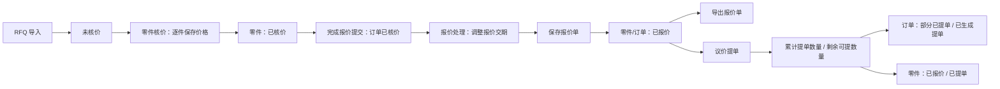

# QPO 报价状态流转优化开发文档

## 1. 背景

当前 QPO 报价主流程中，工程端“零件核价”点击 **完成报价提交** 后，订单会直接从 `待工程部评估` 进入 `已报价`。这导致一个业务边界不够清晰：

- 工程完成的是“核价完成”，不是市场报价单已经确认完成。
- 市场在“报价处理”模块还需要调整零件交期。
- 现在只要进入 `已报价`，系统就已经允许导出报价单，缺少“市场保存报价单”这个确认动作。
- `待工程部评估` 文案偏部门内部，不如 `未核价` 更贴合用户理解。

因此本次优化要把“核价完成”和“报价单确认完成”拆开，新增 `已核价` 状态，让市场在报价处理模块完成交期确认后，再显式点击 **保存报价单**，订单才进入 `已报价`。

## 2. 目标

1. 把现有 `待工程部评估` 统一改名为 `未核价`。
2. 新增订单状态 `已核价`。
3. 零件核价模块点击 **完成报价提交** 后，订单进入 `已核价`，不再直接进入 `已报价`。
4. 报价处理模块可以选择 `已核价` 和 `已报价` 两类订单。
5. `已核价` 订单允许调整报价交期，并显示 **保存报价单** 按钮。
6. 点击 **保存报价单** 后，订单从 `已核价` 进入 `已报价`。
7. 只有 `已报价` 订单允许点击四个报价单导出按钮。
8. `已报价` 订单只能查看和导出，不允许再改日期，也不允许再点击 **保存报价单**。
9. 零件核价模块的单据按钮改为 **生成核价单**，只允许 `已核价` 订单导出核价单；内容沿用原详细报价单结构，但不代表市场报价单已确认。
10. 保持后续议价提单状态 `部分已提单`、`已生成提单` 不变。
11. 同步补齐权限、操作日志、文件日志、数据权限、测试和文档。

## 3. 非目标

- 不重做报价处理页面视觉布局。
- 不改报价计算公式。
- 不改报价单导出模板内容。
- 不把历史 `已报价` 订单迁移成 `已核价`。
- 不把系统内部所有“已生成提单”强行改名成“已提单”。
- 不引入新的前端状态管理或 UI 库。

## 4. 状态定义

### 4.1 订单状态

| 状态 | 含义 | 主要来源 | 允许动作 |
| --- | --- | --- | --- |
| `未核价` | RFQ 已导入，工程尚未完成整单核价 | 新单导入、旧状态迁移、未完整核价 | 进入零件核价 |
| `已核价` | 工程已完成整单核价，等待市场确认报价交期并保存报价单 | 零件核价点击完成报价提交 | 报价处理、调整交期、保存报价单 |
| `已报价` | 市场已确认报价单，可以导出或重新导出报价单 | 报价处理点击保存报价单；历史兼容订单 | 查看报价处理、导出报价单 |
| `部分已提单` | 已报价订单中部分零件已生成提单 | 议价提单生成部分零件 | 继续提单、查看 |
| `已生成提单` | 订单全部可提单零件已生成提单 | 议价提单完成 | 查看历史和提单结果 |

### 4.2 零件状态

零件主表 `item_quote_version.status` 采用更细的四状态口径：

| 状态 | 含义 | 写入时机 |
| --- | --- | --- |
| `未核价` | RFQ 导入后，零件尚未完成核价 | 新单导入、旧状态迁移 |
| `已核价` | 工程已保存该零件核价结果，但市场尚未保存报价单 | 单件核价保存、组合件核价保存 |
| `已报价` | 市场已保存报价单，该零件可进入提单流程 | 报价处理点击“保存报价单” |
| `已提单` | 该零件原始数量已经全部生成提单 | 累计提单数量达到原始数量 |

说明：

- 部分提单时，零件仍显示 `已报价`，页面展示 `已提单数量 / 剩余可提数量`。
- 订单最终状态文案保持 `已生成提单`，不改成 `已提单`。
- 历史零件状态 `待核价`、`已部分提单`、`已生成提单` 继续兼容读取；新写入应收敛到 `未核价 / 已核价 / 已报价 / 已提单`。
- 导出报价单的最终门槛看订单状态 `已报价`，不只看零件状态。

## 5. 目标流程



### 5.1 `已核价` 与 `已报价` 的区别

| 对比项 | `已核价` | `已报价` |
| --- | --- | --- |
| 含义 | 工程价格已完成，市场还未确认报价单 | 市场已经保存确认报价单 |
| 报价处理可选 | 是 | 是 |
| 可修改报价交期 | 是 | 否 |
| 可点击保存报价单 | 是 | 否 |
| 可导出报价单 | 否 | 是 |
| 可生成核价单 | 是 | 否 |
| 可进入议价提单 | 建议否，必须先保存报价单 | 是 |

## 6. 后端设计

### 6.1 状态常量

建议新增或集中一个状态常量类，避免继续在代码中散落硬编码：

```java
public final class QuoteOrderStatus {
    public static final String UNPRICED = "未核价";
    public static final String PRICED = "已核价";
    public static final String QUOTED = "已报价";
    public static final String PARTIALLY_RELEASED = "部分已提单";
    public static final String RELEASED = "已生成提单";
}
```

零件状态应使用独立口径，不复用订单最终状态：

```java
public final class QuoteItemStatus {
    public static final String UNPRICED = "未核价";
    public static final String PRICED = "已核价";
    public static final String QUOTED = "已报价";
    public static final String RELEASED = "已提单";
}
```

如果暂时不新增常量类，也必须至少在 `EngineerService`、`QuoteProcessService`、`DeliveryService`、`OrderManagementService` 内用局部常量替代裸字符串，避免漏改。

### 6.2 数据迁移

新增 Flyway 迁移，建议命名为下一序号，例如：

```text
quote-system/src/main/resources/db/migration/V32__quote_status_workflow.sql
```

迁移内容：

```sql
UPDATE order_rfq
SET status = '未核价'
WHERE status = '待工程部评估';

UPDATE item_quote_version
SET status = '未核价'
WHERE status = '待核价';
```

兼容要求：

- 迁移不修改历史 `已报价` 订单，确保旧订单仍可导出。
- 服务端查询和状态判断短期内可以兼容 `待工程部评估`、`待核价`，但新写入只写 `未核价`。
- 如果存在测试数据库或旧环境未跑迁移，后端仍要能给出清晰错误，而不是空指针或页面白屏。

### 6.3 `EngineerService`

修改目标：

- `completeOrderQuote(Integer rfqId)` 不再把订单设为 `已报价`，改为 `已核价`。
- 完成报价前仍检查所有应核价零件已经有最终价格。
- 如果订单已经是 `已报价`、`部分已提单`、`已生成提单`，不允许重复完成报价。
- 文件日志事件由 `Order quote completed` 保持，但摘要里写清 `toStatus=已核价`。
- 操作日志可以沿用原完成报价动作，但 `after.status` 应显示 `已核价`。

验收点：

- 工程端完成整单报价后，订单状态为 `已核价`。
- 前端提示文案改为“订单核价已完成，已进入报价处理”之类，不再提示“状态已更新为已报价”。

### 6.4 `QuoteProcessService`

报价处理模块需要从“只接受已报价”改为状态分层：

```text
可查看：已核价、已报价
可编辑报价交期：已核价
可保存报价单：已核价
可导出报价单：已报价
```

建议拆出三个 guard：

```java
requireQuoteProcessReadableOrder(rfqId);   // 已核价、已报价
requireQuoteProcessEditableOrder(rfqId);   // 仅已核价
requireQuoteExportableOrder(rfqId);        // 仅已报价
```

需要新增服务方法：

```java
public Map<String, Object> saveQuoteSheet(Integer rfqId)
```

业务规则：

- 仅允许 `已核价` 订单保存报价单。
- 保存前校验订单下可报价零件都已有报价交期。
- 保存成功后订单状态改为 `已报价`。
- 保存后返回最新订单状态和报价处理数据，便于前端刷新按钮状态。
- 如果订单已经 `已报价`，返回明确业务错误：“该订单已保存报价单，不能重复保存”。
- 如果订单仍 `未核价`，返回明确业务错误：“订单尚未完成核价，不能保存报价单”。
- 如果订单已提单，返回明确业务错误：“订单已进入提单流程，不能保存报价单”。

### 6.5 Controller 和接口

新增报价处理保存接口：

```text
POST /api/market/quote-process/{rfqId}/save-quote
```

权限：

```java
@RequirePermission("market:quote-process:save-quote")
```

现有导出接口保持不变，但内部必须增加 `已报价` 状态校验，不能只依赖前端禁用按钮。

涉及文件：

- `quote-system/src/main/java/com/machining/quote/controller/QuoteProcessController.java`
- `quote-system/src/main/java/com/machining/quote/controller/MarketController.java`
- `quote-system/src/main/java/com/machining/quote/controller/SystemTaskController.java`
- `quote-system/src/main/java/com/machining/quote/service/QuoteProcessService.java`
- `quote-system/src/main/java/com/machining/quote/service/ExcelExportService.java`
- `quote-system/src/main/java/com/machining/quote/service/SystemTaskService.java`

### 6.6 导出任务边界

四个报价单导出按钮和异步导出任务必须只接受 `已报价`：

- 报价单导出。
- CRM 报价导出。
- 报价模板导出。

如果 `已核价` 订单调用导出接口，后端返回 400 或业务异常：

```text
请先在报价处理模块保存报价单后再导出
```

工程侧核价单属于独立单据边界：零件核价模块的 **生成核价单** 只允许 `已核价` 订单，用于输出工程核价结果，权限为 `engineer:pricing:export-sheet`，操作日志动作为 `PRICING_SHEET_EXPORT`。订单进入 `已报价` 后，不再从工程侧生成核价单，只能在报价处理模块导出正式报价单。

### 6.7 提单边界

议价提单应继续只面向 `已报价`、`部分已提单` 等已进入市场确认后的订单。

要求：

- `已核价` 不应进入提单生成候选范围。
- 如果用户绕过前端直接调用提单接口，后端仍要拒绝。
- 分批提单通过累计提单数量和剩余可提数量控制：
  - 原始数量 = `item_quote_version.qty`。
  - 已提单数量 = `SUM(order_delivery_ticket.qty)`。
  - 剩余可提数量 = 原始数量 - 已提单数量。
- `order_delivery_ticket` 是不可逆发布记录，也是 APS 同步工艺快照的单一来源。
- `order_process_sheet` 已通过 `V36__decommission_order_process_sheet.sql` 在回填快照后删除；QPO 内部工艺表展示和导出结果从 `order_delivery_ticket` 动态生成，不作为 APS 同步来源。
- 提单/工艺回退能力已在分批提单不可逆优化中废弃；`market:release:reset` 不再作为可分配权限出现。
- 如需状态回算，只能基于现有提单明细汇总：
  - 有最终价格但未保存报价单：`已核价`。
  - 已保存报价单且未提单：`已报价`。
  - 已保存报价单且部分数量已提单：零件仍为 `已报价`，并显示已提单数量和剩余可提数量。
  - 累计提单数量达到原始数量：零件为 `已提单`。
  - 没有完整价格：`未核价`。

如果当前表结构无法判断“曾经保存过报价单”，推荐第一版用订单状态作为事实来源，不对历史 `已报价` 做降级。

## 7. 前端设计

### 7.1 `QuoteProcess.vue`

订单选择：

- 弹窗标题从“选择已报价 RFQ 订单”改为“选择已核价 / 已报价 RFQ 订单”。
- `allowed-statuses` 改为 `['已核价', '已报价']`。
- 空状态文案改为“请选择已核价或已报价订单”。

按钮状态：

| 按钮 | `已核价` | `已报价` | 无订单 |
| --- | --- | --- | --- |
| 批量平移交期 | 可用 | 禁用 | 禁用 |
| 批量指定交期 | 可用 | 禁用 | 禁用 |
| 单行保存交期 | 可用 | 禁用 | 禁用 |
| 保存报价单 | 可用 | 禁用/隐藏 | 禁用 |
| 四个导出按钮 | 禁用 | 可用 | 禁用 |

建议页面顶部显示一条轻提示：

- `已核价`：`请确认报价交期，保存报价单后即可导出。`
- `已报价`：`报价单已保存，交期已锁定，可重新导出。`

### 7.2 `marketApi.js`

新增接口：

```js
export const saveQuoteSheet = (rfqId) => postJson(`/api/market/quote-process/${rfqId}/save-quote`)
```

调用成功后：

- 刷新 `getQuoteProcess(rfqId)`。
- 更新当前订单状态为 `已报价`。
- 禁用交期编辑按钮。
- 启用四个导出按钮。

### 7.3 `OrderPickerDialog.vue`

默认状态选项改为：

```js
['未核价', '已核价', '已报价', '部分已提单', '已生成提单']
```

状态标签建议：

| 状态 | 标签类型 |
| --- | --- |
| `未核价` | `info` |
| `已核价` | `warning` |
| `已报价` | `primary` |
| `部分已提单` | `warning` |
| `已生成提单` | `success` |

### 7.4 `ItemPricing.vue`

完成报价按钮逻辑调整：

- 当订单为 `未核价` 时，允许点击完成报价。
- 当订单为 `已核价`、`已报价`、`部分已提单`、`已生成提单` 时，不允许重复完成报价。
- 页面内“已核价”统计仍表示已保存核价的零件数量，不等同于订单状态。

### 7.5 订单管理和历史订单

所有订单状态展示位置要统一显示新状态：

- 新单导入后是 `未核价`。
- 工程完成后是 `已核价`。
- 市场保存报价单后是 `已报价`。
- 历史订单仍显示真实历史状态。

## 8. 权限设计

新增权限点：

```text
market:quote-process:save-quote
```

权限类型：

```text
BUTTON
```

父级：

```text
market:quote-process:view
```

权限名称：

```text
保存报价单
```

默认角色：

| 角色 | 是否默认拥有 |
| --- | --- |
| `SUPER_ADMIN` | 是 |
| `MARKET_USER` | 是 |
| `MARKET_MANAGER` | 是 |
| `READONLY` | 否 |
| `AUDITOR` | 否 |

需要同步：

- Flyway 权限迁移。
- `PermissionService` fallback catalog。
- `docs/QPO权限用户体系/02-权限点清单与现有角色映射.md`。
- `docs/QPO权限用户体系/03-权限体系部署与管理员使用说明.md`。
- `docs/QPO权限用户体系/04-角色授权模块树企业级开发文档.md` 如涉及授权树示例。
- 后端权限唯一性测试。
- 前端权限扫描测试。

## 9. 数据权限

该改动不新增数据归属模型，但必须沿用现有订单数据权限：

- 报价处理订单选择仍按当前用户数据范围过滤。
- `getQuoteProcess(rfqId)` 必须校验用户能访问该订单。
- `saveQuoteSheet(rfqId)` 必须校验用户能访问该订单。
- 报价交期修改和导出接口继续校验用户能访问该订单。
- 无数据权限时列表为空；直接访问无权限订单时后端拒绝。

## 10. 操作日志与文件日志

### 10.1 操作日志

新增或复用动作：

```text
QUOTE_PROCESS_SAVE_QUOTE
```

建议字段：

| 字段 | 内容 |
| --- | --- |
| module | `MARKET` 或 `QUOTE_PROCESS` |
| action | `QUOTE_PROCESS_SAVE_QUOTE` |
| objectType | `order_rfq` |
| objectId | `rfqId` |
| before | `{ status: "已核价", itemCount: 12, missingLeadTimeCount: 0 }` |
| after | `{ status: "已报价", itemCount: 12, savedBy: "当前用户ID" }` |
| message | `保存报价单：RFQ xxx，零件 n 个` |
| result | `SUCCESS` / `FAILED` |

用户输入导致的业务失败可以记录失败摘要，但不要写入大量报价明细。

### 10.2 后端文件日志

新增主流程事件：

```text
Quote sheet save started
Quote sheet save completed
Quote sheet save rejected
Quote sheet save failed
```

日志级别：

| 场景 | 级别 |
| --- | --- |
| 保存开始、完成 | INFO |
| 状态不允许、缺少交期等用户可修正问题 | WARN |
| 未预期异常、数据库异常 | ERROR |

示例：

```java
log.info("Quote sheet save completed rfqId={} fromStatus={} toStatus={} itemCount={} durationMs={}",
        rfqId, "已核价", "已报价", itemCount, durationMs);
```

注意：

- 不记录完整报价单 JSON。
- 不在每个零件循环里打 INFO。
- ERROR 必须带异常对象，进入 `qpo-error.log`。
- 操作日志和文件日志通过 `requestId` 关联。

## 11. 测试计划

### 11.1 后端测试

建议新增或扩展：

- `QuoteStatusWorkflowTest`
- `QuoteProcessServiceTest`
- `PermissionModuleTreeTest`
- `PermissionSystemStage4Test`
- `PermissionSystemStage5Test`
- 相关集成测试中的旧状态断言。

重点用例：

1. RFQ 导入后订单状态是 `未核价`。
2. 工程完成报价后订单状态是 `已核价`。
3. 报价处理读取允许 `已核价` 和 `已报价`。
4. 报价交期修改只允许 `已核价`。
5. `已报价` 修改报价交期返回业务错误。
6. 保存报价单只允许 `已核价`。
7. 保存报价单成功后状态变为 `已报价`。
8. `已核价` 订单不能导出报价单。
9. `已报价` 订单可以导出报价单。
10. `market:quote-process:save-quote` 权限存在、唯一、挂在报价处理模块下。
11. 无该权限调用保存接口返回 403。
12. 无订单数据权限调用保存接口被拒绝。

### 11.2 前端测试

建议新增或扩展：

- `quote-frontend/src/services/marketApi.test.js`
- `quote-frontend/src/permissionStage4.test.js`
- `quote-frontend/src/permissionStage0.test.js`
- `quote-frontend/src/components/QuoteProcess` 相关轻量源码测试。

重点用例：

1. `marketApi.saveQuoteSheet(rfqId)` 调用正确接口。
2. `QuoteProcess.vue` 订单选择允许 `已核价`、`已报价`。
3. `QuoteProcess.vue` 使用 `market:quote-process:save-quote` 权限控制保存按钮。
4. `已核价` 时导出按钮禁用、交期按钮可用。
5. `已报价` 时导出按钮可用、交期按钮禁用、保存报价单不可用。
6. 权限清单包含 `market:quote-process:save-quote`。

## 12. 分阶段实施计划

### 阶段 0：测试护栏与状态口径冻结

目标：先把目标状态流和权限点冻结，防止实现时漏改。

后端：

- 新增状态流测试，先覆盖 `未核价 -> 已核价 -> 已报价`。
- 新增导出门槛测试，要求 `已核价` 不能导出。
- 新增权限测试，要求 `market:quote-process:save-quote` 唯一并挂在 `market:quote-process:view` 下。

前端：

- 新增或扩展源码扫描测试，要求报价处理页面出现 `save-quote` API 和保存报价单权限。
- 冻结订单选择允许状态。

验收：

```powershell
cd quote-system
mvn test -Dtest=QuoteStatusWorkflowTest,PermissionModuleTreeTest

cd quote-frontend
npm test -- marketApi.test.js permissionStage4.test.js
```

### 阶段 1：数据库迁移与状态文案统一

目标：把旧状态迁移成新状态，并保证新写入不再产生 `待工程部评估`。

后端：

- 新增 Flyway 迁移 `V32__quote_status_workflow.sql`。
- 新单导入默认状态改为 `未核价`。
- 订单重置、提单回退、状态回算中的 `待工程部评估` 改为 `未核价`。
- 保留旧状态兼容判断。

前端：

- `OrderPickerDialog.vue` 状态选项和标签更新。
- 订单管理、历史订单、工程设置等展示文案同步。

验收：

- 新导入 RFQ 显示 `未核价`。
- 旧 `待工程部评估` 数据迁移后显示 `未核价`。
- 旧 `已报价` 订单仍然是 `已报价`。

### 阶段 2：后端状态机与保存报价单接口

目标：落地真正业务流转。

后端：

- `EngineerService.completeOrderQuote()` 改为写 `已核价`。
- `QuoteProcessService` 拆分可查看、可编辑、可导出的状态 guard。
- 新增 `saveQuoteSheet(rfqId)`。
- 新增 `POST /api/market/quote-process/{rfqId}/save-quote`。
- 导出接口统一校验 `已报价`。
- 提单候选和提单接口拒绝 `已核价`。

验收：

- 工程完成报价后不能直接导出。
- 报价处理保存报价单后才能导出。
- `已报价` 无法再修改报价交期。

### 阶段 3：权限、日志和审计补齐

目标：新动作符合企业级权限和审计口径。

后端：

- Flyway 新增 `market:quote-process:save-quote`。
- 更新 `PermissionService` fallback catalog。
- 保存报价单接口加 `@RequirePermission("market:quote-process:save-quote")`。
- 新增 `QUOTE_PROCESS_SAVE_QUOTE` 操作日志。
- 新增 `Quote sheet save started/completed/rejected/failed` 文件日志。

文档：

- 更新权限点清单。
- 更新权限管理员说明。
- 更新日志运维说明中的事件命名表。

验收：

- 角色未授权保存报价单时，按钮不可见或不可用，后端返回 403。
- 操作日志可查到保存报价单动作。
- 后端文件日志可通过 requestId 查到保存报价单主流程。

### 阶段 4：前端报价处理页面改造

目标：让市场按新流程工作。

前端：

- `marketApi.js` 新增 `saveQuoteSheet`。
- `QuoteProcess.vue` 订单选择允许 `已核价`、`已报价`。
- 新增 **保存报价单** 按钮。
- `已核价`：允许编辑交期，不允许导出。
- `已报价`：禁止编辑交期，允许导出，禁止保存报价单。
- 错误提示统一使用 Element Plus 消息。

验收：

- 从零件核价进入报价处理后，能看到 `已核价` 订单。
- 调整交期后点击保存报价单，状态切换为 `已报价`。
- 状态切换后导出按钮可用，交期编辑按钮禁用。

### 阶段 5：回归测试与收尾

目标：确认状态流不会破坏现有主流程。

回归范围：

- 新单导入。
- 零件核价。
- 报价处理交期调整。
- 保存报价单。
- 四个报价单导出。
- 议价提单。
- 订单管理和历史订单。
- 权限树授权。
- 操作日志查询。

验收命令：

```powershell
cd quote-system
mvn test

cd quote-frontend
npm test
npm run build
```

如需要容器验证：

```powershell
cd D:\Code
docker compose --env-file erp.env up -d --build backend frontend
```

## 13. 实施注意事项

- 新增状态流是业务行为变化，必须先跑测试，再改实现。
- 不要只在前端禁用按钮，后端接口必须做状态和权限兜底。
- 不要把旧 `已报价` 历史订单降级，否则会影响历史报价单导出。
- 不要把 `已核价` 订单放进议价提单候选，否则会绕过市场确认报价单。
- 不要新增 `common:*` 权限；保存报价单属于报价处理模块。
- 操作日志记录业务动作，文件日志记录技术排查摘要，二者不要混在一起。
- 数据权限始终跟订单走，不能因为新增状态绕过订单可见范围。

## 14. 最终验收清单

- [ ] 新单导入后订单显示 `未核价`。
- [ ] 零件核价完成整单后订单显示 `已核价`。
- [ ] 报价处理可以选择 `已核价` 和 `已报价`。
- [ ] `已核价` 订单可以修改报价交期。
- [ ] `已核价` 订单不能导出报价单。
- [ ] `已核价` 订单点击保存报价单后变为 `已报价`。
- [ ] `已报价` 订单不能修改报价交期。
- [ ] `已报价` 订单不能重复点击保存报价单。
- [ ] `已报价` 订单可以点击四个报价单导出按钮。
- [ ] `已核价` 订单不能进入议价提单生成流程。
- [ ] `market:quote-process:save-quote` 出现在权限树报价处理模块下。
- [ ] 保存报价单动作进入操作日志。
- [ ] 保存报价单主流程进入后端文件日志。
- [ ] 无数据权限时不能读取或保存对应订单。
- [ ] `mvn test`、`npm test`、`npm run build` 全部通过。
