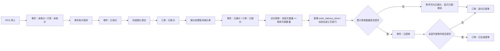

# 零件状态与分批提单不可逆优化开发文档

> 2026-08-07 价格字段收口：本文中的核价单价和金额均以 `tax_included_unit_price`、`tax_included_total_price`、`untaxed_unit_price`、`untaxed_total_price` 为正式字段。`final_*` 不属于现行数据库、实体或业务口径。

> 2026-08-08 两级工艺主数据阶段 15 收口：提单不可逆边界中的工艺事实统一为标准工艺快照，包含 `processDetailId / processCode / categoryName / detailName / hourlyRate / unitWorkHours / lineCost / sortNo`。提单生成后，后续工艺字典价格或名称调整不改写历史提单、已提零件、WMS allocation、待产和锁库快照。

## 1. 背景

当前 QPO 已经完成订单级状态流转拆分：

```text
未核价 -> 已核价 -> 已报价 -> 部分已提单 -> 已生成提单
```

但零件级状态仍然存在两个问题：

1. 零件在单件核价保存后直接写入 `已报价`，和订单级“市场保存报价单后才是已报价”的口径不完全一致。
2. 议价提单生成后，提单行和工艺表行仍允许删除，订单管理页也允许“重置提单/工艺”，这与“提单后进入外部系统需求池、不可随意回退”的企业级要求不一致。

本次优化目标是把零件状态、分批提单、MES/WMS 需求池来源和不可逆发布边界统一起来。

## 2. 当前系统事实

### 2.1 现有表职责

| 表 | 当前职责 | 本次目标职责 |
| --- | --- | --- |
| `item_quote_version` | 订单零件主表，保存原始数量、核价结果、报价交期、状态 | 保持为订单零件主表，不复制、不拆行，数量代表原始询价数量 |
| `order_delivery_ticket` | 已生成提单行，当前允许删除 | 升级为已提单零件明细表 / 发布记录表，一旦生成不可删除，并保存本批次外部系统所需工艺快照 |
| `order_delivery_ticket_allocation` | 本阶段之前不存在 | WMS 锁库拆分结果表，保存库存锁定、在产锁定和待生产明细，不改写原始提单需求行 |
| `order_process_sheet` | 已生成工艺表行，当前允许删除且按 `item_id` 找快照 | 通过 `V36__decommission_order_process_sheet.sql` 回填并删除；新提单不再写入，QPO 工艺表展示/导出从 `order_delivery_ticket` 动态生成 |

### 2.2 现有状态问题

- 单件核价保存时，`item_quote_version.status` 当前写 `已报价`。
- 订单完成核价提交时，`order_rfq.status` 当前写 `已核价`。
- 市场保存报价单时，`order_rfq.status` 当前写 `已报价`。
- 提单生成后，零件当前可能写 `已部分提单` 或 `已生成提单`。
- 删除提单行后，当前会把零件状态回算到 `已报价`。

这些行为需要统一成更清晰的零件级状态机。

## 3. 目标

### 3.1 零件状态口径

零件主表 `item_quote_version.status` 新口径：

| 状态 | 含义 | 写入时机 |
| --- | --- | --- |
| `未核价` | RFQ 导入后，零件尚未完成核价 | 新单导入、旧状态迁移 |
| `已核价` | 工程已保存该零件核价结果，但市场尚未保存报价单 | 单件核价保存、组合件核价保存 |
| `已报价` | 市场已保存报价单，该零件可进入提单流程 | 报价处理点击“保存报价单” |
| `已提单` | 该零件原始数量已经全部生成提单 | 议价提单生成后累计提单数量达到原始数量 |

说明：

- 部分提单时，零件仍显示 `已报价`，但页面展示 `已提单数量 / 剩余可提数量`。
- 订单最终状态文案保持现有 `已生成提单`，不改名。
- 历史数据里的 `已部分提单`、`已生成提单` 等零件状态需要兼容读取，但新写入应逐步收敛到上述 4 个状态。
- `无图` 作为特殊展示状态可以继续兼容，不进入可提单范围。

### 3.2 分批提单口径

允许同一个 `item_id` 多次生成提单，直到剩余可提数量为 0。

计算规则：

```text
原始数量 = item_quote_version.qty
已提单数量 = SUM(order_delivery_ticket.qty WHERE item_id = 当前零件ID)
剩余可提数量 = 原始数量 - 已提单数量
```

兼容规则：

- 优先按 `item_id` 汇总提单数量。
- 对历史缺失 `item_id` 的提单行，可按 `rfq_id + part_no + version` 兜底汇总。
- 剩余可提数量小于 0 时，页面显示为 0，后端应记录 WARN 并阻止继续提单。

## 4. 非目标

- 不修改订单最终状态文案，仍保留 `部分已提单`、`已生成提单`。
- 不复制 `item_quote_version` 零件主记录。
- 不让 QPO 直接管理外部系统是否已同步、是否已排产。
- 不重做议价提单页面视觉设计，只做与分批提单、只读结果相关的必要交互调整。
- 不引入新 UI 库。

## 5. 目标数据模型

### 5.1 `item_quote_version`

继续作为订单零件主表：

- `qty` 永远表示原始询价数量，不因提单减少。
- `tax_included_unit_price`、`tax_included_total_price` 保存核价结果。
- `quote_lead_time` 保存报价处理交期。
- `internal_target_lead_time` 保存提单使用的内部目标交期。
- `status` 保存当前零件业务状态。

不新增“剩余数量”字段。剩余数量由提单明细实时汇总计算，避免主表和明细表不一致。

### 5.2 `order_delivery_ticket`

正式作为不可逆发布记录：

- 每次提单生成一行。
- 同一个 `item_id` 可以有多行。
- `qty` 表示本批次提单数量。
- `process_route` 保存本批次提单时从零件主表继承的工艺路线快照。
- `material_data`、`material_gross_weight`、`part_net_weight` 等外部系统需要的核价快照字段建议一并保存。
- `id` 继续作为提单记录的稳定递增标识。
- 后端不再提供删除接口。
- 前端只读展示已生成提单行。

建议新增迁移：

```text
quote-backend/src/main/resources/db/migration/V34__delivery_batch_immutability.sql
```

迁移内容建议：

```sql
ALTER TABLE order_delivery_ticket
    ADD COLUMN IF NOT EXISTS process_route JSONB,
    ADD COLUMN IF NOT EXISTS material_data JSONB,
    ADD COLUMN IF NOT EXISTS material_gross_weight NUMERIC(14, 4),
    ADD COLUMN IF NOT EXISTS part_net_weight NUMERIC(14, 4);
```

建议新增或确认索引：

```sql
CREATE INDEX IF NOT EXISTS idx_order_delivery_ticket_rfq_item_id
    ON order_delivery_ticket(rfq_id, item_id, id);
```

### 5.3 `order_process_sheet`

`order_process_sheet` 不再承担保存职责，已通过 `V36__decommission_order_process_sheet.sql` 在回填提单快照后删除。新提单生成后，QPO 页面展示和工艺表导出都从 `order_delivery_ticket` 的提单快照动态生成工艺表行。

生成新工艺表行视图时：

- 先插入带完整工艺快照的 `order_delivery_ticket`。
- 不再插入 `order_process_sheet`。
- `qty`、`delivery_date`、`internal_project_no`、`process_route` 等字段由 `order_delivery_ticket` 动态映射成工艺表行。
- 动态工艺表行 ID 可使用 `order_delivery_ticket.id`，方便和提单批次及外部系统任务记录关联。

历史数据处理：

- 旧提单行可能没有 `process_route`，由 `V36__decommission_order_process_sheet.sql` 在删除旧表前回填到 `order_delivery_ticket`。
- 历史兼容数据源不再 fallback 到 `item_quote_version.process_route`。
- 旧 `order_process_sheet` 数据在 V36 回填完成后删除；所有提单行必须从 `order_delivery_ticket.process_route` 取工艺，避免分批后从两个来源拼装。

### 5.4 `order_delivery_ticket_allocation`

`order_delivery_ticket_allocation` 是 WMS 锁库拆分结果表，不是新的提单需求源。

- 每一行必须关联一个 `order_delivery_ticket.id`。
- 分配类型至少覆盖：已入库库存锁定、在产库存锁定、待生产数量。
- 在产库存锁定行需要保存 WMS 返回的在产订单号和本次锁定数量。
- 同一个 `ticket_id` 可以有多条 allocation 行，适配 WMS 返回动态长度在产订单数组。
- allocation 数量合计必须等于原始提单需求行 `order_delivery_ticket.qty`。
- allocation 生成不修改 `order_delivery_ticket.qty`，不改变零件提单状态回算，只作为 WMS 拆分结果展示和追溯。

## 6. 目标流程



## 7. 后端设计

### 7.1 状态常量

建议扩展或新增零件状态常量，避免硬编码散落：

```java
public final class QuoteItemStatus {
    public static final String UNPRICED = "未核价";
    public static final String PRICED = "已核价";
    public static final String QUOTED = "已报价";
    public static final String RELEASED = "已提单";
    public static final String NO_DRAWING = "无图";
}
```

订单状态继续使用 `QuoteStatusWorkflow`：

```text
未核价 / 已核价 / 已报价 / 部分已提单 / 已生成提单 / 废弃
```

订单状态管理补充口径：

- `废弃` 是订单管理里的人工治理状态，用于停止订单继续流转但保留全部业务内容。
- 状态管理只调整订单和非提单零件状态，不清空核价结果、报价交期、图纸、材料、工艺或提单快照。
- `部分已提单` / `已生成提单` 不允许废弃或回退；只要订单存在 `order_delivery_ticket` 提单行，即使订单状态异常，也不得执行废弃或状态回退。
- `废弃` 订单恢复时统一恢复为 `已核价`，后续保存报价单、导出、提单仍由原业务校验决定是否可继续流转。

### 7.2 工程核价

修改 `EngineerService`：

- 单件核价保存成功：`item.status = 已核价`。
- 组合件核价保存成功：父件 `status = 已核价`。
- 完成报价提交：继续只修改订单状态为 `已核价`。
- 完成报价提交前检查所有有图零件都已有最终价格。
- 旧数据中已经是 `已报价` 的零件，在工程页面不应被误降级，除非用户重新保存核价。
- 全局设定页只做前 10 个零件预览和全局默认配置，不执行全量核价、不调用重复件复用。
- 逐件核价页负责加载全部零件，并在首次完整加载后执行重复件复用；普通重复件自动带入历史核价结果。
- 重复件复用候选只来自 `item_quote_version.status = 已提单` 的历史零件，按 `part_no + version` 匹配；`order_delivery_ticket` 仅作为提单发布 / MES-WMS 需求池，不再作为重复件候选入口。
- 组合件重复件按当前订单 `part_no + version` 重建子件关系；如果当前订单缺少历史子件，跳过父件，不写 `quote_mode`、`assembly_fee`、`tax_included_unit_price` 或 `item_assembly_relation`。
- 组合件缺子件不在前端额外弹窗、toast 或行内提示，父件保持 `未核价`，由工程师进入正常组合件核价弹窗手动补齐。

日志要求：

- 单件核价成功日志继续保留 `Item quote saved`，摘要里增加 `toStatus=已核价`。
- 不在工序循环里打 INFO。

### 7.3 报价处理保存报价单

修改 `QuoteProcessService.saveQuoteSheet(rfqId)`：

- 仅允许订单状态 `已核价`。
- 校验所有有图零件均已核价。
- 校验报价交期完整。
- 保存成功后：
  - 订单状态改为 `已报价`。
  - 该订单下状态为 `已核价` 的可报价零件批量改为 `已报价`。
  - 已经是 `已报价` 的历史兼容零件保持不变。
  - `无图` 零件保持 `无图`。

操作日志：

- 继续使用 `QUOTE_PROCESS_SAVE_QUOTE`。
- `before/after` 增加 `itemStatusUpdatedCount`。

文件日志：

- `Quote sheet save started`
- `Quote sheet save completed`
- `Quote sheet save rejected`
- `Quote sheet save failed`

### 7.4 分批提单生成

修改 `DeliveryService.generateTickets(req)`：

生成前：

1. 锁订单。
2. 锁请求中的零件。
3. 校验订单状态允许提单：`已报价`、`部分已提单`。
4. 计算每个零件：

```text
ticketedQty = 已提单数量
remainingQty = item.qty - ticketedQty
```

5. 校验本次 `acceptedQty > 0`。
6. 校验本次 `acceptedQty <= remainingQty`。
7. 删除当前 `assertNoDuplicateTicket(item)` 的“禁止重复提单”逻辑。

生成时：

1. 从 `item_quote_version` 读取当前零件核价快照。
2. 插入带完整快照的 `order_delivery_ticket`，包括本批次数量、材料、重量、交期、工艺路线。
3. 基于 `order_delivery_ticket` 的快照动态生成工艺表行，用于 QPO 页面展示和工艺表导出。
4. 本批次工艺表行数量等于本批次提单数量。
5. 本批次工艺表行交期、内部项目号、工艺路线都来自提单行快照。

生成后：

1. 对本次涉及零件执行状态回算：

```text
累计提单数量 >= 原始数量 -> 零件状态 = 已提单
累计提单数量 < 原始数量 -> 零件状态 = 已报价
```

2. 对订单执行状态回算：

```text
没有任何提单 -> 已报价
存在提单但未全部提完 -> 部分已提单
全部可提零件提完 -> 已生成提单
```

注意：

- 订单最终状态文案保持 `已生成提单`。
- 零件最终状态使用 `已提单`。
- 新代码不再写 `已部分提单` 作为零件状态。

### 7.5 删除和重置能力清理

彻底删除回退能力：

后端删除：

- `MarketController.DELETE /api/market/tickets/{ticketId}`
- `MarketController.DELETE /api/market/process-sheets/{sheetId}`
- `DeliveryService.deleteTicket(...)`
- `DeliveryService.deleteProcessSheet(...)`
- `OrderManagementController.POST /api/order-management/orders/{rfqId}/reset-production`
- `OrderManagementService.resetProductionData(...)`

前端删除：

- `marketApi.deleteTicket`
- `marketApi.deleteProcessSheet`
- `orderApi.resetProduction`
- `MarketRelease.vue` 已生成提单行删除按钮和方法。
- `MarketRelease.vue` 已生成工艺表行删除按钮和方法。
- `OrderManage.vue` 重置提单/工艺按钮和方法。

权限删除：

- 删除或废弃 `market:release:reset`。
- 从 `PermissionService` fallback catalog 删除。
- 从默认角色映射中删除。
- 从权限树文档和测试中删除。

审计动作删除或废弃：

- `DELIVERY_TICKET_DELETE`
- `PROCESS_SHEET_DELETE`
- 订单提单/工艺重置相关动作。

## 8. 前端设计

### 8.1 议价提单零件选择表

新增展示列：

| 列 | 来源 |
| --- | --- |
| 询价数量 | `item_quote_version.qty` |
| 已提单数量 | 后端汇总 `order_delivery_ticket.qty` |
| 剩余可提数量 | `询价数量 - 已提单数量` |

交互规则：

- 只展示或默认筛选 `剩余可提数量 > 0` 的零件。
- 本次通过数量输入框最大值为 `剩余可提数量`。
- 剩余为 0 的零件不可选，或不进入候选列表。
- 长文本列继续保持 `show-overflow-tooltip`。

### 8.2 已生成提单行

- 保留表格展示。
- 删除“删除”按钮。
- 操作列如无其他动作可删除。
- 可以增加“批次/提单行 ID”展示，帮助和 MES/WMS 任务记录关联。

### 8.3 已生成工艺表行

- 保留表格展示。
- 删除“删除”按钮。
- 工艺表行可以展示提单行 ID 或批次信息，方便排查同一零件多批次，但 MES/WMS 对接不依赖工艺表行。

### 8.4 订单管理

- 删除“重置提单/工艺”按钮。
- 订单详情中仍可查看提单行和工艺表行。
- 已提单记录只读。

## 9. 外部系统需求池安全性

当前新目标系统不再是 APS，`order_delivery_ticket` 作为 MES/WMS 需求池：

```text
MES：读取图号、版本、图纸、内部项目号并回写物料号。
WMS：基于物料号、图号、版本、客户、内部项目号返回库存分配结果。
```

QPO 继续以 `order_delivery_ticket.id` 作为提单发布记录的稳定标识。

本次优化后：

- 提单行不可删除，MES/WMS 任务和历史兼容接口都能稳定追溯。
- 同一个零件多批次提单会生成多条 `order_delivery_ticket`。
- 每条提单行都保存本批次 `process_route` 等工艺快照。
- `order_delivery_ticket` 是 MES/WMS 原始需求池，不因 WMS 拆分而拆成多条需求行。
- `order_delivery_ticket_allocation` 是 WMS 拆分结果，保存库存锁定、在产锁定和待生产明细。
- MES/WMS 只从 `order_delivery_ticket` 和必要的订单基础信息组装需求池数据；新数据不再从 `order_process_sheet` 或 `item_quote_version.process_route` 拼接工艺。
- 旧提单行如果没有 `process_route`，由 `V36__decommission_order_process_sheet.sql` 在删除旧表前回填到 `order_delivery_ticket`；历史兼容接口也不再回退读取 `item_quote_version.process_route`。
- 旧 APS 出口仅作为历史兼容接口保留，不是新目标系统；新增 MES/WMS 能力不得复用 APS 数据源口径。
- 外部系统可继续按 `ticketId` 去重导入或关联任务。
- QPO 不直接管理外部系统是否已同步；QPO 只保证提单记录不可逆、可追溯。

## 10. 权限、日志、审计同步

### 10.1 权限

需要同步更新：

- `docs/QPO权限用户体系/02-权限点清单与现有角色映射.md`
- `docs/QPO权限用户体系/03-权限体系部署与管理员使用说明.md`
- `docs/QPO权限用户体系/04-角色授权模块树企业级开发文档.md`
- 后端权限唯一性和模块树测试。
- 前端权限扫描测试。

目标：

- 保留 `market:release:view`。
- 保留 `market:release:create`。
- 删除或废弃 `market:release:reset`。
- 不新增 `common:*` 权限。

### 10.2 操作日志

保留并增强：

- `DELIVERY_TICKET_GENERATE`

建议增强记录内容：

```json
{
  "rfqId": 1,
  "selectedItemCount": 2,
  "createdTicketCount": 2,
  "createdProcessSheetCount": 2,
  "items": [
    {
      "itemId": 10,
      "partNo": "P-001",
      "requestedQty": 10,
      "previousTicketedQty": 4,
      "generatedQty": 3,
      "remainingQty": 3
    }
  ]
}
```

删除或废弃：

- `DELIVERY_TICKET_DELETE`
- `PROCESS_SHEET_DELETE`
- 重置提单/工艺相关操作日志。

### 10.3 文件日志

保留主流程事件：

- `Delivery ticket generation started`
- `Delivery ticket generation completed`
- `Delivery ticket generation failed`

增强摘要字段：

- `rfqId`
- `selectedItemCount`
- `ticketCount`
- `processSheetCount`
- `remainingItemCount`
- `toOrderStatus`
- `durationMs`

用户可修正问题使用 WARN：

- 提单数量超过剩余可提数量。
- 订单状态不允许提单。
- 零件未报价或无剩余数量。

未预期异常使用 ERROR，并带异常对象进入 `qpo-error.log`。

## 11. 测试计划

### 11.1 后端测试

建议新增或扩展：

- `QuoteStatusWorkflowTest`
- `QuoteStatusWorkflowStage2Test`
- `CoreWorkflowIntegrationTests`
- `PermissionModuleTreeTest`
- `LoggingConventionTest`

重点用例：

1. RFQ 导入后零件状态为 `未核价`。
2. 单件核价保存后零件状态为 `已核价`。
3. 完成报价提交后订单状态为 `已核价`。
4. 保存报价单后订单状态为 `已报价`，零件状态由 `已核价` 变为 `已报价`。
5. 第一次提单数量小于原始数量时，零件仍为 `已报价`。
6. 第二次/多次提单累计达到原始数量时，零件变为 `已提单`。
7. 本次提单数量超过剩余可提数量时后端拒绝。
8. 同一个 `item_id` 允许多次提单，只要不超过剩余数量。
9. `order_delivery_ticket.process_route` 正确保存本批次工艺快照。
10. 订单部分提单后状态为 `部分已提单`。
11. 订单全部提单后状态为 `已生成提单`。
12. 删除提单接口不存在或不再暴露。
13. 删除工艺表接口不存在或不再暴露。
14. 订单重置提单/工艺接口不存在或不再暴露。
15. `market:release:reset` 不再出现在权限 fallback catalog 和权限树。
16. 历史兼容数据源对新提单只从 `order_delivery_ticket.process_route` 读取工艺快照，旧提单快照由迁移回填。

### 11.2 前端测试

建议新增或扩展：

- `marketApi.test.js`
- `orderApi.test.js`
- `permissionStage4.test.js`
- `workflowPolish.test.js`
- 议价提单页面源码扫描测试。

重点用例：

1. `marketApi` 不再导出 `deleteTicket`、`deleteProcessSheet`。
2. `orderApi` 不再导出 `resetProduction`。
3. `MarketRelease.vue` 不再出现删除提单行按钮。
4. `MarketRelease.vue` 不再出现删除工艺表行按钮。
5. `OrderManage.vue` 不再出现“重置提单/工艺”。
6. 议价提单候选表展示 `已提单数量` 和 `剩余可提数量`。
7. 本次通过数量不能超过剩余可提数量。
8. 已生成提单行和已生成工艺表行为只读展示。
9. 权限扫描不再要求 `market:release:reset`。

## 12. 分阶段实施计划

### 阶段 0：测试护栏与口径冻结

目标：先锁定目标行为，防止实现时回到旧逻辑。

后端：

- 新增零件状态流测试：`未核价 -> 已核价 -> 已报价 -> 已提单`。
- 新增分批提单测试。
- 新增提单不可删除测试。
- 新增权限测试，要求 `market:release:reset` 不再作为可分配权限出现。

前端：

- 新增源码扫描测试，要求删除按钮和重置按钮不存在。
- 冻结议价提单候选表必须出现 `已提单数量`、`剩余可提数量`。

验收：

```powershell
cd quote-backend
mvn test -Dtest=QuoteStatusWorkflowTest,CoreWorkflowIntegrationTests,PermissionModuleTreeTest

cd quote-frontend
npm test -- marketApi.test.js orderApi.test.js permissionStage4.test.js workflowPolish.test.js
```

### 阶段 1：数据库迁移与状态常量

目标：补齐分批提单所需的数据结构和状态常量。

后端：

- 新增 `V34__delivery_batch_immutability.sql`。
- `order_delivery_ticket` 新增 `process_route`、`material_data`、`material_gross_weight`、`part_net_weight` 等快照字段。
- 新增或扩展零件状态常量。
- 兼容历史零件状态。

验收：

- Flyway 迁移通过。
- 历史提单行快照字段可为空。
- 新提单行必须写入工艺快照。
- 历史兼容数据源只读取 `order_delivery_ticket.process_route`；历史缺失快照由 `V36__decommission_order_process_sheet.sql` 回填。

### 阶段 2：核价与保存报价单状态改造

目标：让零件级 `已核价` 和 `已报价` 口径落地。

后端：

- 单件核价保存写 `已核价`。
- 组合件核价保存写 `已核价`。
- 保存报价单后批量把可报价零件写 `已报价`。
- 日志和操作日志摘要补齐状态变化。

前端：

- 零件核价页文案同步，避免把单件核价结果误称为“已报价”。

验收：

- 单个零件核价后状态为 `已核价`。
- 保存报价单后零件状态为 `已报价`。
- 订单状态流仍符合上一阶段状态流转设计。

### 阶段 3：分批提单生成改造

目标：允许同一零件按剩余数量分批生成提单。

后端：

- 删除 `assertNoDuplicateTicket(item)` 或改为剩余数量校验。
- 新增已提单数量汇总方法。
- 新增剩余可提数量计算。
- 提单生成后按累计数量回算零件状态。
- 提单行写入本批次工艺快照。
- 工艺表行从提单行快照生成。
- MES/WMS 对新数据只从提单行读取工艺快照。

前端：

- 议价提单候选表展示已提单数量、剩余可提数量。
- 通过数量输入限制为剩余数量。
- 剩余为 0 的零件不可选。

验收：

- 数量 10 的零件可以先提 4，再提 6。
- 第一次提 4 后零件仍为 `已报价`，剩余为 6。
- 第二次提 6 后零件变为 `已提单`，剩余为 0。
- 两条提单行都带有各自的 `process_route` 快照。
- 工艺表行有两条，内容来自对应提单行快照。
- MES/WMS 需求池能查询到两条提单记录。

### 阶段 4：删除回退能力

目标：把提单后不可逆落实到代码层。

后端：

- 删除提单行删除接口和服务方法。
- 删除工艺表行删除接口和服务方法。
- 删除订单重置提单/工艺接口和服务方法。
- 删除相关操作日志动作或标记为历史废弃。

前端：

- 删除议价提单两个删除按钮。
- 删除订单管理重置提单/工艺按钮。
- 删除对应 API 方法和测试。

权限：

- 删除 `market:release:reset` fallback catalog。
- 删除默认角色映射。
- 删除权限文档中的授权说明。

验收：

- 页面没有删除提单行入口。
- 页面没有删除工艺表行入口。
- 页面没有重置提单/工艺入口。
- 后端对应接口不可访问。
- 权限树不再出现 `market:release:reset`。

### 阶段 5：文档、权限、日志收尾

目标：让后续维护不漂移。

更新文档：

- `docs/QPO报价状态流转/01-报价状态流转优化开发文档.md`
- `docs/QPO权限用户体系/02-权限点清单与现有角色映射.md`
- `docs/QPO权限用户体系/03-权限体系部署与管理员使用说明.md`
- `docs/QPO权限用户体系/04-角色授权模块树企业级开发文档.md`
- `docs/QPO日志模块/03-日志运维说明.md`
- `docs/QPO日志模块/04-主流程文件日志规范化开发文档.md`

说明内容：

- `order_delivery_ticket` 是不可逆发布记录，也是 MES/WMS 需求池与工艺快照事实来源。
- `order_process_sheet` 已通过 V36 回填后删除；QPO 内部工艺表展示/导出结果从 `order_delivery_ticket` 动态生成，不作为外部系统同步来源。
- 分批提单通过累计提单数量和剩余可提数量控制。
- 订单最终状态仍使用 `已生成提单`。
- 零件最终状态使用 `已提单`。
- `market:release:reset` 已废弃。
- 订单管理新增的 `废弃` / 恢复 / 状态回退只适用于未产生提单行的订单；已发布到 `order_delivery_ticket` 的订单仍保持不可逆。

验收：

```powershell
cd quote-backend
mvn test

cd quote-frontend
npm test
npm run build
```

## 13. 风险与注意事项

1. **提单行快照完整性是关键风险点**  
   如果新提单行没有写入 `process_route`，外部系统任务可能拿不到发布时点的工艺路线，进而误用后续被修改过的零件主表工艺。

2. **不要在主表存剩余数量**  
   剩余数量应由提单行汇总计算，避免双写不一致。

3. **不要只删前端按钮**  
   删除、重置能力必须从后端接口、service、权限、测试、文档同时清理。

4. **历史数据必须兼容**  
   旧提单行缺失 `process_route` 时由 V36 回填；旧零件状态可能是 `已生成提单` 或 `已部分提单`，查询和展示不能报错，但历史兼容接口不再使用零件主表工艺兜底。

5. **提单发布记录不能被破坏**
   `order_delivery_ticket.id` 继续作为 MES/WMS 任务和历史兼容接口的稳定游标，不能重排、重建或复用。

6. **权限和日志要同步维护**  
   任何提单生成、权限删除、文档更新都要同步权限测试和日志说明。

## 14. 最终验收清单

- [ ] 零件核价保存后，零件状态为 `已核价`。
- [ ] 保存报价单后，零件状态为 `已报价`。
- [ ] 同一零件可以分批提单。
- [ ] 本次提单数量不能超过剩余可提数量。
- [ ] 部分提单后，零件仍显示 `已报价`，并展示已提单数量和剩余可提数量。
- [ ] 全部数量提完后，零件状态为 `已提单`。
- [ ] 部分提单后，订单状态为 `部分已提单`。
- [ ] 全部提单后，订单状态仍为 `已生成提单`。
- [ ] 订单管理可检索 `废弃` 状态，但 `部分已提单` / `已生成提单` / 存在提单行的订单不可废弃或回退。
- [ ] 已生成提单行只读，不可删除。
- [ ] 已生成工艺表行只读，不可删除。
- [ ] 订单管理不再提供“重置提单/工艺”。
- [ ] `order_delivery_ticket.process_route` 保存对应提单批次的工艺快照。
- [ ] `order_delivery_ticket` 是 MES/WMS 需求池。
- [ ] `order_delivery_ticket_allocation` 是 WMS 拆分结果。
- [ ] MES/WMS 新数据从 `order_delivery_ticket.process_route` 读取工艺。
- [ ] 旧 APS 出口仅作为历史兼容接口，不作为新目标系统。
- [ ] 历史兼容接口继续按 `order_delivery_ticket.id` 增量读取。
- [ ] `market:release:reset` 不再出现在权限树和默认角色中。
- [ ] 操作日志和文件日志能追踪分批提单生成。
- [ ] `mvn test` 通过。
- [ ] `npm test` 通过。
- [ ] `npm run build` 通过。

### 阶段 8 收口补充：RFQ 派生销售订单进入 U9

RFQ 议价提单现在由同一客户的一批 RFQ 零件一次生成一张派生销售订单；原 RFQ `order_delivery_ticket` 仍按 RFQ 来源保存，派生销售订单只作为 U9 和销售订单查询载体。MES 物料号双写、U9 含税单价与物料号阻断、事务回滚和数据权限遵循 37 号开发文档。

本次不新增用户权限。议价提单、已提零件、MES、WMS、待产、锁库和 U9 使用现有权限边界；普通查询不记操作日志，日志和文件日志不记录 token、密钥、Authorization header 或完整业务体。
