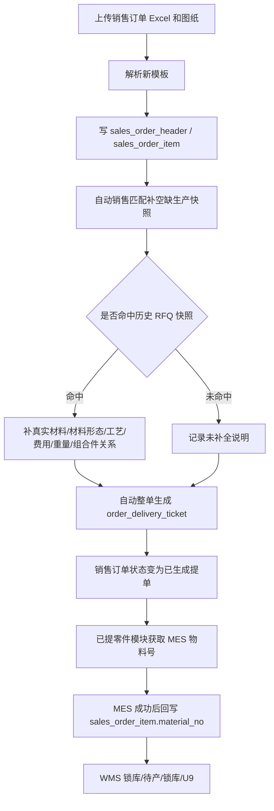

# 33-销售订单导入即提单与异常治理重构开发文档

> 2026-08-07 价格字段收口：销售订单导入、自动补全、自动提单和异常治理均使用四个正式价格字段 `tax_included_unit_price`、`tax_included_total_price`、`untaxed_unit_price`、`untaxed_total_price`。价格为空不阻断导入和已提零件，U9 只读取含税单价并在缺失时阻断；`final_*` 不再是当前字段。

> 2026-08-08 两级工艺主数据阶段 15 收口：销售订单导入自动补全和异常治理复用历史生产快照时，工艺路线使用标准两级工艺字段全集；导入事实字段不被覆盖，历史工艺快照不按当前字典重新计价。自动提单把该标准工艺快照写入已提零件需求池。

## 1. 背景

市场部确认销售订单主链路需要从“导入销售订单 -> 可选销售匹配 -> 议价提单 -> 已提零件”调整为“导入销售订单 -> 自动补全历史生产快照 -> 自动生成提单 -> 已提零件”。

新的销售订单模板以 `D:/桌面/销售订单模版.xlsx` 为准，第一版工作表为 `GSQ`，表头包含：

```text
序号、下单日期、客户订单号、客户项目号、客户下单抬头、订单类型、内部项目号、客户交期、内部交期(给生产的交期)、图号、订单数量、描述、材料、表面处理、版本、VAT单价-含税、未税单价(CNY)、（未税）金额、备注
```

与现有系统口径相比，新模板和新流程有以下变化：

1. 模板不再提供 `料号`，销售订单后续只使用 MES 获取并确认的 `material_no`。
2. 模板不再提供已提数量 / 未提数量类字段，`订单数量` 就是本次要进入已提零件的数量。
3. 模板已经包含 `内部交期(给生产的交期)`、`内部项目号`、`客户订单号`、`客户项目号` 等原来议价提单页面需要维护的信息。
4. 销售订单导入后不再让用户手工进入销售匹配模块和议价提单模块，系统自动完成历史快照补全和整单提单生成。
5. 销售匹配页面暂不删除，改为“异常治理”口径，作为后续排查旧订单或异常订单的兜底工具。
6. 价格列允许导入为空；导入、自动提单和进入已提零件不因价格为空阻断。U9 同步前必须补齐价格，否则拒绝同步。

## 2. 当前系统回收

现有系统已经具备可复用能力：

| 能力 | 当前文件 / 模块 | 现状 |
| --- | --- | --- |
| 销售订单模板解析 | `SalesOrderQpoExcelParser` | 已能识别大部分新表头，但仍读取旧 `料号`、`已出数量`、`未出数量`，且价格必填。 |
| 销售订单落主表 | `SalesOrderQpoImportService` | 导入后写 `sales_order_header` / `sales_order_item`，状态为 `已报价`，不自动匹配、不自动提单。 |
| 销售匹配补全 | `SalesOrderMatchService` | 按 `图号 + 版本` 查历史 RFQ 已提单零件，只补空缺生产 / 核价快照，不覆盖导入事实。 |
| 销售订单提单 | `DeliveryService` | 已支持 `SALES_ORDER` 来源提单，写 `order_delivery_ticket` 并更新 `released_qty / remaining_qty / status`。当前手动提单要求价格不为空。 |
| 已提零件后续链路 | `DeliveredItemService`、MES/WMS 服务 | 已提零件以 `order_delivery_ticket` 为需求池，销售订单来源行可继续获取 MES 物料号、WMS 库存。 |
| 销售订单物料号回写 | `SourceItemMaterialNoSyncService` | MES 成功后已能按 `source_type + source_item_id` 回写 `sales_order_item.material_no / material_no_status`。 |
| U9 同步 | `SalesOrderU9SyncService` | 要求销售订单已提单、物料号已确认、价格不为空后才同步 U9；后续需补充更清晰的价格缺失预览和前端补价入口。 |

## 3. 目标

1. 销售订单导入成功后自动整单进入已提零件模块。
2. 导入时自动执行一次历史生产快照补全，匹配不到不阻断。
3. 销售订单不再通过议价提单模块手工生成提单。
4. 销售订单模板和系统模板下载删除 `料号`、`已出数量`、`未出数量` 口径。
5. `sales_order_item.material_no` 初始为空，只能由 MES 获取成功后写入并置为 `已确认`。
6. 导入价格允许为空；U9 同步前强校验价格、物料号、已提单状态。
7. 销售匹配页面改为“异常治理”口径，保留作为兜底工具，日常新导入销售订单不进入该页面待办。
8. 首页、权限、日志、文档和测试口径同步收口。

## 4. 非目标

- 不把销售订单写入 `order_rfq` 或 `item_quote_version`。
- 不改变 RFQ 询价订单导入、核价、报价、议价提单主流程。
- 不在本次实现 U9 同步页面的完整改价 / 补价编辑器；本次只保证价格为空时 U9 不可同步，并为后续补价入口预留接口和文案。
- 不新增 `common:*` 权限。
- 不把销售匹配补全动作重新设计成用户必经步骤。
- 不要求把历史已导入但未提单的销售订单自动迁移到已提零件；如生产数据存在旧销售订单，后续可单独执行一次性治理任务。

## 5. 新业务流程

### 5.1 销售订单导入主链路



### 5.2 状态口径

| 对象 | 导入落主表时 | 自动匹配后 | 自动提单后 |
| --- | --- | --- | --- |
| `sales_order_header.status` | `已报价` | `已报价` | `已生成提单` |
| `sales_order_item.status` | `已报价` | `已报价` | `已生成提单` |
| `sales_order_item.released_qty` | `0` | `0` | `qty` |
| `sales_order_item.remaining_qty` | `qty` | `qty` | `0` |
| `sales_order_item.match_status` | `待匹配` 或 `未匹配` | `已匹配` / `未匹配` | 保持匹配结果 |
| `sales_order_item.material_no` | 空 | 空 | 空，等待 MES 回写 |
| `sales_order_item.material_no_status` | `未确认` | `未确认` | `未确认` |
| `order_delivery_ticket.material_no` | 不存在 | 不存在 | 空，等待已提零件获取 MES 物料号 |

### 5.3 未匹配处理

未匹配历史 RFQ 快照时：

- 不阻断导入。
- 不阻断自动提单。
- 不阻断进入已提零件。
- `match_status = 未匹配`。
- `match_message = 未命中历史已提单生产快照`。
- 导入结果展示未补全数量。
- 销售订单详情保留匹配状态，方便后续异常治理。

## 6. 字段口径

### 6.1 新模板字段映射

| Excel 表头 | 保存位置 | 必填 | 说明 |
| --- | --- | --- | --- |
| 序号 | `sales_order_item.line_no` | 否 | 市场原始行号。 |
| 下单日期 | `sales_order_header.sales_order_date` | 是 | 同一客户订单号 + 内部项目号分组内必须一致。 |
| 客户订单号 | `sales_order_header.customer_order_no` / `sales_order_item.customer_order_no` | 是 | 销售订单分组依据之一，也写入提单快照。 |
| 客户项目号 | `sales_order_header.customer_project_no` / `sales_order_item.customer_project_no` | 否 | 自动提单写入 `customer_project_no`。 |
| 客户下单抬头 | `sales_order_header.customer_order_title` | 否 | 订单头快照。 |
| 订单类型 | `sales_order_header.order_type` / `sales_order_item.order_type` | 是 | 自动提单写入 `order_type`。 |
| 内部项目号 | `sales_order_header.internal_project_no` / `sales_order_item.internal_project_no` | 是 | 自动提单必填来源。 |
| 客户交期 | `sales_order_item.customer_delivery_date` | 否 | 销售订单客户交期。 |
| 内部交期(给生产的交期) | `sales_order_item.internal_delivery_date` | 否 | 自动提单优先作为 `delivery_date`。为空时用导入当天。 |
| 图号 | `sales_order_item.part_no` | 是 | 历史快照匹配主键之一。 |
| 订单数量 | `sales_order_item.qty` | 是 | 本次自动提单数量。 |
| 描述 | `sales_order_item.description` | 否 | 对应 RFQ 导入模板的材料描述口径，销售匹配不覆盖。 |
| 材料 | `sales_order_item.material_name` | 否 | 导入材料，销售匹配不覆盖；真实材料使用 `engineering_material_name`。 |
| 表面处理 | `sales_order_item.surface_treatment` | 否 | 销售订单导入事实，销售匹配不覆盖。 |
| 版本 | `sales_order_item.version` | 是 | 历史快照匹配主键之一。 |
| VAT单价-含税 | `tax_included_unit_price` | 否 | 允许为空；U9 同步前必须补齐含税单价。 |
| 未税单价(CNY) | `untaxed_unit_price` | 否 | 允许为空；不能替代 U9 所需的含税单价。 |
| （未税）金额 | `untaxed_total_price` | 否 | 有未税单价且金额为空时可按数量计算；未税单价为空则保持空。 |
| 备注 | `sales_order_item.remark` | 否 | 自动提单写入 `remark`。 |

### 6.2 删除 / 废弃字段口径

| 旧字段 | 新口径 |
| --- | --- |
| Excel `料号` | 新模板删除。后端不再解析、不再写入 `sales_material_no` 或 `material_no`。如果上传旧模板仍包含该列，第一版建议忽略并给导入结果警告，不因该列失败。 |
| `sales_order_item.sales_material_no` | 数据库字段暂留兼容，但页面不再作为业务字段展示，U9 不再把它作为料号说明。 |
| Excel `已出数量` / `未出数量` | 新模板删除。导入时默认 `shipped_qty = 0`、`unshipped_qty = qty`，页面可隐藏。 |
| 已提数量 / 未提数量 | 不再由模板提供。`released_qty / remaining_qty` 由自动提单流程维护，自动提单后为 `qty / 0`。 |

### 6.3 物料号口径

销售订单只保留一个正式物料号：

```text
sales_order_item.material_no
```

写入规则：

1. 导入时永远为空。
2. 销售匹配 / 异常治理永远不写入。
3. 自动提单时 `order_delivery_ticket.material_no` 为空。
4. 已提零件 MES 物料号成功后，写入 `order_delivery_ticket.material_no`。
5. MES 成功链路同步回写 `sales_order_item.material_no`，并置 `material_no_status = 已确认`、`material_no_source = MES_TICKET`。
6. U9 同步只接受 `sales_order_item.material_no_status = 已确认` 的物料号。

### 6.4 价格口径

导入允许以下情况：

- 含税单价为空、未税单价为空。
- 只有含税单价。
- 只有未税单价。
- 未税金额为空。

保存规则：

| 情况 | `tax_included_unit_price` | `untaxed_unit_price` | 说明 |
| --- | --- | --- | --- |
| 含税价有值 | 写入 | 按模板写入或空 | U9 使用含税单价。 |
| 含税价空、未税价有值 | 保持空 | 写入 | 导入和自动提单允许；U9 仍阻断，不允许未税价降级。 |
| 两者都空 | 空 | 空 | 导入和自动提单允许；U9 同步前必须补齐含税单价。 |

U9 同步校验：

U9 预览和提交只读取 `tax_included_unit_price`，不提供任何价格降级。若含税单价为空：

- 预览返回 `syncReady = false`。
- `blockedReason` 明确提示存在价格为空零件。
- 行级提示包含图号、版本、行号。
- 不调用 U9 / 数据中心。

## 7. 后端设计

### 7.1 `SalesOrderQpoExcelParser`

修改点：

1. `REQUIRED_HEADERS` 删除 `VAT单价-含税`、`未税单价(CNY)`。
2. 删除或停止使用 `SALES_MATERIAL_NO = 料号` 解析。
3. `taxIncludedUnitPrice` 改为 `optionalDecimal(...)`。
4. `untaxedUnitPrice` 改为 `optionalDecimal(...)`。
5. `untaxedTotalPrice` 仅在 `untaxedUnitPrice != null` 时按数量计算，否则保持空。
6. `taxIncludedTotalPrice` 仅在 `taxIncludedUnitPrice != null` 时按数量计算，否则保持空。
7. `shippedQty` 默认 0，`unshippedQty` 默认 `qty`，但不再把旧列写入模板下载和页面说明。
8. 对旧模板中的 `料号` 列不入库；可将“检测到旧料号列，已忽略”写入导入警告摘要。

阶段 1 实施选择：`SalesOrderQpoExcelLineDTO.salesMaterialNo` 暂时保留并标记废弃，避免阶段 1 影响后续导入服务编译；`SalesOrderQpoExcelParser` 从本阶段开始固定不再从 Excel 填充该字段。

验收：

- 新模板价格为空时解析成功。
- 新模板没有 `料号` 时解析成功。
- `salesMaterialNo` 不再从 Excel 读取。
- 数量仍必须大于 0。
- 日期序列号仍可解析。

### 7.2 `SalesOrderQpoImportService`

导入事务改为四段：

```text
parse -> create sales order -> auto match -> auto release tickets
```

建议新增内部结果对象：

```java
private record AutoImportFlowResult(
        CreatedSalesOrder created,
        SalesOrderMatchApplyResp matchResp,
        List<OrderDeliveryTicket> tickets
) {}
```

落主表规则：

- `item.setSalesMaterialNo(null)`。
- `item.setMaterialNo(null)`。
- `item.setMaterialNoStatus("未确认")`。
- `item.setReleasedQty(0)`。
- `item.setRemainingQty(line.getQty())`。
- `item.setStatus(QuoteStatusWorkflow.QUOTED)`。
- `item.setTaxIncludedUnitPrice(taxIncludedUnitPrice)`；不得写入未税单价作为降级值。
- `item.setTaxIncludedTotalPrice(...)` 仅在含税单价可计算时写入。

自动补全规则：

- 在所有 `sales_order_item` 插入完成后调用自动匹配。
- 自动匹配必须在销售订单仍是 `已报价` 时执行。
- 未匹配不抛错，不阻断。
- 匹配命中时继续沿用“只补空缺生产快照”规则。

自动提单规则：

- 自动提单数量 = `sales_order_item.qty`。
- `orderType` = `sales_order_header.order_type`。
- `internalProjectNo` = `sales_order_header.internal_project_no`。
- `customerOrderNo` = `sales_order_header.customer_order_no`。
- `customerProjectNo` = `sales_order_header.customer_project_no`。
- `startDate` = 当前日期。
- `deliveryDate` = `sales_order_item.internal_delivery_date`，为空时用 `startDate`。
- `arrangeType` = `计划`。
- 自动提单允许价格为空。
- 自动提单后订单和零件状态刷新为 `已生成提单`。

导入结果新增建议字段：

| DTO | 字段 | 说明 |
| --- | --- | --- |
| `SalesOrderQpoImportResultRow` | `autoReleasedTicketCount` | 自动生成提单行数。 |
| `SalesOrderQpoImportResultRow` | `autoReleasedQty` | 自动提单总数量。 |
| `SalesOrderQpoImportResultRow` | `matchedItemCount` | 自动补全命中数量。 |
| `SalesOrderQpoImportResultRow` | `unmatchedItemCount` | 未补全数量。 |
| `SalesOrderQpoImportResultRow` | `missingPriceCount` | 价格为空行数。 |
| `SalesOrderQpoImportResultRow` | `deliveredItemEntered` | 是否已进入已提零件。 |

验收：

- 导入成功后能查到销售订单主表。
- 同一销售订单下所有零件都生成 `order_delivery_ticket`。
- `order_delivery_ticket.source_type = SALES_ORDER`。
- `source_order_id = sales_order_header.id`。
- `source_item_id = sales_order_item.id`。
- `sales_order_header.status = 已生成提单`。
- `sales_order_item.released_qty = qty`、`remaining_qty = 0`。
- `sales_order_item.material_no` 为空且 `material_no_status = 未确认`。

### 7.3 自动匹配服务复用

现有 `SalesOrderMatchService.applyOrder(...)` 会写操作日志并校验订单状态为 `已报价`。导入自动补全建议采用以下方式之一：

#### 推荐：新增内部自动补全方法

```java
public SalesOrderMatchApplyResp autoApplyImportedOrder(Long salesOrderId)
```

差异：

- 复用 `apply(...)` 核心逻辑。
- `audit action` 可继续使用 `SALES_ORDER_MATCH_APPLY`，但摘要中增加 `trigger=IMPORT_AUTO`。
- 不依赖前端 `market:sales-match:apply` 权限；导入端由 `market:rfq:import-sales-order` 控制。
- 不改变手动异常治理接口。

验收：

- 自动补全与手动补全写入字段一致。
- 自动补全不覆盖 `material_name / surface_treatment / drawing_url / description / material_no`。
- 未匹配行保留 `未匹配` 状态并继续提单。

### 7.4 自动提单服务复用

现有 `DeliveryService.generateTickets(...)` 手动销售订单提单会校验价格不为空。新流程需要导入自动提单允许价格为空，因此建议新增内部入口：

```java
public List<OrderDeliveryTicket> generateSalesOrderTicketsFromImport(Long salesOrderId)
```

该方法复用现有销售订单提单的核心快照写入逻辑，但差异如下：

| 行为 | 手动议价提单 | 导入自动提单 |
| --- | --- | --- |
| 权限 | `market:release:create` 控制 controller | 不单独暴露 controller，由导入接口触发 |
| 价格校验 | 价格不能为空 | 允许为空 |
| 数量 | 用户选择 acceptedQty | 固定整行 `qty` |
| 来源 | RFQ 或 SALES_ORDER | 仅 SALES_ORDER |
| 操作日志 | `DELIVERY_TICKET_GENERATE` | 可继续记录 `DELIVERY_TICKET_GENERATE`，摘要增加 `trigger=SALES_ORDER_IMPORT_AUTO` |

实现要点：

- 避免复制一套 `insertSalesOrderTicket(...)` 大逻辑；优先抽取公共私有方法。
- 自动提单必须加行级幂等保护：如果该销售订单已有 `SALES_ORDER` 来源提单，自动提单拒绝重复生成。
- 自动提单在导入事务内执行，任一订单组失败时整个导入回滚，避免主表存在但已提零件缺失。
- 如果未来需要部分成功导入，再单独设计批次级失败明细，本次保持事务一致。

验收：

- 价格为空也能自动生成提单。
- 重复调用自动提单不会重复写 `order_delivery_ticket`。
- 自动提单生成的快照字段与手动销售订单提单一致。
- 自动提单后已提零件默认未完成池能看到这些销售订单来源行。

### 7.5 `SalesOrderU9SyncService`

本次不实现完整补价编辑，但必须收紧预览和同步校验：

1. `syncBlockedReason(...)` 增加价格缺失判断。
2. `toPreviewLine(...)` 增加或复用 `taxIncludedUnitPrice` 展示。
3. 行级 blocked reason 需要能提示：`价格不能为空，不能同步 U9`。
4. `toU9Line(...)` 继续使用 `requiredPrice(...)`，不允许价格为空时进入数据中心 / U9。
5. `CustomerItemNo` 不再使用 `salesMaterialNo` 作为销售料号；第一版建议置空或使用 `partNo`，需按 U9 接口字段语义确认。若无明确要求，建议置空，避免把旧“料号”语义传出去。

验收：

- 销售订单已提单且物料号已确认但价格为空时，U9 预览显示不可同步。
- 点击同步不会调用数据中心。
- 错误提示能定位到图号 / 版本 / 行号。
- 价格补齐后可恢复同步。

## 8. 前端设计

### 8.1 新单导入页 `MarketDashboard.vue`

销售订单导入区域文案调整：

- 标题仍为 `销售订单`。
- 说明改为：`上传销售订单后，系统将自动补全历史生产快照并生成已提零件。`
- 模板提示删除 `料号`、`已出数量`、`未出数量`。
- 价格提示改为：`价格允许为空，但 U9 同步前必须补齐。`
- 成功弹窗改为：`销售订单已导入并生成已提零件`。

导入结果表建议列：

| 列 | 字段 |
| --- | --- |
| 销售订单号 | `salesOrderNo` |
| 客户订单号 | `customerOrderNo` |
| 内部项目号 | `internalProjectNo` |
| 零件数 | `lineCount` |
| 自动提单行 | `autoReleasedTicketCount` |
| 自动提单数量 | `autoReleasedQty` |
| 已补全快照 | `matchedItemCount` |
| 未补全快照 | `unmatchedItemCount` |
| 缺价格 | `missingPriceCount` |
| 图纸绑定 | `matchedDrawingCount` |
| 提示 | `warningMessage` |

验收：

- 页面不再提示销售订单导入后只创建独立主表。
- 页面不再提示用户下一步进入销售匹配或议价提单。
- 导入成功后结果能看出已进入已提零件。

### 8.2 销售订单管理页 `SalesOrderManage.vue`

调整：

- 移除 `销售料号` 列。
- 保留 `物料号` 和 `物料号状态` 列。
- 订单列表中 `已提 / 总数` 对新导入订单应显示 `总数 / 总数`。
- 详情中展示 `匹配状态 / 匹配说明`，用于异常治理追踪。
- 废弃 / 恢复文案删除“恢复后可继续销售匹配、议价提单”的旧描述。
- 已生成提单订单仍不可废弃，沿用当前状态锁定逻辑。

验收：

- 新导入订单显示为 `已生成提单`。
- 详情提单行能看到自动生成的销售订单来源提单。
- 页面不再出现“销售料号”。

### 8.3 异常治理页 `SalesMatch.vue`

保留路由和权限编码，调整可见文案：

| 旧文案 | 新文案 |
| --- | --- |
| 销售匹配 | 异常治理 |
| 选择销售订单，预览并补全历史生产快照 | 用于排查历史销售订单或自动补全异常，不作为新销售订单日常流程入口。 |
| 补全生产快照 | 补全异常快照 |

权限编码第一版保持不变：

```text
market:sales-match:view
market:sales-match:customer-select
market:sales-match:order-select
market:sales-match:apply
market:sales-match:file-preview
```

`PermissionService.defaultPermissions()` 中权限名称建议同步改为异常治理文案，但权限 code 不改，避免角色迁移。

验收：

- 左侧菜单显示 `异常治理`。
- 页面标题显示 `异常治理`。
- 路由 `/sales-match` 可暂时保留。
- 新导入销售订单因状态为 `已生成提单`，不出现在异常治理默认可选 `已报价` 列表。

### 8.4 议价提单页 `MarketRelease.vue`

新口径：议价提单只服务 RFQ 主流程。

调整：

- `release` 订单选择只展示 RFQ 来源订单。
- 前端删除或隐藏销售订单来源标签、销售订单刷新逻辑、销售订单来源自动填表逻辑。
- 后端 `/api/market/release/orders` 不返回销售订单。
- 后端 `InternalTargetLeadTimeService` 中销售订单候选逻辑可保留给历史接口测试，但不作为页面入口；若要一次到位清理，可删除 release scope 下销售订单混合候选代码，并补回归测试。
- `DeliveryService.generateTickets(...)` 可保留销售订单手动入口供内部服务复用，但不再从页面触发销售订单提单。

验收：

- 议价提单订单选择弹窗不出现销售订单。
- RFQ 提单流程不受影响。
- 新销售订单不需要进入议价提单也能进入已提零件。

### 8.5 U9 同步页 `SalesOrderU9Sync.vue`

本次先做校验和展示收口：

- 移除 `料号 / salesMaterialNo` 列。
- 保留 `物料号 / 物料号状态`。
- 增加或强化 `价格` 缺失提示。
- 预览页展示 `taxIncludedUnitPrice` 或可用价格来源。
- 若价格为空，顶部 alert 提示：`存在价格为空零件，请先补齐价格后同步 U9。`
- 后续补价编辑器另行开发时，可在该页面增加行内编辑或批量补价入口。

验收：

- 价格为空时不能同步 U9。
- 页面不再展示销售料号。
- 已确认物料号仍作为 U9 `ItemCode`。

### 8.6 首页看板

本次最小收口：

- 移除或改名 `待补全销售订单` 待办卡片。
- 如保留异常入口，标题改为 `销售订单异常治理`，跳转 `/sales-match`。
- 销售订单 `已报价` 客户分布保留为历史 / 异常观察口径；新导入订单正常会直接进入 `已生成提单`，不会长期留在已报价。
- 若后续要把销售订单首页主图改为 `已生成提单客户分布` 或 `待U9客户分布`，建议单独出首页看板二期文档，避免本次重构扩大范围。

验收：

- 首页不再把新销售订单引导到销售匹配。
- 首页进入销售订单 / 已提零件 / U9 的跳转不触发写操作。

## 9. 权限与日志

### 9.1 权限

本次不新增权限。

| 动作 | 权限 |
| --- | --- |
| 导入销售订单并自动提单 | `market:rfq:import-sales-order` |
| 自动历史快照补全 | 不单独校验 `market:sales-match:apply`；作为导入事务内部步骤，由导入权限覆盖。 |
| 自动生成提单 | 不单独校验 `market:release:create`；作为导入事务内部步骤，由导入权限覆盖。 |
| 异常治理页面 | 继续使用 `market:sales-match:*`，仅改显示名称。 |
| U9 同步 | 继续使用 `market:u9-sync:*`。 |

安全边界说明：

- 手动销售匹配接口仍必须由 `market:sales-match:apply` 控制。
- 手动议价提单接口仍必须由 `market:release:create` 控制。
- 自动补全和自动提单不新增可直接调用接口，只能由销售订单导入服务触发。
- 数据权限仍按客户范围校验：导入时校验所选客户，销售订单查询 / 已提零件 / U9 仍按各自数据权限过滤。

### 9.2 操作日志

建议继续沿用现有动作，但增加摘要字段：

| 动作 | targetType | 摘要新增字段 |
| --- | --- | --- |
| `SALES_ORDER_IMPORT_QPO` | `sales_order_import_batch` | `autoMatch=true`、`autoRelease=true`、`autoReleasedTicketCount`、`missingPriceCount` |
| `SALES_ORDER_MATCH_APPLY` | `sales_order_header` | `trigger=IMPORT_AUTO` 或 `trigger=MANUAL_EXCEPTION_GOVERNANCE` |
| `DELIVERY_TICKET_GENERATE` | `sales_order_header` | `trigger=SALES_ORDER_IMPORT_AUTO`、`ticketCount`、`ticketQty` |

不得记录：

- Excel 完整内容。
- PDF 文件内容。
- MES / WMS / U9 / 数据中心 token。
- Authorization header。
- 完整外部接口请求体或响应体。

## 10. 数据库与迁移

第一版不强制新增表。

如实现需要记录导入自动提单统计，可优先通过现有 `sales_order_import_record.request_summary_json` 和 `warning_message` 保存摘要，不新增字段。

若后续确认需要结构化查询自动提单统计，再新增迁移，例如：

```text
V87__sales_order_import_auto_release_summary.sql
```

可选字段：

```sql
ALTER TABLE sales_order_import_record
    ADD COLUMN IF NOT EXISTS auto_released_ticket_count INTEGER DEFAULT 0,
    ADD COLUMN IF NOT EXISTS auto_released_qty INTEGER DEFAULT 0,
    ADD COLUMN IF NOT EXISTS missing_price_count INTEGER DEFAULT 0;
```

第一版建议不新增，降低迁移复杂度。

## 11. 测试方案

### 11.1 后端测试

#### 模板解析

- 新模板无 `料号` 时解析成功。
- 新模板价格为空时解析成功。
- `订单数量` 为空或小于等于 0 时失败。
- `下单日期 / 客户订单号 / 订单类型 / 内部项目号 / 图号 / 订单数量 / 版本` 缺失时失败。
- `客户项目号` 表头带换行时可识别。
- `内部交期(给生产的交期)` 表头带换行时可识别。

#### 导入自动补全

- 导入后自动调用历史快照补全。
- 命中 RFQ 已提单历史时补齐 `engineering_material_name / material_shape / material_data / process_route / fee_data / weight / assembly relation`。
- 未命中时 `match_status = 未匹配`，导入继续成功。
- 自动补全不写 `material_name / surface_treatment / drawing_url / description / material_no`。

#### 导入自动提单

- 导入一张销售订单后生成同数量 `order_delivery_ticket`。
- `order_delivery_ticket.source_type = SALES_ORDER`。
- `order_delivery_ticket.source_order_id` 指向销售订单头。
- `order_delivery_ticket.source_item_id` 指向销售订单零件。
- `order_delivery_ticket.qty = sales_order_item.qty`。
- `order_delivery_ticket.internal_project_no / customer_order_no / customer_project_no / delivery_date` 来自模板字段。
- 价格为空时仍可生成提单。
- 自动提单重复调用不会重复生成。

#### 物料号与 U9

- 销售订单导入后 `sales_order_item.material_no` 为空。
- MES 成功后仍能回写 `sales_order_item.material_no_status = 已确认`。
- U9 预览在价格为空时 `syncReady=false`。
- U9 同步在价格为空时不调用数据中心。
- U9 同步在物料号未确认时不调用数据中心。

#### 权限和数据权限

- 导入接口仍要求 `market:rfq:import-sales-order`。
- 自动补全不暴露无权限接口。
- 自动提单不暴露无权限接口。
- 手动异常治理补全仍要求 `market:sales-match:apply`。
- 手动议价提单仍要求 `market:release:create`。
- 无客户数据权限时不能导入到该客户，不能看到对应已提零件 / 销售订单 / U9 预览。

### 11.2 前端测试

- 销售订单导入说明不包含 `料号`、`已出数量`、`未出数量`。
- 销售订单导入成功文案包含 `已生成已提零件` 或同义表达。
- 导入结果表包含 `自动提单行`、`已补全快照`、`未补全快照`、`缺价格`。
- `SalesOrderManage.vue` 不展示 `销售料号`。
- `SalesOrderU9Sync.vue` 不展示 `料号 / salesMaterialNo`。
- `SalesMatch.vue` 菜单 / 标题显示 `异常治理`。
- `MarketRelease.vue` 不再出现销售订单作为选择来源。
- 首页不再展示 `待补全销售订单` 作为正常待办。

### 11.3 回归测试

后端：

```powershell
cd D:\QPO-Operations-Management-System\quote-backend
.\mvnw.cmd test
```

前端：

```powershell
cd D:\QPO-Operations-Management-System\quote-frontend
npm test
npm run build
```

## 12. 分阶段开发计划

### 阶段 1：模板解析与字段口径收口

目标：新销售订单模板可导入，且不再引入旧料号口径。

修改：

- 修改 `SalesOrderQpoExcelParser`。
- 修改 `SalesOrderQpoExcelLineDTO`，废弃或停止使用 `salesMaterialNo`。
- 修改 `ImportTemplateExportService` 销售订单模板。
- 修改 `MarketDashboard.vue` 上传说明。
- 更新 `14-销售订单独立主表开发文档.md` 和本开发文档相关字段说明。
- 补解析测试和模板导出测试。

验收：

- 新模板价格为空可解析。
- 新模板无料号可解析。
- 系统下载模板不再包含料号、已出数量、未出数量。
- 导入页面不再提示旧字段。

### 阶段 2：导入落主表物料号与价格规则调整

目标：销售订单主表保存新口径字段，物料号只等待 MES 回写。

修改：

- 修改 `SalesOrderQpoImportService.toItem(...)`。
- `salesMaterialNo` 不再写入。
- `materialNo` 初始为空。
- `materialNoStatus` 初始 `未确认`。
- 价格允许为空。
- 导入结果增加缺价格统计。
- 补后端导入服务测试。

验收：

- 导入后销售订单零件没有销售料号。
- 导入后物料号为空且未确认。
- 价格为空不阻断导入。

### 阶段 3：自动销售匹配接入导入事务

目标：导入后自动补齐历史生产快照，未命中不阻断。

修改：

- `SalesOrderMatchService` 增加内部自动补全入口。
- `SalesOrderQpoImportService` 在插入全部行后调用自动补全。
- 审计摘要增加 `trigger=IMPORT_AUTO`。
- 导入结果展示 matched / unmatched。
- 补命中、未命中、保护字段测试。

验收：

- 命中历史 RFQ 时补齐真实材料、材料形态、工艺、费用、重量、组合件关系。
- 未命中时导入仍成功。
- 导入事实字段不被覆盖。

### 阶段 4：自动整单提单进入已提零件

目标：销售订单导入成功后自动生成销售订单来源提单行。

修改：

- `DeliveryService` 增加导入自动提单内部入口，或抽取可配置价格校验的销售订单提单核心方法。
- `SalesOrderQpoImportService` 自动调用整单提单。
- 自动提单允许价格为空。
- 自动提单写 `order_delivery_ticket.source_type/source_order_id/source_item_id`。
- 自动提单后更新 `released_qty / remaining_qty / status`。
- 审计摘要增加 `trigger=SALES_ORDER_IMPORT_AUTO`。
- 补自动提单、幂等、已提零件可见性测试。

验收：

- 导入成功即在已提零件看到销售订单来源行。
- 自动提单数量等于订单数量。
- 销售订单状态为已生成提单。
- 价格为空不影响进入已提零件。

### 阶段 5：销售匹配改为异常治理，议价提单排除销售订单

目标：页面入口不再误导用户走旧销售订单流程。

修改：

- `App.vue` 菜单文案 `销售匹配` 改为 `异常治理`。
- `SalesMatch.vue` 页面标题、说明、按钮文案改为异常治理。
- `PermissionService.defaultPermissions()` 权限名称更新为异常治理，权限 code 不变。
- 权限文档同步说明 code 兼容保留。
- `MarketRelease.vue` 和订单选择 scope 排除销售订单。
- 后端 release 订单列表不返回销售订单。
- 补前后端测试。

验收：

- 左侧看到异常治理。
- 新导入销售订单不出现在异常治理待处理列表。
- 议价提单只展示 RFQ。
- RFQ 议价提单不回退。

### 阶段 6：销售订单和 U9 前端展示收口

目标：销售订单管理和 U9 同步页面符合新字段口径。

修改：

- `SalesOrderManage.vue` 移除销售料号展示。
- 销售订单详情增加或强化匹配状态 / 自动提单结果展示。
- `SalesOrderU9Sync.vue` 移除销售料号列。
- U9 预览展示价格缺失状态。
- 后端 `SalesOrderU9SyncService` 预览补价格缺失 blocked reason。
- 补前后端测试。

验收：

- U9 页面只展示 MES 物料号。
- 价格为空时 U9 不可同步。
- 销售订单详情能看到自动提单行。

### 阶段 7：首页、文档、权限、日志口径收口

目标：全系统文字和运维口径不再指向旧销售订单流程。

修改：

- 首页移除或改名 `待补全销售订单` 待办。
- 更新 `14-销售订单独立主表开发文档.md`。
- 更新 `15-销售匹配模块开发文档.md`，说明已改异常治理。
- 更新 `26-销售匹配材料字段口径重构开发文档.md`。
- 更新 `27-销售匹配订单级工作台重构开发文档.md`，说明页面已降级为异常治理。
- 更新 `16-销售订单U9同步模块开发文档.md`，说明价格补齐前不可同步。
- 更新权限清单和日志运维说明。
- 更新 MES/WMS/U9 主链路文档中的销售订单来源描述。

验收：

- 文档不再说新销售订单必须手动销售匹配 / 手动议价提单。
- 文档明确导入后自动进入已提零件。
- 权限文档说明本次不新增权限。
- 日志文档说明自动补全和自动提单归入导入链路摘要。

### 阶段 8：全量回归

目标：销售订单新链路和 RFQ 主链路均不回退。

验收命令：

```powershell
cd D:\QPO-Operations-Management-System\quote-backend
.\mvnw.cmd test

cd D:\QPO-Operations-Management-System\quote-frontend
npm test
npm run build
```

额外验收：

- 销售订单导入、自动补全、自动提单、已提零件、MES 物料号、WMS 锁库、待产、锁库、U9 同步主链路可串通。
- 未匹配历史快照不阻断主链路。
- 价格为空不阻断导入和已提零件，但阻断 U9。
- `sales_order_item.material_no` 只由 MES 成功回写。
- RFQ 导入、核价、报价、议价提单、已提零件链路不受影响。
- 不新增用户权限。
- 操作日志和文件日志不包含完整 Excel 内容、外部系统 token、Authorization header、完整外部请求体或响应体。

## 18. 已确认物料号前置复用收口

销售订单导入后的自动异常治理匹配除补齐真实材料、材料形态、工艺、费用、重量和组合件关系外，还会在历史 RFQ 来源满足 `material_no` 非空且 `material_no_status = 已确认` 时补齐完整物料号确认元组：`material_no`、`material_no_status`、`material_no_source`、`material_no_source_ticket_id`、`material_no_synced_at`、`material_no_message`。

写入规则仍是只补空缺：目标为空时写入，目标同值时幂等补齐元数据，目标已有不同物料号时拒绝覆盖并记录冲突，且不阻断其他生产快照补全。来源没有确认物料号时，销售订单导入、自动异常治理匹配和自动提单继续成功。

自动提单时，来源销售订单零件已有确认物料号则提单行继承该值并初始化 `mes_sync_status = SUCCESS`，不进入已提零件 MES 待处理池；来源未确认时提单行保持 `PENDING`。进入 MES 后只进行活动主请求和 follower 并发去重，不再扫描历史成功提单行。

### 阶段 8 收口补充：与 RFQ 派生订单并行

本文件的直接导入销售订单固定为 `DIRECT_IMPORT`。RFQ 议价提单的一批 RFQ 零件由 37 号文档生成 `RFQ_RELEASE` 派生销售订单，两者共用销售订单 U9、MES 回写和 WMS 后续口径，但来源关系、RFQ 主表和直接导入主表保持隔离。

销售订单直接导入仍不进入 `order_rfq / item_quote_version`，RFQ 派生销售订单也不替代 RFQ ticket。权限不新增，自动导入摘要沿用现有审计和文件日志规范，普通读取不记操作日志。
