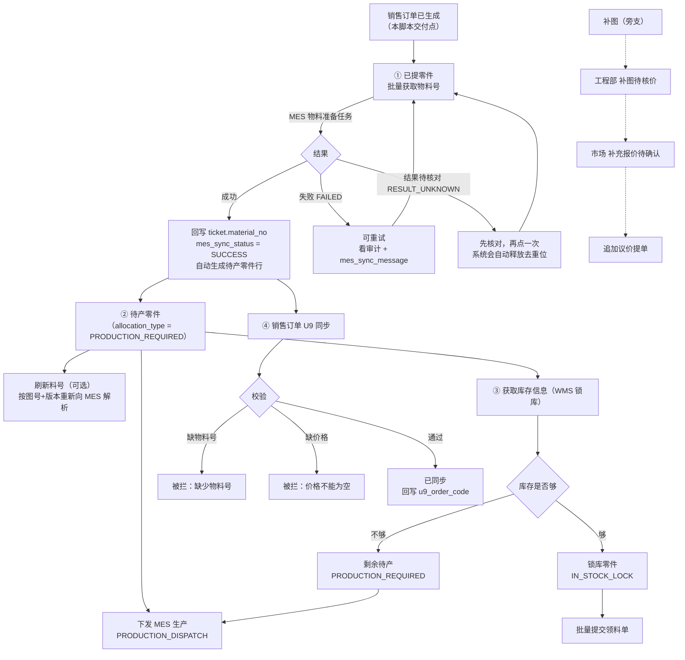

# QPO 销售订单测试数据 · 后续操作流程

配套脚本：`scripts/test-data/01-sales-order-test-data.sql`
适用版本：V2.4 分支 / Flyway **V66 及以上**（脚本已做版本兼容，不会因缺列报错）

---

## 零、怎么执行（以及报错怎么办）

脚本是**纯 PostgreSQL SQL**，只有 `INSERT / UPDATE / DELETE / SELECT`，不含任何 psql 元命令、临时表、`DO $$` 块或 `::` 类型转换，所以：

- 用 `psql -f` 跑可以；
- 用 Navicat / DBeaver / pgAdmin / DataGrip 打开文件、全选、一次性执行也可以。

**必须整份执行**，不要只选中一部分，否则 `BEGIN` 和 `COMMIT` 配不上。

执行顺序上唯一要注意的：脚本第 0 条 `SELECT` 会先打印 `flyway_version`。确认这个数字是你要操作的库，再往下看结果。

### 如果还是报错，按下表对照

| 报错信息 | 真实原因 | 处理 |
| --- | --- | --- |
| `syntax error at or near "$$"` 或 `at or near "DO"` | 旧版脚本用了 `DO $$ ... $$` 断言块，部分客户端不认美元引用 | 用当前这版（已改成纯 SQL） |
| `column "created_at" of relation "order_delivery_ticket" does not exist` | 目标库停在 Flyway V66，该列是 V68 才加的 | 用当前这版（已不依赖该列） |
| `relation "tmp_qtest_ctx" does not exist` | 旧版脚本依赖临时表，客户端逐条自动提交时临时表被提前销毁 | 用当前这版（已不用临时表） |
| `there is no unique or exclusion constraint matching the ON CONFLICT specification` | 目标库 `customer_master.customer_code` 上没有唯一索引 | 用当前这版（已改成 `NOT EXISTS`） |
| `current transaction is aborted, commands ignored until end of transaction block` | 前面某一条已经报错了，后面的语句全部连坐 | 先解决第一条报错，然后**整份重跑**（脚本自带清理，重跑即重置） |
| `permission denied for table ...` | 连库账号没有写权限 | 换成有写权限的账号（一般就是 `POSTGRES_USER` 那个） |

不是「数据库格式不对」——QPO 本来就是 PostgreSQL，脚本也是按 PostgreSQL 写的。上面这些报错全部来自**脚本写法与客户端/版本的不匹配**，现在这版已经都规避了。

---

## 一、脚本造了什么

一共 **3 家客户、5 张销售订单、10 行零件、10 行提单**，状态停在「销售订单刚生成、自动提单刚跑完」这一刻。

| 销售订单号 | 客户 | 订单类型 | 状态 | 行数 | 这张单用来验什么 |
| --- | --- | --- | --- | --- | --- |
| QTEST-SO-2601 | 苏州启测 | 正式订单 | 已生成提单 | 3 | 最标准的全流程，三行不同材质/表面处理 |
| QTEST-SO-2602 | 无锡启测 | 正式订单 | 已生成提单 | 2 | 第 1 行**故意不给价格**，验 U9 同步的「价格不能为空」拦截 |
| QTEST-SO-2603 | 苏州启测 | 备货订单 | 已生成提单 | 2 | 小件大批量（50 / 200），交期最近，验排序与筛选 |
| QTEST-SO-2604 | 常州启测 | 正式订单 | **部分已提单** | 2 | 第 2 行 20 件只提 8 件，验部分提单 / 待提数量展示 |
| QTEST-SO-2605 | 无锡启测 | 正式订单 | 已生成提单 | 1 | 单行大批量（100），交期最远 |

图号统一 `QTEST-2601-001` 这种格式，和真实数据、MES 里已有的图号不会撞车。

### 明确**没有**预置的东西（这些正是留给你手工验的）

| 表 / 字段 | 脚本给的值 | 原因 |
| --- | --- | --- |
| `order_delivery_ticket.material_no` | 空 | 物料号要你点「批量获取物料号」由 MES 回写 |
| `order_delivery_ticket.mes_sync_status` | `PENDING` | 还没请求过 MES |
| `order_delivery_ticket.wms_allocate_status` | `PENDING` | 还没请求过 WMS |
| `order_delivery_ticket_allocation` | 一行都没有 | 待产/锁库分配行是物料号成功后才生成的 |
| `sales_order_item.material_no_status` | `未确认` | 同上 |
| `sales_order_item.has_drawing` / `drawing_url` | `false` / 空 | 补图是人工测试项，脚本不伪造文件对象 |
| `sales_order_header.u9_sync_status` | `未同步` | U9 同步要你手工点 |
| 审计日志 | 不写 | 手工操作产生的审计才是真审计 |

所以在页面上应该看到：

- 销售订单管理：5 张单，4 张「已生成提单」+ 1 张「部分已提单」
- 已提零件：10 行，全部落在「待获取物料号」
- 待产零件：**0 行**
- 锁库零件：**0 行**
- U9 同步池：5 张单全部 `syncReady = false`，原因「缺少物料号」

如果待产或锁库已经有行，说明环境里跑过别的东西，脚本没清干净，先确认是不是自己的历史数据。

---

## 二、后续操作流程图



关键依赖只有一句话：**没有物料号，就没有待产行；没有待产行，就下发不了生产、也锁不了库；没有物料号，U9 也同步不了。** 所以顺序不能跳。

---

## 三、分步操作说明

### ① 已提零件 → 批量获取物料号

| 项 | 内容 |
| --- | --- |
| 页面 | 已提零件（`/delivered-items`） |
| 权限 | `market:delivered-item:view`、`market:delivered-item:mes-sync` |
| 前置 | MES 接口地址可通（`system_external_integration_config` 里的 MES 配置） |
| 动作 | 勾选行 → 「批量获取物料号」 |

**预期结果**

- 成功：该行「物料号」列出现 MES 返回的料号，MES 状态变 `SUCCESS`，行从「待获取物料号」列表消失
- 同时：待产零件页自动多出对应的 `PRODUCTION_REQUIRED` 行，数量 = 提单数量
- 失败：MES 状态 `FAILED`，`mes_sync_message` 有原因；可直接重试
- 结果待核对：MES 状态 `RESULT_UNKNOWN`，**不是失败**，说明超时/5xx/回包解析不了。再点一次会先释放去重占位再重发

**建议**：第一次只勾 1 行（比如 `QTEST-2603-001`）跑通，再整批勾。因为 MES 物料接口是**整批回滚**语义——某一行被拒（比如图号版本材质重复、图纸转存失败），整批一条都不会建，容易误判成"全都失败"。

**踩坑提示**

- MES 按「图号 + 版本 + 材质」全局唯一。同一个图号版本材质重复提交，只会返回 `EXISTING_PRODUCT`（带料号）或「已存在物料准备任务」，不会建第二个任务。所以别拿真实图号反复试。
- 版本不能为空，材质不要带首尾空格（脚本已经处理好）。

### ② 待产零件 → 下发 MES 生产

| 项 | 内容 |
| --- | --- |
| 页面 | 待产零件（`/production-items`） |
| 权限 | `market:production-item:view`、`market:production-item:mes-production-submit` |
| 前置 | ①已成功，列表里有 `PRODUCTION_REQUIRED` 行 |
| 动作 | 勾选 → 「下发MES生产」 |

**同页还有两个按钮，先弄清区别**

- **刷新料号**（`market:production-item:material-no-refresh`）：对**已确认料号**的行按图号+版本重新向 MES 解析并覆盖料号。已成功下发、结果待核对的行不会刷新。注意它和①的「获取物料号」是两件事——MES 那边同图号+版本+材质只允许一个物料准备任务，所以对已经解析过的零件"刷新"通常拿不到新料号，这是 MES 规则决定的，不是 QPO 的 bug。
- **定时下发策略**（`market:production-item:mes-production-schedule`）：配置每日自动下发的时间和范围，配好后不用手点。

**预期结果**：行上「生产下发状态」从 `PENDING` 变 `PROCESSING` → `SUCCESS`；失败则 `FAILED` 并带 message；`RESULT_UNKNOWN` 要先核对再决定，不能直接重复下发（会重复建生产任务）。

### ③ 获取库存信息（WMS 锁库）

| 项 | 内容 |
| --- | --- |
| 页面 | 销售订单管理 → 打开订单详情 → **锁库拆行** 页签 |
| 权限 | `market:sales-order:view`、`market:sales-order:wms-allocate` |
| 前置 | 该订单已经有待产行（①成功） |
| 动作 | 「整单获取库存信息」或选中行「批量获取库存信息」 |

**预期结果**

- WMS 有库存：拆出 `IN_STOCK_LOCK` 行，进「锁库零件」页
- 库存不够：剩下的部分留在 `PRODUCTION_REQUIRED`，继续走②下发生产
- 「锁库拆行」页签能看到每一行的 锁库数量 / 剩余待产数量 / WMS 批次号

**注意**：这个按钮只对「数量 > 0 的待产 Allocation」生效；没有待产行时按钮点了也没数据。可选库存获取失败**不会**影响未获取库存零件的 MES 全量生产。

### ④ 锁库零件 → 批量提交领料单

| 项 | 内容 |
| --- | --- |
| 页面 | 锁库零件（`/locked-items`） |
| 权限 | `market:locked-item:view`、`market:locked-item:stock-picking-submit` |
| 前置 | ③产生了 `IN_STOCK_LOCK` / `IN_PRODUCTION_LOCK` 行 |
| 动作 | 勾选 → 批量提交领料单 |

### ⑤ 销售订单 U9 同步

| 项 | 内容 |
| --- | --- |
| 页面 | 销售订单 U9 同步（`/u9-sync`） |
| 权限 | `market:u9-sync:view` |
| 前置 | 零件有物料号（`material_no_status = 已确认`）、价格不为空 |

**预期结果**

- `QTEST-SO-2601 / 2603 / 2604 / 2605`：物料号拿到后 `syncReady` 变 `true`，可以同步
- `QTEST-SO-2602`：**即使物料号拿到了也同步不了**，因为第 1 行价格为空，会被「价格不能为空，不能同步 U9」拦住——这张单就是专门用来看这个提示的

### 旁支：补图 → 补核价 → 补充报价 → 追加提单

| 项 | 内容 |
| --- | --- |
| 入口 | 已提零件 → 行操作「补图」 |
| 链路 | 上传图纸 → 工程部「补图待核价」核价 → 市场「补充报价待确认」 → 追加议价提单 |
| 说明 | 补图待核价**不改变整单历史提单状态**，只处理本次补图的零件 |

脚本没给图纸，所以每条提单行都是「缺图纸」状态，正好可以从这里起手验补图链路。

---

## 四、测试数据与验证点的对应关系

| 想验什么 | 用哪张单 / 哪一行 |
| --- | --- |
| 标准全流程（物料号 → 待产 → 生产下发 → 锁库 → U9） | QTEST-SO-2601（3 行） |
| U9 同步「价格不能为空」拦截 | QTEST-SO-2602 第 1 行（`QTEST-2602-001`） |
| 大批量、列表排序 / 分页 | QTEST-SO-2603（50/200）、QTEST-SO-2605（100） |
| 部分已提单、待提数量展示 | QTEST-SO-2604 第 2 行（提 8 / 待 12） |
| 客户下拉、客户维度筛选 | 三家常州/苏州/无锡启测 |
| 图纸缺失提示、补图链路 | 全部 10 行（都没有图纸） |
| 订单废弃 / 恢复 | 任意一张「已生成提单」单（`market:sales-order:discard`；部分已提单单不显示这个按钮） |
| 零件行关联废弃（仅排除 U9 与销售变更） | 销售订单详情 → 零件明细 → 行操作 |

---

## 五、重置与清理

**重跑脚本即重置**：脚本开头会按 `QTEST` 前缀把上一轮的订单、零件、提单，以及可能已经产生的 MES 请求、WMS 预留、待产/锁库分配行全部删掉再重建。清理范围严格限定在 `QTEST` 前缀，不碰真实数据。

只删不建（想彻底清空测试数据时）：

```sql
BEGIN;
-- 与脚本第 1 段清理逻辑一致，把最后的 INSERT 段去掉即可
-- 最省事的做法：把脚本复制一份，删掉第 2~6 段，只留第 0、1 段执行
COMMIT;
```

**不要**直接 `TRUNCATE` 业务表，库里还有真实数据。

---

## 六、几个容易踩的点

1. **MES 物料接口是整批回滚**：非 0 返回码时一条都不会建。批量勾选前先单行验证，别一上来全选。
2. **「获取物料号」和「刷新料号」不是一回事**：前者是首次建物料准备任务，后者是对已确认料号重新解析。MES 侧同图号+版本+材质只允许一个任务，所以刷新往往拿不到新结果。
3. **`RESULT_UNKNOWN` 不是失败**：超时、5xx、回包解析不了都记这个状态。可以重试，重试前系统会把旧行收口成 `STALE` 释放去重位。
4. **U9 同步有两个前置**：物料号 + 价格。缺一个都同步不了，且拦截原因会分行显示。
5. **脚本不写审计日志**：想验审计，必须手工点按钮，别指望 SQL 造出来的数据有操作记录。
6. **如果测试环境配了真实 MES/WMS 地址**：批量点按钮前先确认能连通，连不通会直接报失败，但数据本身不会被破坏（失败状态可重试）。
