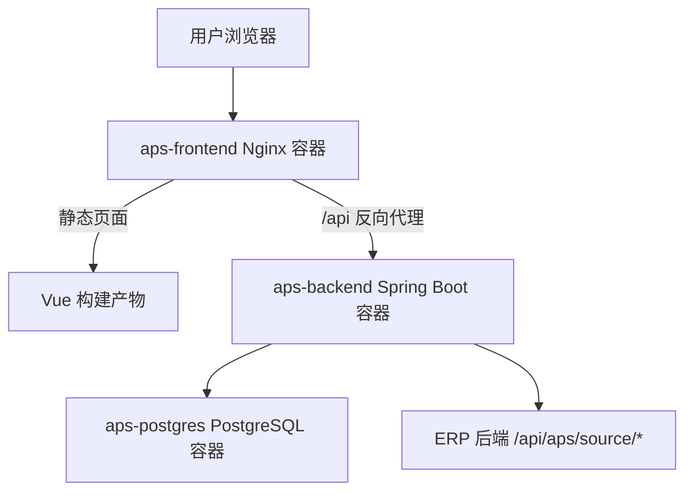
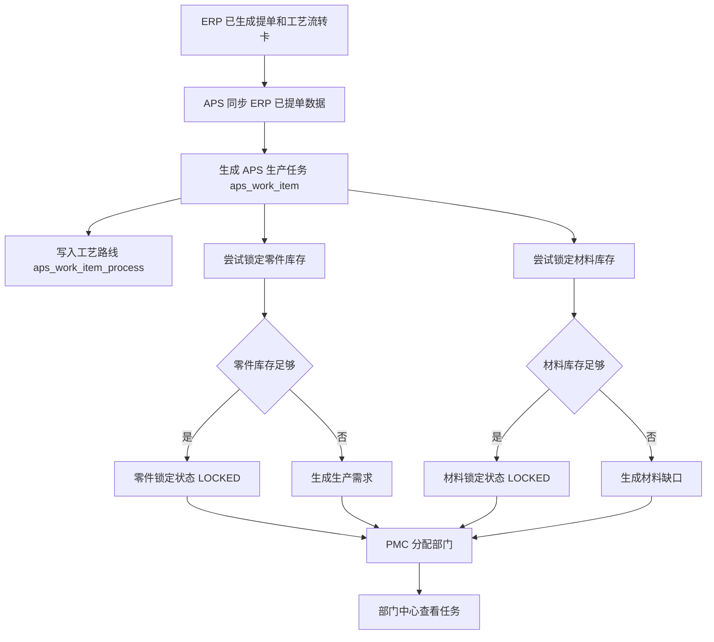

# APS 系统总览

编写日期：2026-06-13  
适用系统：生产准备与排产辅助 APS 系统  
前端工程：`D:\Code\aps-frontend`  
后端工程：`D:\Code\aps-system`  
部署入口：`D:\Code\docker-compose.aps.yml`  

本文用于交接 APS 系统整体情况，说明系统定位、技术架构、主要模块、数据来源、核心业务、部署方式和后续维护重点。

## 1. 系统定位

APS 是 ERP 报价和提单之后的生产准备系统。它不负责客户报价，也不直接替代 ERP 的订单主数据，而是从 ERP 读取已提单的生产数据，形成 APS 内部生产任务，并围绕生产准备做以下工作：

1. 同步 ERP 已提单零件和工艺路线。
2. 同步 ERP 工艺字典到 APS。
3. 根据零件库存自动锁定可用库存。
4. 根据材料库存自动锁定材料。
5. 对库存不足部分生成生产需求或材料缺口。
6. PMC 根据工时和部门产能分配任务。
7. 部门中心查看已分配任务和工艺明细。
8. 维护部门、机台和机台工艺能力。
9. 维护 APS 管理员账号。

当前 APS 只设置管理员角色，便于后续继续开发部门角色和更细权限。

## 2. 系统边界

| 事项 | ERP | APS |
| --- | --- | --- |
| 客户询价导入 | 负责 | 不负责 |
| 工程核价 | 负责 | 不负责 |
| 报价单导出 | 负责 | 不负责 |
| 客户确认和提单 | 负责 | 读取提单结果 |
| 工艺流转卡 | 负责生成 | 读取工艺路线快照 |
| 工艺字典 | 源数据 | 同步副本 |
| 生产任务 | 输出提单数据 | 形成 APS 任务 |
| 零件库存锁定 | 不负责 | 负责 |
| 材料库存锁定 | 不负责 | 负责 |
| 部门产能分配 | 不负责 | 负责 |
| 机台能力维护 | 不负责 | 负责 |

## 3. 当前技术栈

### 3.1 前端

| 项目 | 当前技术 |
| --- | --- |
| 框架 | Vue 3 |
| 路由 | Vue Router 4 |
| UI 组件库 | Element Plus |
| 图标 | `@element-plus/icons-vue` |
| 构建工具 | Vite |
| HTTP 请求 | 原生 `fetch` 封装在 `src\api.js` |
| 生产运行 | Nginx 容器 |

### 3.2 后端

| 项目 | 当前技术 |
| --- | --- |
| 语言 | Java 17 |
| 框架 | Spring Boot 3.5.14 |
| ORM | MyBatis-Plus 3.5.16 |
| 数据库 | PostgreSQL 15 |
| 数据库迁移 | Flyway |
| Excel 导出 | EasyExcel |
| 登录鉴权 | 自定义 JWT + BCrypt |
| 测试 | Spring Boot Test + Testcontainers PostgreSQL |
| 容器运行 | eclipse-temurin:17-jre |

## 4. 部署架构

当前 APS Docker Compose 使用三容器：



当前 Compose 服务：

| 服务 | 容器名 | 说明 |
| --- | --- | --- |
| `aps-postgres` | `aps-postgres` | APS PostgreSQL 数据库 |
| `aps-backend` | `aps-backend` | APS Spring Boot 后端 |
| `aps-frontend` | `aps-frontend` | APS 前端 Nginx |

当前默认对宿主机暴露：

| 服务 | 暴露方式 |
| --- | --- |
| 前端 | `127.0.0.1:8095 -> 80` |
| 后端 | 不映射宿主机端口，由前端容器通过 Docker 网络访问 |
| 数据库 | 不映射宿主机端口，由后端容器通过 Docker 网络访问 |

这比 ERP 当前本机部署更严格，后端和数据库默认不暴露到宿主机端口。

## 5. 访问入口

| 项目 | 地址 |
| --- | --- |
| 本机前端 | `http://127.0.0.1:8095` |
| 前端容器健康检查 | `http://127.0.0.1:8095/health` |
| 后端健康检查 | 容器内 `http://aps-backend:8091/api/health` |

正式部署时建议外层 Nginx 或网关提供 HTTPS：

```text
https://aps.企业域名
        |
外层 Nginx / 网关
        |
http://127.0.0.1:8095
        |
APS 前端容器
        |
Docker 内部 HTTP
```

## 6. 前端页面模块

当前前端菜单来自 `D:\Code\aps-frontend\src\App.vue`：

| 一级模块 | 子模块 | 路由 | 说明 |
| --- | --- | --- | --- |
| ERP 同步 | 无 | `/sync` | 从 ERP 同步已提单生产数据，查看同步结果和任务概览 |
| 分配中心 | 待分配 | `/assignment/pending` | PMC 查看待分配任务，按客户、材料、工艺排序并分配部门 |
| 分配中心 | 已分配 | `/assignment/assigned` | 查看已分配任务，释放分配 |
| 部门中心 | 无 | `/department-center` | 按部门查看任务和工艺明细 |
| 零件库存 | 零件库存维护 | `/part-inventory/manage` | 维护零件已入库、在产库存和在产单号 |
| 零件库存 | 零件锁定记录 | `/part-inventory/locks` | 查看、确认、释放零件库存锁定 |
| 零件库存 | 生产需求 | `/part-inventory/requirements` | 查看因零件库存不足生成的生产需求 |
| 材料库存 | 材料库存维护 | `/material-inventory/manage` | 维护材料库存、安全库存、单位和备注 |
| 材料库存 | 材料锁定记录 | `/material-inventory/locks` | 查看、确认、释放材料锁定 |
| 材料库存 | 材料缺口 | `/material-inventory/shortages` | 查看因材料不足生成的采购或补料需求 |
| 部门管理 | 无 | `/departments` | 维护生产部门、外协部门、月可用工时 |
| 工艺管理 | 无 | `/processes` | 从 ERP 同步工时工艺和非工时工艺 |
| 机台能力 | 无 | `/machines` | 维护部门下机台和机台可加工工艺 |
| 系统管理：用户权限 | 无 | `/users` | 维护 APS 管理员账号 |

## 7. 后端接口模块

| 控制器 | 接口前缀 | 说明 |
| --- | --- | --- |
| `ApsAuthController` | `/api/auth` | 登录、登出、当前用户、改密 |
| `ApsAdminController` | `/api/aps/admin` | APS 管理员账号维护 |
| `ApsSyncController` | `/api/aps` | ERP 提单数据同步、最近任务 |
| `ApsProcessController` | `/api/aps/processes` | APS 工艺列表和 ERP 工艺同步 |
| `ApsPmcController` | `/api/aps/pmc` | 部门、机台、能力、PMC 任务分配 |
| `ApsDepartmentCenterController` | `/api/aps/department-center` | 部门中心任务列表和详情 |
| `ApsInventoryController` | `/api/aps/inventory` | 零件库存、材料库存、锁定、缺口、生产需求 |
| `ApsHealthController` | `/api/health` | 后端健康检查 |

## 8. 数据来源

APS 主要数据来自两类：

1. ERP 同步数据。
2. APS 本地维护数据。

### 8.1 ERP 同步数据

| ERP 接口 | APS 用途 |
| --- | --- |
| `/api/aps/source/processes` | 同步 ERP 工艺字典到 APS 工艺管理 |
| `/api/aps/source/delivery-items` | 同步 ERP 已提单零件、工艺路线、材料、交期、图纸等 |

APS 访问 ERP 时使用：

| 变量 | 说明 |
| --- | --- |
| `APS_ERP_BASE_URL` | ERP 后端内网地址 |
| `APS_ERP_AUTH_TOKEN` | APS 访问 ERP 的 token，应与 ERP 的 `ERP_APS_SOURCE_TOKEN` 一致 |

### 8.2 APS 本地维护数据

| 数据 | 说明 |
| --- | --- |
| 零件库存 | 客户、图号、版本、已入库数量、在产数量、在产单号 |
| 材料库存 | 材料名称、材料类型、库存重量、安全库存 |
| 部门 | 生产部门、外协部门、月可用工时、占用工时 |
| 机台 | 机台编号、机台名称、所属部门、状态 |
| 机台能力 | 机台可加工的工艺 |
| 用户 | APS 管理员账号 |

## 9. 核心业务流程

APS 主流程如下：



## 10. 主要数据库表

| 表 | 说明 |
| --- | --- |
| `aps_erp_sync_run` | ERP 同步运行记录 |
| `aps_work_item` | APS 生产任务主表 |
| `aps_work_item_process` | 任务工艺路线 |
| `aps_part_inventory` | 零件库存汇总 |
| `aps_part_inventory_pending_stock` | 零件在产库存明细 |
| `aps_part_inventory_lock` | 零件库存锁定汇总 |
| `aps_part_inventory_lock_detail` | 零件库存锁定明细 |
| `aps_production_requirement` | 零件库存不足生成的生产需求 |
| `aps_material_inventory` | 材料库存 |
| `aps_material_lock` | 材料锁定记录 |
| `aps_material_shortage` | 材料缺口 |
| `aps_process` | APS 工艺字典 |
| `aps_department` | 部门 |
| `aps_department_assignment` | PMC 分配记录 |
| `aps_department_task` | 部门中心任务 |
| `aps_machine` | 机台 |
| `aps_machine_process_capability` | 机台工艺能力 |
| `aps_user` | APS 用户 |

## 11. 权限现状

当前 APS 已接入登录和 JWT 鉴权，但只开放 `ADMIN` 管理员角色。

| 项目 | 当前状态 |
| --- | --- |
| 登录 | 已实现 |
| JWT | 已实现 |
| 强制改密 | 已实现 |
| 用户管理 | 已实现 |
| 角色 | 当前只允许 `ADMIN` |
| 部门级权限 | 尚未细分 |
| 路由守卫 | 已实现 |
| 后端接口权限 | 使用 `@RequireRole({"ADMIN"})` |

默认初始化账号来自 Flyway 迁移：

| 账号 | 初始密码 | 说明 |
| --- | --- | --- |
| `admin` | `admin123` | 初始管理员，首次使用应修改密码 |

如果本机继承旧数据库卷，实际密码可能已经被修改，应以当前数据库为准。

## 12. 部署配置重点

APS 生产部署环境变量文件建议使用：

```text
D:\Code\aps.env
```

示例文件：

```text
D:\Code\aps.env.example
```

关键变量：

| 变量 | 说明 |
| --- | --- |
| `APS_POSTGRES_PASSWORD` | APS 数据库密码 |
| `APS_POSTGRES_VOLUME_NAME` | APS PostgreSQL 数据卷名，正式库建议独立命名 |
| `APS_JWT_SECRET` | APS JWT 强随机密钥 |
| `APS_ERP_BASE_URL` | ERP 后端内网地址 |
| `APS_ERP_AUTH_TOKEN` | ERP-APS 共享 token |
| `APS_FRONTEND_BIND` | 前端绑定地址，默认 `127.0.0.1` |
| `APS_FRONTEND_PORT` | 前端端口，默认 `8095` |
| `APS_CORS_ALLOWED_ORIGINS` | 允许访问后端的前端来源 |

## 13. 备份恢复现状

APS 已有独立备份恢复脚本：

| 脚本 | 用途 |
| --- | --- |
| `scripts\backup-aps.ps1` | 手动备份 APS PostgreSQL |
| `scripts\restore-aps.ps1` | 从指定备份恢复 APS 数据库 |
| `scripts\restore-drill-aps.ps1` | 启动临时 PostgreSQL 容器做恢复演练 |
| `scripts\install-aps-backup-task.ps1` | 安装 APS 每日自动备份任务 |
| `scripts\run-aps-backup-task.ps1` | 定时任务执行入口 |

APS 当前主要数据都在 PostgreSQL 中，没有像 ERP 那样的业务上传文件目录。因此 APS 备份重点是数据库 dump 和 `aps.env` 的安全保管。

## 14. 上线状态判断

按当前代码，APS 已具备以下上线基础：

1. 前后端分离。
2. Vue 3 + Vue Router + Element Plus 前端。
3. Spring Boot 后端。
4. PostgreSQL + Flyway。
5. Docker Compose 部署文件。
6. JWT 登录和管理员模块。
7. 与 ERP 的 token 同步接口。
8. 数据库备份、恢复、恢复演练脚本。
9. 容器健康检查、重启策略、日志限制、资源限制。
10. 后端和数据库端口默认不映射到宿主机。

正式上线前仍必须完成：

1. 用正式新库初始化 APS。
2. 设置强随机 `APS_POSTGRES_PASSWORD`。
3. 设置强随机 `APS_JWT_SECRET`。
4. 设置生产 ERP 内网地址 `APS_ERP_BASE_URL`。
5. 设置与 ERP 一致的 `APS_ERP_AUTH_TOKEN`。
6. 跑完整 APS 业务验收。
7. 做一次 APS 数据库备份和恢复演练。

## 15. 后续开发重点

建议后续开发优先级：

1. 从当前单管理员角色扩展为部门角色、PMC 角色、仓库角色。
2. 部门中心按登录用户过滤部门任务。
3. 机台能力与实际排程算法联动。
4. 生产需求闭环，例如转生产单、完成入库。
5. 材料缺口闭环，例如采购状态和到料入库。
6. APS 与 ERP 的同步差异处理和重同步策略。
7. 增加操作审计日志。

