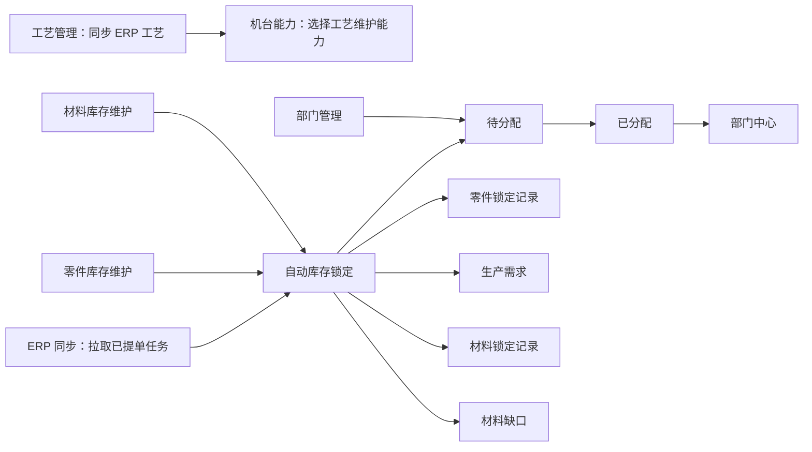

# APS 页面功能与输入输出说明

编写日期：2026-06-13  
适用系统：生产准备与排产辅助 APS 系统  
适用范围：APS 前端页面、输入输出、调用接口、业务规则、落库影响  

本文依据当前 APS 代码整理：

- 前端工程：`D:\Code\aps-frontend`
- 后端工程：`D:\Code\aps-system`
- 前端路由：`D:\Code\aps-frontend\src\router\index.js`
- 前端页面：`D:\Code\aps-frontend\src\views`
- 后端控制器：`D:\Code\aps-system\src\main\java\com\machining\apssystem\controller`

## 1. 页面总表

| 序号 | 页面 | 路由 | 前端组件 | 角色 | 主要用途 |
| --- | --- | --- | --- | --- | --- |
| 1 | 登录页 | `/login` | `LoginView.vue` | 未登录用户 | 登录 APS、进入系统 |
| 2 | ERP 同步 | `/sync` | `SyncView.vue` | 管理员 | 从 ERP 同步已提单生产数据，查看同步结果和任务概览 |
| 3 | 待分配 | `/assignment/pending` | `TasksView.vue` | 管理员 | 查看待分配生产任务，批量或单件分配部门 |
| 4 | 已分配 | `/assignment/assigned` | `AssignedTasksView.vue` | 管理员 | 查看已分配任务，查看详情，释放分配 |
| 5 | 部门中心 | `/department-center` | `DepartmentCenterView.vue` | 管理员 | 按部门查看当前任务和已释放任务 |
| 6 | 零件库存维护 | `/part-inventory/manage` | `PartInventoryView.vue` | 管理员 | 维护零件已入库、在产库存和在产单号 |
| 7 | 零件锁定记录 | `/part-inventory/locks` | `PartInventoryLocksView.vue` | 管理员 | 查看、确认、释放零件库存锁定 |
| 8 | 生产需求 | `/part-inventory/requirements` | `PartProductionRequirementsView.vue` | 管理员 | 查看零件库存不足生成的生产需求 |
| 9 | 材料库存维护 | `/material-inventory/manage` | `MaterialInventoryView.vue` | 管理员 | 维护材料库存、安全库存、单位和备注 |
| 10 | 材料锁定记录 | `/material-inventory/locks` | `MaterialLocksView.vue` | 管理员 | 查看、确认、释放材料库存锁定 |
| 11 | 材料缺口 | `/material-inventory/shortages` | `MaterialShortagesView.vue` | 管理员 | 查看材料库存不足生成的缺口 |
| 12 | 部门管理 | `/departments` | `DepartmentsView.vue` | 管理员 | 维护生产部门、外协部门和产能 |
| 13 | 工艺管理 | `/processes` | `ProcessesView.vue` | 管理员 | 从 ERP 同步工艺字典，查看工时/非工时工艺 |
| 14 | 机台能力 | `/machines` | `MachinesView.vue` | 管理员 | 维护机台和机台可加工工艺 |
| 15 | 系统管理：用户权限 | `/users` | `UsersView.vue` | 管理员 | 管理 APS 管理员账号 |

## 2. 通用规则

### 2.1 登录与权限

APS 使用 JWT 登录鉴权。前端将登录信息保存到浏览器本地：

| 存储项 | 说明 |
| --- | --- |
| `aps_token` | APS JWT |
| `aps_user` | 当前用户信息 |

当前只开放 `ADMIN` 角色。所有业务页面和后端接口均要求管理员登录。

### 2.2 API 调用

前端请求封装在：

```text
D:\Code\aps-frontend\src\api.js
```

所有请求会自动携带：

```text
Authorization: Bearer <aps_token>
```

异常处理：

| 状态 | 前端行为 |
| --- | --- |
| `401` | 清理登录状态并跳转登录页 |
| `428` | 标记当前用户需要修改密码 |
| 非 2xx 或 `success=false` | 抛出后端错误提示 |

### 2.3 API 根地址

前端 API 地址来自：

```text
D:\Code\aps-frontend\src\config.js
```

| 场景 | API 地址 |
| --- | --- |
| 本地开发未配置 | `http://localhost:8091` |
| Docker 生产构建 | 空字符串，使用同域 `/api` |

Docker 中前端 Nginx 会把 `/api/` 转发到：

```text
http://aps-backend:8091
```

### 2.4 数据展示通用组件

| 组件 | 用途 |
| --- | --- |
| `DataTable.vue` | 通用列表表格 |
| `TaskTable.vue` | APS 任务列表 |
| `ApsProcessTable.vue` | 工艺路线展示 |
| `ApsStatusTag.vue` | 状态标签 |
| `ApsPager.vue` | 分页 |

## 3. 登录页

| 项目 | 内容 |
| --- | --- |
| 路由 | `/login` |
| 组件 | `LoginView.vue` |
| 接口 | `POST /api/auth/login`、`GET /api/auth/me`、`POST /api/auth/change-password`、`POST /api/auth/logout` |

### 输入

| 输入项 | 必填 | 说明 |
| --- | --- | --- |
| 用户名 | 是 | APS 登录账号 |
| 密码 | 是 | APS 登录密码 |

### 输出

| 输出 | 说明 |
| --- | --- |
| 登录成功 | 保存 `aps_token` 和 `aps_user`，跳转原目标页或默认 `/sync` |
| 登录失败 | 显示后端错误 |
| 强制改密 | 首次登录或重置密码后要求修改密码 |

### 规则

1. 当前默认初始化账号为 `admin`。
2. 如果继承旧数据库卷，实际密码以旧库中已修改密码为准。
3. 新建用户或重置密码后，用户需要修改密码。

## 4. ERP 同步

| 项目 | 内容 |
| --- | --- |
| 路由 | `/sync` |
| 组件 | `SyncView.vue` |
| 接口 | `POST /api/aps/sync/erp-delivery-items`、`GET /api/aps/pmc/tasks/page`、`DELETE /api/aps/pmc/tasks` |

### 页面用途

ERP 同步页是 APS 的数据入口。管理员点击同步后，APS 从 ERP 拉取已提单生产数据，生成 APS 任务，并自动执行零件库存锁定、材料库存锁定、生产需求和材料缺口生成。

### 输入

| 输入 | 必填 | 说明 |
| --- | --- | --- |
| 同步按钮 | 是 | 触发 APS 拉取 ERP 已提单数据 |
| 任务选择 | 否 | 可选择同步后的任务进行删除 |
| 删除任务 | 条件 | 删除选中的 APS 任务，同时释放对应库存锁定和部门分配 |

### 输出

| 输出 | 说明 |
| --- | --- |
| 同步结果 | 本次接收数量、导入数量、跳过数量、生成需求数量、材料缺口数量 |
| 任务概览 | 待分配、已分配、零件需生产、材料缺口等统计 |
| 最近任务 | 同步后展示 APS 任务列表 |

### 后端处理

同步逻辑在 `ApsSyncService`：

1. 读取当前已同步最大 ERP 提单 ID。
2. 调用 ERP `/api/aps/source/delivery-items`。
3. 对每条 ERP 提单创建 `aps_work_item`。
4. 写入 `aps_work_item_process`。
5. 自动锁定零件库存。
6. 自动锁定材料库存。
7. 库存不足时生成 `aps_production_requirement` 和 `aps_material_shortage`。
8. 写入 `aps_erp_sync_run` 同步记录。

### 关键规则

1. ERP 同步以 ERP 提单 ID 去重，`aps_work_item.erp_ticket_id` 唯一。
2. 同步失败通常与 ERP 地址、ERP token、ERP 服务状态有关。
3. 删除 APS 任务会释放库存锁定和部门占用工时，是高风险操作。

## 5. 分配中心：待分配

| 项目 | 内容 |
| --- | --- |
| 路由 | `/assignment/pending` |
| 组件 | `TasksView.vue` |
| 接口 | `GET /api/aps/pmc/tasks/page`、`GET /api/aps/pmc/tasks/customers`、`GET /api/aps/pmc/tasks/{id}`、`POST /api/aps/pmc/tasks/assign-department`、`DELETE /api/aps/pmc/tasks` |

### 页面用途

待分配页用于 PMC 根据客户、材料、工艺路线、工时、库存状态查看任务，并将任务分配给生产部门或外协部门。

### 输入

| 输入项 | 必填 | 说明 |
| --- | --- | --- |
| 客户筛选 | 否 | 按客户过滤待分配任务 |
| 排序方式 | 否 | 默认排序、按材料排列、按工艺路线排列、按相同工艺数量 |
| 分页 | 否 | 页码和每页数量 |
| 任务选择 | 是 | 批量分配或删除时选择任务 |
| 部门 | 分配必填 | 选择目标生产或外协部门 |
| 分配人 | 否 | 记录分配操作人 |
| 备注 | 否 | 分配备注 |

### 输出

| 输出 | 说明 |
| --- | --- |
| 待分配任务表 | 展示任务、客户、图号、版本、需生产、交期、材料、工艺、工时、库存状态 |
| 任务详情 | 展示工艺路线、零件锁定、材料锁定、材料缺口、分配记录 |
| 分配结果 | 分配成功后任务转为已分配 |

### 分配规则

1. 目标部门必须启用。
2. 任务所需工时来自 `aps_work_item_process` 的工时汇总。
3. 部门剩余工时必须足够，否则后端拒绝分配。
4. 分配成功后写入 `aps_department_assignment` 和 `aps_department_task`。
5. 分配成功后更新 `aps_work_item.assignment_status`。

## 6. 分配中心：已分配

| 项目 | 内容 |
| --- | --- |
| 路由 | `/assignment/assigned` |
| 组件 | `AssignedTasksView.vue` |
| 接口 | `GET /api/aps/pmc/tasks/page?assignmentStatus=ASSIGNED`、`GET /api/aps/pmc/tasks/{id}`、`POST /api/aps/pmc/tasks/{id}/release-assignment` |

### 页面用途

已分配页用于查看已经分配到部门的任务，并在需要时释放分配。

### 输入

| 输入项 | 必填 | 说明 |
| --- | --- | --- |
| 分页 | 否 | 查看已分配任务 |
| 详情 | 否 | 查看任务详情 |
| 释放分配 | 条件 | 将任务从部门释放回待分配 |

### 输出

| 输出 | 说明 |
| --- | --- |
| 已分配任务列表 | 展示部门、客户、图号、版本、工时、库存状态 |
| 分配详情 | 展示工艺路线、库存锁定、分配记录 |
| 释放结果 | 部门占用工时归还，任务回到待分配状态 |

### 规则

1. 释放分配会释放 `aps_department_assignment` 当前活跃记录。
2. 已计入产能的工时会从部门 `occupied_hours` 扣回。
3. 库存锁定不会因为释放分配自动释放；释放分配只处理部门分配。

## 7. 部门中心

| 项目 | 内容 |
| --- | --- |
| 路由 | `/department-center` |
| 组件 | `DepartmentCenterView.vue` |
| 接口 | `GET /api/aps/department-center/tasks/page`、`GET /api/aps/department-center/tasks/{workItemId}`、`GET /api/aps/pmc/departments` |

### 页面用途

部门中心用于查看分配给部门的任务。当前因为 APS 只有管理员角色，所以管理员可查看全部部门任务。后续扩展部门角色后，可在此基础上按登录用户所属部门过滤。

### 输入

| 输入项 | 必填 | 说明 |
| --- | --- | --- |
| 部门筛选 | 否 | 选择部门查看任务 |
| 状态筛选 | 否 | 当前任务、已释放、全部 |
| 分页 | 否 | 页码和每页数量 |
| 详情 | 否 | 查看任务工艺、库存、分配记录 |

### 输出

| 输出 | 说明 |
| --- | --- |
| 部门任务列表 | 展示部门任务、客户、图号、版本、工时、交期、库存状态 |
| 零件详情 | 展示工艺路线、零件锁定、材料锁定、材料缺口、分配记录 |

### 规则

1. 当前任务来自 `aps_department_task.task_status=ACTIVE`。
2. 释放任务会保留历史记录，便于追溯。
3. 部门中心不负责修改库存或工艺，只负责查看。

## 8. 零件库存维护

| 项目 | 内容 |
| --- | --- |
| 路由 | `/part-inventory/manage` |
| 组件 | `PartInventoryView.vue` |
| 接口 | `GET /api/aps/inventory/parts/customers`、`GET /api/aps/inventory/parts/page`、`POST /api/aps/inventory/parts`、`PUT /api/aps/inventory/parts/{id}`、`GET /api/aps/inventory/parts/{id}/pending`、`POST /api/aps/inventory/parts/add-stock`、`POST /api/aps/inventory/parts/transfer-pending`、`POST /api/aps/inventory/parts/modify`、`DELETE /api/aps/inventory/parts/{id}` |

### 页面用途

维护零件库存，包括客户、图号、版本、已入库数量、在产数量、在产单号。APS 同步 ERP 任务时会按客户、图号、版本自动匹配库存并锁定。

### 输入

新增库存：

| 输入项 | 必填 | 说明 |
| --- | --- | --- |
| 客户 | 是 | 零件库存按客户隔离 |
| 图号 | 是 | 系统会转为大写 |
| 版本 | 否 | 系统会转为大写，空版本按空字符串 |
| 备注 | 否 | 库存备注 |

库存操作：

| 输入项 | 必填 | 说明 |
| --- | --- | --- |
| 新增类型 | 是 | 直接入库或新增在产 |
| 在产单号 | 新增在产时必填 | 记录在产库存来源 |
| 数量 | 是 | 必须为正整数 |
| 转入数量 | 转入库时必填 | 不能超过该在产单号可用数量 |
| 修改已入库库存 | 否 | 不能低于已锁定入库数量 |
| 修改在产库存 | 否 | 不能低于已锁定在产数量 |

### 输出

| 输出 | 说明 |
| --- | --- |
| 零件库存列表 | 图号、版本、已入库、在产、锁定、可用数量 |
| 在产单号明细 | 每个在产单号的在产数量、锁定数量、可用数量 |
| 操作结果 | 入库、在产新增、在产转入库、库存修改后的最新记录 |

### 规则

1. 同一客户、图号、版本只能有一条库存记录。
2. 已锁定库存不能被改到小于锁定数量。
3. 有锁定数量的库存不能删除。
4. 在产转入库会减少在产单号数量并增加已入库库存。

## 9. 零件锁定记录

| 项目 | 内容 |
| --- | --- |
| 路由 | `/part-inventory/locks` |
| 组件 | `PartInventoryLocksView.vue` |
| 接口 | `GET /api/aps/inventory/parts/locks`、`GET /api/aps/inventory/parts/locks/export`、`POST /api/aps/inventory/parts/locks/{id}/confirm`、`POST /api/aps/inventory/parts/locks/{id}/release` |

### 页面用途

查看 APS 同步任务时自动生成的零件库存锁定记录，并支持仓库确认或释放锁定。

### 输入

| 输入项 | 必填 | 说明 |
| --- | --- | --- |
| 客户筛选 | 否 | 按客户筛选锁定记录 |
| 确认锁定 | 条件 | 确认某条锁定明细已经实际占用 |
| 释放锁定 | 条件 | 释放某条锁定明细并生成或增加生产需求 |
| 导出 | 否 | 导出零件锁定记录 Excel |

### 输出

| 输出 | 说明 |
| --- | --- |
| 锁定记录 | 客户、图号、版本、需求数量、锁定入库、锁定在产、需生产数量、状态 |
| 锁定明细 | 区分入库锁定和在产单号锁定 |
| 导出文件 | Excel 锁定记录 |

### 状态

| 状态 | 含义 |
| --- | --- |
| `LOCKED` | 库存已完全满足 |
| `PARTIAL_LOCKED` | 部分库存满足，仍需生产 |
| `NEED_PRODUCTION` | 无可用库存，需要生产 |

### 规则

1. 释放锁定会归还零件库存锁定数量。
2. 释放在产锁定会同步释放在产单号锁定数量。
3. 释放后会增加生产需求，并更新任务零件库存状态。
4. 已处理的锁定明细不能重复确认或释放。

## 10. 生产需求

| 项目 | 内容 |
| --- | --- |
| 路由 | `/part-inventory/requirements` |
| 组件 | `PartProductionRequirementsView.vue` |
| 接口 | `GET /api/aps/inventory/parts/production-requirements` |

### 页面用途

展示因零件库存不足而生成的生产需求。生产需求用于提示哪些零件需要实际生产。

### 输入

| 输入项 | 必填 | 说明 |
| --- | --- | --- |
| 状态筛选 | 否 | 默认查看待生产需求 |
| 数量限制 | 否 | 后端限制最大返回数量 |

### 输出

| 输出 | 说明 |
| --- | --- |
| 生产需求列表 | 客户、图号、版本、需求数量、状态、来源任务 |

### 规则

1. 同步 ERP 任务时，如果零件库存不足，会自动生成生产需求。
2. 释放零件锁定时，也会把释放数量转为生产需求。
3. 当前页面只展示，不负责生产闭环状态流转。

## 11. 材料库存维护

| 项目 | 内容 |
| --- | --- |
| 路由 | `/material-inventory/manage` |
| 组件 | `MaterialInventoryView.vue` |
| 接口 | `GET /api/aps/inventory/materials`、`POST /api/aps/inventory/materials`、`PUT /api/aps/inventory/materials/{id}`、`DELETE /api/aps/inventory/materials/{id}` |

### 页面用途

维护材料库存。APS 同步 ERP 任务时，会根据任务材料名称、材料类型和材料需求重量自动匹配材料库存并锁定。

### 输入

| 输入项 | 必填 | 说明 |
| --- | --- | --- |
| 材料名称 | 是 | 与 ERP 同步来的材料名称匹配 |
| 材料类型 | 否 | 板材、棒材、管材等 |
| 库存 kg | 是 | 材料当前库存重量 |
| 安全库存 kg | 否 | 预警参考值 |
| 单位 | 否 | 默认 kg |
| 备注 | 否 | 说明 |

### 输出

| 输出 | 说明 |
| --- | --- |
| 材料库存列表 | 材料名称、类型、库存、锁定、可用、安全库存、单位 |

### 规则

1. 同一材料名称、材料类型只能有一条库存。
2. 库存重量不能小于已锁定重量。
3. 有锁定重量的材料库存不能删除。
4. 材料名称必须与 ERP 输出材料名称保持一致，否则无法自动锁定。

## 12. 材料锁定记录

| 项目 | 内容 |
| --- | --- |
| 路由 | `/material-inventory/locks` |
| 组件 | `MaterialLocksView.vue` |
| 接口 | `GET /api/aps/inventory/materials/locks`、`GET /api/aps/inventory/materials/locks/customers`、`POST /api/aps/inventory/materials/locks/{id}/confirm`、`POST /api/aps/inventory/materials/locks/{id}/release` |

### 页面用途

查看 APS 同步任务后自动产生的材料锁定，并支持确认或释放锁定。

### 输入

| 输入项 | 必填 | 说明 |
| --- | --- | --- |
| 客户筛选 | 否 | 按客户筛选材料锁定 |
| 确认锁定 | 条件 | 标记材料锁定已被仓库确认 |
| 释放锁定 | 条件 | 释放材料库存并转为材料缺口 |

### 输出

| 输出 | 说明 |
| --- | --- |
| 材料锁定列表 | 客户、图号、版本、材料、需求重量、锁定重量、缺口重量、状态 |

### 状态

| 状态 | 含义 |
| --- | --- |
| `LOCKED` | 材料库存满足 |
| `PARTIAL_LOCKED` | 部分材料满足，仍有缺口 |
| `SHORTAGE` | 材料无库存或不足 |

### 规则

1. 释放材料锁定会归还材料库存锁定重量。
2. 释放后会增加材料缺口。
3. 已确认或已释放的材料锁定不能重复处理。

## 13. 材料缺口

| 项目 | 内容 |
| --- | --- |
| 路由 | `/material-inventory/shortages` |
| 组件 | `MaterialShortagesView.vue` |
| 接口 | `GET /api/aps/inventory/materials/shortages` |

### 页面用途

展示材料库存不足产生的缺口，供采购或仓库后续补料。

### 输入

| 输入项 | 必填 | 说明 |
| --- | --- | --- |
| 状态筛选 | 否 | 默认查看待采购缺口 |
| 数量限制 | 否 | 后端限制最大返回数量 |

### 输出

| 输出 | 说明 |
| --- | --- |
| 材料缺口列表 | 项目号、客户、图号、版本、材料、材料类型、缺口重量、状态 |

### 规则

1. ERP 同步时材料不足会生成缺口。
2. 材料锁定释放时会增加缺口。
3. 当前页面只展示，不负责采购闭环。

## 14. 部门管理

| 项目 | 内容 |
| --- | --- |
| 路由 | `/departments` |
| 组件 | `DepartmentsView.vue` |
| 接口 | `GET /api/aps/pmc/departments`、`POST /api/aps/pmc/departments`、`PUT /api/aps/pmc/departments/{id}`、`POST /api/aps/pmc/departments/{id}/adjust-capacity`、`POST /api/aps/pmc/departments/{id}/reset-capacity`、`DELETE /api/aps/pmc/departments/{id}` |

### 页面用途

维护 APS 分配所需部门和部门产能。PMC 分配任务时会校验部门启用状态和剩余工时。

### 输入

| 输入项 | 必填 | 说明 |
| --- | --- | --- |
| 部门名称 | 是 | 唯一 |
| 部门类型 | 是 | `PRODUCTION` 生产部门或 `OUTSOURCE` 外协部门 |
| 状态 | 是 | `ENABLED` 启用或 `DISABLED` 停用 |
| 月可用工时 | 否 | 部门总产能 |
| 备注 | 否 | 说明 |
| 调整工时 | 条件 | 对月可用工时做增减调整 |
| 重置工时 | 条件 | 重置月可用工时并清空占用统计 |

### 输出

| 输出 | 说明 |
| --- | --- |
| 部门列表 | 部门类型、状态、月可用工时、占用工时、剩余工时 |

### 规则

1. 部门名称不能重复。
2. 月可用工时不能小于已占用工时。
3. 有活跃分配或占用工时的部门不能删除。
4. 停用部门不能接收新任务分配。

## 15. 工艺管理

| 项目 | 内容 |
| --- | --- |
| 路由 | `/processes` |
| 组件 | `ProcessesView.vue` |
| 接口 | `GET /api/aps/processes`、`POST /api/aps/processes/sync-from-erp` |

### 页面用途

维护 APS 本地工艺副本。当前 APS 不手工新增工艺，主要从 ERP 同步工时工艺和非工时工艺。

### 输入

| 输入项 | 必填 | 说明 |
| --- | --- | --- |
| 工艺类型 | 否 | `WORK_HOUR` 工时工艺、`NON_WORK_HOUR` 非工时工艺 |
| 同步按钮 | 是 | 从 ERP 拉取对应工艺 |

### 输出

| 输出 | 说明 |
| --- | --- |
| 工艺列表 | 工艺名称、类型、ERP 来源 ID、排序、同步时间 |
| 同步结果 | 接收数量、导入数量、工艺类型 |

### 规则

1. 工艺来源是 ERP `/api/aps/source/processes`。
2. 机台能力只能选择 APS 已同步的工艺。
3. ERP 工艺变更后，需要在 APS 点击同步。

## 16. 机台能力

| 项目 | 内容 |
| --- | --- |
| 路由 | `/machines` |
| 组件 | `MachinesView.vue` |
| 接口 | `GET /api/aps/pmc/departments`、`GET /api/aps/pmc/machines`、`POST /api/aps/pmc/machines`、`PUT /api/aps/pmc/machines/{id}`、`DELETE /api/aps/pmc/machines/{id}`、`GET /api/aps/pmc/machine-capabilities`、`POST /api/aps/pmc/machine-capabilities`、`DELETE /api/aps/pmc/machine-capabilities/{id}` |

### 页面用途

维护部门下的机台，以及每台机台可加工的工艺能力。当前主要是基础能力维护，尚未与自动排程算法深度联动。

### 输入

机台：

| 输入项 | 必填 | 说明 |
| --- | --- | --- |
| 部门 | 是 | 机台所属部门 |
| 机台编号 | 否 | 同一部门内编号唯一 |
| 机台名称 | 是 | 机台名称 |
| 状态 | 是 | 空闲、生产中、维修、停机 |
| 备注 | 否 | 说明 |

能力：

| 输入项 | 必填 | 说明 |
| --- | --- | --- |
| 工艺类型 | 是 | 工时或非工时 |
| 工艺 | 是 | 从已同步工艺中选择 |
| 备注 | 否 | 能力备注 |

### 输出

| 输出 | 说明 |
| --- | --- |
| 部门机台列表 | 机台编号、名称、状态、备注 |
| 能力列表 | 机台可加工工艺和类型 |

### 规则

1. 新增机台必须选择存在的部门。
2. 同部门机台编号不能重复。
3. 新增能力必须选择已同步到 APS 的工艺。
4. 同一机台不能重复添加相同工艺能力。

## 17. 系统管理：用户权限

| 项目 | 内容 |
| --- | --- |
| 路由 | `/users` |
| 组件 | `UsersView.vue` |
| 接口 | `GET /api/aps/admin/users`、`POST /api/aps/admin/users`、`PUT /api/aps/admin/users/{id}`、`DELETE /api/aps/admin/users/{id}` |

### 页面用途

维护 APS 管理员账号。当前只允许管理员角色，为后续继续扩展权限做基础。

### 输入

新增用户：

| 输入项 | 必填 | 说明 |
| --- | --- | --- |
| 账号 | 是 | 登录用户名，不能重复 |
| 显示名称 | 否 | 不填默认账号名 |
| 角色 | 固定 | 当前固定为管理员 |
| 状态 | 是 | 启用或禁用 |
| 初始密码 | 是 | 至少 8 位 |

编辑用户：

| 输入项 | 必填 | 说明 |
| --- | --- | --- |
| 显示名称 | 否 | 修改显示名 |
| 状态 | 是 | 启用或禁用 |
| 新密码 | 条件 | 管理员重置密码时填写，至少 8 位 |

### 输出

| 输出 | 说明 |
| --- | --- |
| 用户列表 | ID、账号、显示名称、角色、状态、安全状态、最近登录、创建时间 |
| 重置密码结果 | 用户下次登录需修改密码 |

### 规则

1. 当前角色只能是 `ADMIN`。
2. `admin` 初始账号不能删除。
3. 密码使用 BCrypt 存储。
4. 新增用户和重置密码后强制改密。

## 18. 页面间流转



## 19. 交接检查重点

1. 先同步 ERP 工艺，再维护机台能力。
2. 先维护零件和材料库存，再同步 ERP 提单，才能验证自动锁定效果。
3. 待分配任务分配部门时，会占用部门月可用工时。
4. 释放分配只释放部门工时，不释放库存锁定。
5. 删除 APS 任务会释放库存锁定和部门分配，是高风险操作。
6. 当前所有页面均为管理员使用，后续角色扩展时需要同时修改前端路由和后端 `@RequireRole`。

