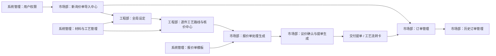

# ERP 页面功能与输入输出说明

编写日期：2026-06-13  
适用系统：机加工报价 ERP 系统  
适用范围：前端页面、页面输入输出、主要业务校验、调用接口、数据落库影响  

本文用于交接 ERP 系统前端页面功能，重点说明每个页面“做什么、谁能用、输入什么、输出什么、会影响哪些数据”。本文依据当前代码仓库整理：

- 前端工程：`D:\Code\quote-frontend`
- 后端工程：`D:\Code\quote-system`
- 前端路由：`D:\Code\quote-frontend\src\router\index.js`
- 前端页面组件：`D:\Code\quote-frontend\src\components`
- 后端接口控制器：`D:\Code\quote-system\src\main\java\com\machining\quote\controller`
- 后端业务服务：`D:\Code\quote-system\src\main\java\com\machining\quote\service`

## 1. 页面总表

| 序号 | 页面名称 | 前端路由 | 前端组件 | 主要角色 | 主要用途 |
| --- | --- | --- | --- | --- | --- |
| 1 | 登录页 | `/login` | `LoginView.vue` | 未登录用户 | 用户登录、首次登录改密入口 |
| 2 | 市场部：新询价单导入中心 | `/market` | `MarketDashboard.vue` | 市场部、管理员 | 导入客户询价 Excel 和图纸 PDF，生成 RFQ 与报价明细 |
| 3 | 市场部：报价单处理生成 | `/quote-process` | `QuoteProcess.vue` | 市场部、管理员 | 查看已报价订单，调整报价交期，导出报价单 |
| 4 | 市场部：议价确认与提单生成 | `/release` | `MarketRelease.vue` | 市场部、管理员 | 确认客户议价结果，生成交付提单和工艺流转卡 |
| 5 | 工程部：全局设定 | `/engineering` | `GlobalSetup.vue` | 工程部、管理员 | 选择待核价订单，设置整单默认材料、形态和默认工艺路线 |
| 6 | 工程部：逐件工艺路线与核价中心 | `/pricing` | `ItemPricing.vue` | 工程部、管理员 | 对单个零件核价、装配件核价、完成整单报价 |
| 7 | 工程部：材料与工艺管理 | `/material-process` | `MaterialProcessManage.vue` | 工程部、管理员 | 维护材料库、工艺单价、百分比费用、非工时费用工艺 |
| 8 | 市场部：订单管理 | `/orders` | `OrderManage.vue` | 市场部、管理员 | 查看当前订单、补充图纸、重置生产输出 |
| 9 | 市场部：历史订单管理 | `/history-orders` | `HistoryOrderManage.vue` | 市场部、管理员 | 查询历史订单，查看详情，删除已归档或测试订单 |
| 10 | 系统管理：用户权限 | `/users` | `UserManage.vue` | 管理员 | 新增用户、编辑用户、启停账号、重置密码 |
| 11 | 系统管理：报价单模板 | `/quote-template` | `QuoteTemplateManage.vue` | 管理员 | 上传和维护报价单 Excel 模板 |

## 2. 通用页面规则

### 2.1 登录与权限

ERP 前端使用 Vue Router 路由守卫控制页面访问权限。登录成功后，前端将登录状态保存到浏览器 `localStorage`：

| 存储项 | 含义 |
| --- | --- |
| `erp_token` | 后端签发的 JWT 访问令牌 |
| `erp_user` | 当前登录用户信息，包含用户名、显示名、角色等 |

路由角色规则如下：

| 角色 | 可访问页面 |
| --- | --- |
| `ADMIN` 管理员 | 可访问全部页面 |
| `MARKET` 市场部 | 可访问市场部相关页面，包括新单导入、报价单处理、议价提单、订单管理、历史订单管理 |
| `ENGINEER` 工程部 | 可访问工程部相关页面，包括全局设定、逐件核价、材料与工艺管理 |

后端也会二次校验权限，前端隐藏入口不等于接口无权限限制。交接时应重点保留后端权限校验。

### 2.2 接口访问规则

前端 API 根地址由 `VITE_API_BASE_URL` 控制：

| 场景 | API 地址 |
| --- | --- |
| 本地开发未显式配置 | `http://localhost:8080` |
| Docker / 生产部署建议 | `/api` 或外层反向代理地址 |

所有需要登录的接口都会携带：

```text
Authorization: Bearer <erp_token>
```

当后端返回 `401` 时，前端会清理本地登录状态并跳转登录页。  
当后端返回 `428` 时，表示当前账号需要强制修改密码。

### 2.3 日期、数量与金额规则

| 类型 | 当前系统规则 |
| --- | --- |
| 日期 | 页面通常使用 `yyyy-MM-dd`；交期字段可来自客户 Excel，也可由页面调整 |
| 数量 | 零件数量、通过数量、装配子件数量必须为正数 |
| 金额 | 材料费、工艺费、百分比费用由后端核价服务计算，前端展示计算结果 |
| 重量 | 材料毛重、零件净重单位为 kg，工程核价页输入后参与核价 |
| 导出文件 | 报价单、流转卡、提单通过后端接口生成 Excel 文件并下载 |

### 2.4 文件上传规则

| 文件类型 | 页面 | 规则 |
| --- | --- | --- |
| 客户询价表 Excel | 新询价单导入中心 | 用于生成 RFQ 和报价明细；字段标题必须能被后端 DTO 识别 |
| 图纸 PDF | 新询价单导入中心、订单管理补图 | 仅 PDF 参与图纸匹配；系统按文件名解析图号并绑定到对应零件 |
| 报价单模板 Excel | 报价单模板管理 | 模板第 8 行必须包含系统要求的表头 |

### 2.5 订单与零件状态

系统核心状态由后端服务维护，页面不应自行拼接或绕过状态更新。

常见订单状态：

| 状态 | 含义 |
| --- | --- |
| 待工程部评估 | 市场部已导入询价单，工程部尚未完成整单报价 |
| 已报价 | 工程部已完成整单报价，可进入市场报价处理和议价提单 |
| 部分已提单 | 订单中部分零件已经生成提单 |
| 已生成提单 | 订单内可提单零件已全部生成提单 |

常见零件状态：

| 状态 | 含义 |
| --- | --- |
| 待核价 | 零件尚未完成工程核价 |
| 已报价 | 零件已完成核价 |
| 已部分提单 | 零件已有部分数量被提单 |
| 已生成提单 | 零件已按可通过数量完成提单 |

## 3. 登录页

### 3.1 基本信息

| 项目 | 内容 |
| --- | --- |
| 页面名称 | 登录页 |
| 路由 | `/login` |
| 前端组件 | `LoginView.vue` |
| 后端接口 | `/api/auth/login`、`/api/auth/me`、`/api/auth/change-password`、`/api/auth/logout` |
| 可访问角色 | 未登录用户 |

### 3.2 页面用途

登录页用于 ERP 用户进入系统。系统支持管理员、市场部、工程部三类角色。登录后根据用户角色显示对应菜单，并由前后端共同限制页面和接口访问权限。

### 3.3 输入说明

| 输入项 | 必填 | 类型 | 说明 | 校验规则 |
| --- | --- | --- | --- | --- |
| 用户名 | 是 | 文本 | 登录账号，例如管理员或部门账号 | 不能为空 |
| 密码 | 是 | 密码文本 | 当前账号密码 | 不能为空 |
| 新密码 | 条件必填 | 密码文本 | 当账号被标记为必须改密时显示 | 后端要求密码长度至少 8 位 |
| 确认新密码 | 条件必填 | 密码文本 | 确认新密码 | 必须与新密码一致 |

### 3.4 输出说明

| 输出项 | 说明 |
| --- | --- |
| 登录成功 | 前端保存 `erp_token` 和 `erp_user`，跳转到目标页或默认首页 |
| 登录失败提示 | 显示账号、密码、锁定、停用等后端返回错误 |
| 强制改密提示 | 如果后端返回用户需要改密，页面要求先修改密码 |
| 退出登录 | 调用登出接口后清理本地登录状态 |

### 3.5 业务规则

1. 账号停用时不能登录。
2. 管理员可访问全部页面。
3. 非管理员只能访问自己角色允许的页面。
4. 新建用户或重置密码后，后端会将用户标记为需要修改密码。
5. 后端具备登录失败次数和账号锁定字段，交接后如继续完善安全策略，应优先沿用现有字段。

## 4. 市场部：新询价单导入中心

### 4.1 基本信息

| 项目 | 内容 |
| --- | --- |
| 页面名称 | 市场部：新询价单导入中心 |
| 路由 | `/market` |
| 前端组件 | `MarketDashboard.vue` |
| 后端接口 | `/api/market/import-rfq` |
| 可访问角色 | 市场部、管理员 |

### 4.2 页面用途

该页面是 ERP 报价流程入口。市场部收到客户询价资料后，在此页面填写客户信息，上传客户询价 Excel，并可同时上传图纸 PDF。提交后系统创建 RFQ 订单和零件报价明细，并自动尝试将 PDF 图纸绑定到零件。

### 4.3 输入说明

| 输入项 | 必填 | 类型 | 说明 | 规则 |
| --- | --- | --- | --- | --- |
| 客户名称 / 代码 | 是 | 文本 | 客户名称或客户识别代码 | 用于订单归属和后续客户筛选 |
| 客户询价表 | 是 | Excel 文件 | 客户提供的询价明细 | 后端按表头解析 |
| 图纸文件 | 否 | PDF 多文件 | 客户图纸，可一次选择多个 | 仅 PDF 参与自动匹配，非 PDF 不应作为正式图纸上传 |

客户询价表主要字段：

| Excel 表头 | 后端字段 | 说明 |
| --- | --- | --- |
| 图号 | `partNo` | 零件图号，是图纸匹配和历史重复识别的重要字段 |
| 物料描述 | `description` | 零件名称或说明 |
| 材料名称 | `materialName` | 客户提供材料名称，工程部可后续修正为工程材料 |
| 表面处理 | `surfaceTreatment` | 表面处理要求 |
| 版本 | `version` | 图纸版本，系统会做大写和去空格规范化 |
| 数量 | `qty` | 报价数量 |
| 单位 | `unit` | 数量单位 |
| 交货周期 | `leadTime` | 客户询价交期 |
| 备注 | `remark` | 客户备注 |

### 4.4 输出说明

| 输出项 | 说明 |
| --- | --- |
| RFQ 编号 | 后端自动生成，用于贯穿整单流程 |
| 导入成功提示 | 显示订单创建成功结果 |
| 图纸匹配结果 | 显示上传图纸数、已匹配数、缺失图纸数、未匹配图纸数等 |
| 缺失图纸清单 | 列出 Excel 中有零件但未找到对应 PDF 的图号 |
| 未匹配图纸清单 | 列出上传了 PDF 但未绑定到零件的文件 |

图纸匹配结果字段：

| 字段 | 含义 |
| --- | --- |
| `totalItemCount` | 本次导入零件总数 |
| `uploadedDrawingCount` | 上传 PDF 图纸总数 |
| `matchedItemCount` | 已成功绑定图纸的零件数 |
| `matchedDrawingCount` | 已被绑定的图纸文件数 |
| `missingDrawingCount` | 缺失图纸的零件数 |
| `unmatchedDrawingCount` | 未匹配到零件的图纸文件数 |
| `missingItems` | 缺失图纸的零件列表 |
| `unmatchedDrawings` | 未匹配图纸文件列表 |

### 4.5 落库影响

提交成功后主要写入：

| 表 | 写入内容 |
| --- | --- |
| `order_rfq` | 新订单主记录，初始状态通常为“待工程部评估” |
| `item_quote_version` | 零件报价明细，初始状态通常为“待核价” |
| 上传文件目录 | 保存询价 Excel 和图纸 PDF 文件 |

### 4.6 业务规则和注意事项

1. 客户名称是后续订单管理、历史订单查询和重复件识别的重要维度，录入时应保持统一。
2. Excel 表头和数据质量直接影响导入成功率，交接时应保留客户模板要求。
3. 图纸自动匹配依赖文件名中的图号解析，图纸命名不规范会导致未匹配。
4. 未匹配图纸不会阻塞订单创建，但会影响工程核价效率。
5. 导入后订单进入工程部评估流程，市场部不应直接修改工程核价数据。

## 5. 市场部：报价单处理生成

### 5.1 基本信息

| 项目 | 内容 |
| --- | --- |
| 页面名称 | 市场部：报价单处理生成 |
| 路由 | `/quote-process` |
| 前端组件 | `QuoteProcess.vue` |
| 后端接口 | `/api/market/quote-process/*`、`/api/market/export/*`、`/api/tasks/*` |
| 可访问角色 | 市场部、管理员 |

### 5.2 页面用途

该页面用于市场部处理工程部已完成报价的订单。市场部可以查看零件报价结果，调整报价交期，并导出不同格式的报价单。

### 5.3 输入说明

| 输入项 | 必填 | 类型 | 说明 | 规则 |
| --- | --- | --- | --- | --- |
| 订单选择 | 是 | 弹窗选择 | 选择需要处理的已报价订单 | 后端仅允许读取状态为“已报价”的订单 |
| 选中零件 | 条件必填 | 表格勾选 | 对部分零件批量调整交期时使用 | 批量调整必须选择零件 |
| 交期加减天数 | 条件必填 | 操作按钮 | 将选中零件报价交期整体提前或延后 | 调整天数不能为 0；负数表示提前 |
| 指定报价交期 | 条件必填 | 日期 | 将选中零件交期设置为指定日期 | 日期必须可被后端识别 |
| 单行报价交期 | 否 | 日期或文本 | 单个零件调整报价单交期 | 为空时可清除报价交期 |

### 5.4 输出说明

| 输出项 | 说明 |
| --- | --- |
| 订单基础信息 | 客户、RFQ 号、订单状态等 |
| 报价明细表 | 展示图号、版本、物料描述、数量、类型、含税单价、客户询价交期、报价交期等 |
| 导出报价单 | 下载后端生成的报价单文件 |
| 任务状态 | 大文件或耗时导出通过系统任务查询状态并下载 |

报价明细表主要字段：

| 字段 | 含义 |
| --- | --- |
| 图号 | 零件编号 |
| 版本 | 图纸版本 |
| 物料描述 | 零件描述 |
| 数量 | 报价数量 |
| 类型 | 普通件或装配件等 |
| 含税单价 | 工程核价后的最终单价 |
| 客户询价交期 | 客户原始询价交期 |
| 报价交期 | 工程或市场处理后的报价交期 |
| 报价单交期 | 最终写入报价单的交期字段 |
| 解析日期 | 系统解析交期得到的日期 |
| 自动调整 | 系统对交期进行换算或调整的结果 |

### 5.5 主要接口

| 接口 | 方法 | 用途 |
| --- | --- | --- |
| `/api/market/quote-process/{rfqId}` | GET | 读取已报价订单的报价处理数据 |
| `/api/market/quote-process/lead-time/shift` | POST | 批量按天数调整报价交期 |
| `/api/market/quote-process/lead-time/set` | POST | 批量设置报价交期 |
| `/api/market/quote-process/lead-time/update` | POST | 更新单个零件报价交期 |
| `/api/market/export/quote/{rfqId}` | GET | 导出标准报价单 |
| `/api/market/export/quote/simple/{rfqId}` | GET | 导出简版报价单 |
| `/api/market/export/quote/template/detail/{rfqId}` | GET | 按模板导出明细报价单 |
| `/api/market/export/quote/template/simple/{rfqId}` | GET | 按模板导出简版报价单 |
| `/api/market/export/quote/customer-lead-time/{rfqId}` | GET | 导出客户交期相关报价单 |

### 5.6 业务规则和注意事项

1. 该页面只处理工程部已经完成报价的订单。
2. 报价单金额来自工程核价结果，市场部页面不负责重新计算价格。
3. 交期调整会写回零件报价明细，影响后续导出的报价单。
4. 如果导出模板未上传或模板格式不符合要求，模板导出会失败，应到“报价单模板”页面维护模板。
5. 报价交期字段可为空，后端会按规则回退到客户询价交期或内部计算交期。

## 6. 市场部：议价确认与提单生成

### 6.1 基本信息

| 项目 | 内容 |
| --- | --- |
| 页面名称 | 市场部：议价确认与提单生成 |
| 路由 | `/release` |
| 前端组件 | `MarketRelease.vue` |
| 后端接口 | `/api/market/generate-ticket`、`/api/market/tickets/{rfqId}`、`/api/market/process-sheets/{rfqId}`、`/api/market/export/*` |
| 可访问角色 | 市场部、管理员 |

### 6.2 页面用途

该页面用于客户议价或确认下单后，市场部选择需要通过的零件数量，填写内部项目号、客户订单号、开工日期等信息，生成内部交付提单和生产工艺流转卡。

### 6.3 输入说明

| 输入项 | 必填 | 类型 | 说明 | 规则 |
| --- | --- | --- | --- | --- |
| 订单选择 | 是 | 弹窗选择 | 选择已报价或可提单订单 | 订单内零件必须已有报价结果 |
| RFQ 号 | 自动 | 文本 | 当前订单 RFQ 编号 | 页面只读 |
| 开工日期 | 否 | 日期 | 生产计划起始日期 | 为空时后端默认使用当前日期 |
| 安排类型 | 否 | 下拉 | 计划、加急、备货等 | 为空时后端默认“计划” |
| 内部目标交期 | 否 | 日期 | 内部生产交付目标 | 优先用于生产交付日期计算 |
| 内部项目号 | 是 | 文本 | 内部生产或项目识别号 | 后端要求必填，长度不超过 100 |
| 客户订单号 | 是 | 文本 | 客户正式订单号 | 后端要求必填，长度不超过 100 |
| 客户项目号 | 否 | 文本 | 客户项目识别号 | 长度不超过 100 |
| 通过数量 | 是 | 数字 | 本次客户确认通过的数量 | 必须大于 0，不能超过询价数量或剩余可提单数量 |
| 备注 | 否 | 文本 | 提单或生产备注 | 写入提单和流转卡相关字段 |

### 6.4 输出说明

| 输出项 | 说明 |
| --- | --- |
| 报价明细表 | 展示订单零件报价、交期、价格、当前状态 |
| 已生成提单列表 | 展示已生成的交付提单 |
| 已生成流转卡列表 | 展示已生成的工艺流转卡 |
| 导出提单 | 导出指定订单提单 Excel |
| 导出流转卡 | 导出指定订单工艺流转卡 Excel |
| 删除提单 / 流转卡 | 删除已生成的单据记录 |

提单表主要字段：

| 字段 | 含义 |
| --- | --- |
| 内部项目号 | 生产内部项目编号 |
| 类型 | 零件类型 |
| 图号 | 零件图号 |
| 版本 | 图纸版本 |
| 数量 | 本次提单数量 |
| 材料 | 工程确认材料 |
| 表面处理 | 表面处理要求 |
| 开工日期 | 计划开工日期 |
| 交付日期 | 根据交期规则计算的交付日期 |
| 安排类型 | 计划、加急、备货等 |
| 备注 | 单据备注 |

流转卡表主要字段：

| 字段 | 含义 |
| --- | --- |
| 内部项目号 | 生产内部项目编号 |
| 类型 | 零件类型 |
| 图号 | 零件图号 |
| 版本 | 图纸版本 |
| 名称 / 描述 | 零件描述 |
| 数量 | 生产数量 |
| 工程材料 | 工程部确认材料 |
| 材料毛重 | 核价时输入或计算的材料毛重 |
| 零件净重 | 核价时输入的零件净重 |
| 表面处理 | 表面处理要求 |
| 交付日期 | 生产交付日期 |
| 工艺路线 | 工程部核价时确认的工艺路线 |

### 6.5 主要接口

| 接口 | 方法 | 用途 |
| --- | --- | --- |
| `/api/market/generate-ticket` | POST | 生成提单和工艺流转卡 |
| `/api/market/tickets/{rfqId}` | GET | 查询订单提单列表 |
| `/api/market/process-sheets/{rfqId}` | GET | 查询订单工艺流转卡列表 |
| `/api/market/tickets/{ticketId}` | DELETE | 删除指定提单 |
| `/api/market/process-sheets/{sheetId}` | DELETE | 删除指定工艺流转卡 |
| `/api/market/export/tickets/{rfqId}` | GET | 导出提单 |
| `/api/market/export/process-sheets/{rfqId}` | GET | 导出工艺流转卡 |

### 6.6 落库影响

| 表 | 影响 |
| --- | --- |
| `order_delivery_ticket` | 新增或删除提单记录 |
| `order_process_sheet` | 新增或删除工艺流转卡记录 |
| `item_quote_version` | 刷新零件提单状态 |
| `order_rfq` | 刷新订单整体状态，如部分已提单、已生成提单 |

### 6.7 业务规则和注意事项

1. 零件必须已经完成工程报价，才允许生成提单。
2. 同一零件不能重复生成超过可通过数量的提单。
3. 后端会阻止同一零件重复生成完全冲突的提单。
4. 生成提单时会同步生成工艺流转卡，流转卡读取工程核价时确认的材料和工艺路线。
5. 删除提单或流转卡会影响生产输出数据，应由市场或管理员谨慎操作。
6. 内部目标交期优先级高于客户报价交期，适用于内部生产排期。

## 7. 工程部：全局设定

### 7.1 基本信息

| 项目 | 内容 |
| --- | --- |
| 页面名称 | 工程部：全局设定 |
| 路由 | `/engineering` |
| 前端组件 | `GlobalSetup.vue` |
| 后端接口 | `/api/engineer/pending-items`、`/api/engineer/order-config/{rfqId}`、`/api/engineer/repeat-analysis/{rfqId}`、`/api/dict/*` |
| 可访问角色 | 工程部、管理员 |

### 7.2 页面用途

工程部在进入逐件核价前，先在该页面选择待核价订单，查看订单零件和重复件识别结果，并为整单设置默认材料、默认毛坯形态、默认工艺路线等全局配置。

这些全局设定用于减少逐件核价时重复录入，但不替代每个零件的精确核价。进入逐件核价后，工程师仍可针对单个零件修改材料、尺寸、重量、工艺路线和费用。

### 7.3 输入说明

| 输入项 | 必填 | 类型 | 说明 | 规则 |
| --- | --- | --- | --- | --- |
| 订单选择 | 是 | 弹窗选择 | 选择待工程评估或待核价订单 | 进入页面流程的前提 |
| 默认材质 | 否 | 弹窗选择 | 从材料库选择默认材料 | 当前已改为弹出表格选择，适合材料增多后的检索 |
| 默认毛坯形态 | 否 | 下拉 | 板材 / 方块、圆棒材、管材 | 影响后续材料重量和材料单价选择 |
| 默认工艺路线 | 否 | 弹窗选择 / 列表 | 从工艺库选择多个默认工艺 | 当前已改为弹出表格选择，适合工艺增多后的检索 |
| 工艺输入值 | 否 | 数字 | 默认工艺的工时或费用输入值 | 工时类工艺按数量阶梯单价计算；非工时费用按输入值计入 |

### 7.4 输出说明

| 输出项 | 说明 |
| --- | --- |
| 订单零件列表 | 展示图号、版本、描述、数量、图纸、重复识别等 |
| 重复件分析结果 | 展示历史同图号、同版本、同客户等可复用报价信息 |
| 默认配置结果 | 保存后供逐件核价页面读取 |
| 跳转核价 | 进入 `/pricing` 页面进行逐件核价 |

零件列表常见字段：

| 字段 | 含义 |
| --- | --- |
| 图号 | 零件编号 |
| 版本 | 图纸版本 |
| 物料描述 | 客户询价描述 |
| 数量 | 报价数量 |
| 重复 | 是否识别到历史可参考报价 |
| 图纸 | 当前零件绑定的 PDF 图纸 |

### 7.5 主要接口

| 接口 | 方法 | 用途 |
| --- | --- | --- |
| `/api/engineer/pending-items` | GET | 查询工程部待处理订单或待核价零件 |
| `/api/engineer/order-config/{rfqId}` | POST | 保存订单级默认核价配置 |
| `/api/engineer/repeat-analysis/{rfqId}` | GET | 查询重复件和历史报价分析 |
| `/api/dict/materials` | GET | 查询材料库 |
| `/api/dict/processes` | GET | 查询工艺库 |
| `/api/dict/extra-fee-items` | GET | 查询启用的非工时费用项 |

### 7.6 落库影响

| 表 | 影响 |
| --- | --- |
| `order_rfq` | 保存订单级工程配置 JSON |
| `item_quote_version` | 读取当前订单零件，不在全局设定页直接完成核价 |

### 7.7 业务规则和注意事项

1. 全局默认值是辅助录入，不代表最终核价结果。
2. 工艺和材料选择使用弹出表格后，可通过搜索、分页、确认选择提高大量字典数据下的可用性。
3. 重复件分析只提供参考，是否复用仍由工程师确认。
4. 若默认工艺路线不适用于某些零件，应在逐件核价页面单独调整。

## 8. 工程部：逐件工艺路线与核价中心

### 8.1 基本信息

| 项目 | 内容 |
| --- | --- |
| 页面名称 | 工程部：逐件工艺路线与核价中心 |
| 路由 | `/pricing` |
| 前端组件 | `ItemPricing.vue` |
| 后端接口 | `/api/engineer/submit-quote`、`/api/engineer/complete-order/{rfqId}`、`/api/engineer/refresh-quotes/{rfqId}`、`/api/engineer/apply-repeat-quotes/{rfqId}`、`/api/dict/*` |
| 可访问角色 | 工程部、管理员 |

### 8.2 页面用途

该页面是 ERP 工程核价核心页面。工程师按零件逐个确认材料、重量、毛坯形态、工艺路线、工时或费用，并由后端计算材料成本、工艺成本、百分比加成、最终含税单价和合计金额。对装配件，系统支持选择子件并计算装配报价。

### 8.3 输入说明

#### 8.3.1 页面级输入

| 输入项 | 必填 | 类型 | 说明 | 规则 |
| --- | --- | --- | --- | --- |
| 当前 RFQ | 是 | 来源于全局设定或订单选择 | 当前核价订单 | 必须存在订单和零件明细 |
| 零件选择 | 是 | 表格操作 | 点击某行进入核价控制台 | 零件必须属于当前订单 |
| 一键刷新核价 | 否 | 按钮 | 对已报价零件按当前字典重新计算 | 适用于字典价格调整后刷新 |
| 完成整单报价 | 是 | 按钮 | 工程核价完成后提交整单状态 | 应在需要报价的零件都完成核价后执行 |

#### 8.3.2 普通零件核价输入

| 输入项 | 必填 | 类型 | 说明 | 规则 |
| --- | --- | --- | --- | --- |
| 核价类型 | 是 | 单选 | 普通件或装配件 | 普通零件选择普通核价 |
| 材质 | 是 | 弹出表格选择 | 工程确认材料 | 从材料库选择，避免自由文本导致价格无法匹配 |
| 毛坯形态 | 是 | 下拉 | 板材 / 方块、棒材、管材 | 决定取用材料库中对应形态的密度和单价 |
| 长、宽、厚 | 条件必填 | 数字 | 板材 / 方块尺寸 | 单位为米，用于计算毛坯体积 |
| 长度、外半径、内半径 | 条件必填 | 数字 | 棒材或管材尺寸 | 单位为米，用于计算毛坯体积 |
| 材料毛重 | 是 | 数字 | 材料下料重量 | 单位 kg，可由尺寸计算辅助得出 |
| 零件净重 | 否 | 数字 | 零件成品净重 | 单位 kg，写入流转卡 |
| 工艺路线 | 是 | 表格 | 选择工艺并输入工时或费用 | 至少应包含实际生产所需工艺 |
| 工艺输入值 | 是 | 数字 | 工时类为工时，非工时类为费用 | 工时类按数量阶梯单价计算 |

#### 8.3.3 装配件核价输入

| 输入项 | 必填 | 类型 | 说明 | 规则 |
| --- | --- | --- | --- | --- |
| 核价类型 | 是 | 单选 | 选择装配件核价 | 装配件价格由子件和装配费组成 |
| 子件选择 | 是 | 弹出选择 | 选择已经报价的子件 | 子件必须已有报价结果 |
| 子件用量 | 是 | 数字 | 每件父件所需子件数量 | 必须大于 0 |
| 装配费 | 否 | 数字 | 每件装配费用 | 可为 0，参与部分百分比费用计算 |

### 8.4 输出说明

| 输出项 | 说明 |
| --- | --- |
| 核算总成本 | 材料成本、工艺成本、费用加成计算后的成本 |
| 含税单价 | 最终对客户报价的单件价格 |
| 单项合计 | 含税单价乘以数量 |
| 状态 | 零件核价状态，如待核价、已报价 |
| 材料明细 | 保存材料、形态、尺寸、重量等 JSON 数据 |
| 工艺路线明细 | 保存工艺名称、输入值、工艺成本等 JSON 数据 |
| 费用明细 | 保存百分比费用和非工时费用结果 |

列表主要字段：

| 字段 | 含义 |
| --- | --- |
| 图号 | 零件编号 |
| 版本 | 图纸版本 |
| 名称 / 描述 | 零件描述 |
| 数量 | 报价数量 |
| 类型 | 普通件或装配件 |
| 材料毛重 | 当前核价材料重量 |
| 零件净重 | 工程输入的净重 |
| 重复 | 是否存在历史可复用报价 |
| 图纸 | 零件 PDF 图纸 |
| 核算总成本 | 后端计算成本 |
| 含税单价 | 后端计算最终单价 |
| 单项合计 | 后端计算总价 |
| 状态 | 核价状态 |

### 8.5 主要接口

| 接口 | 方法 | 用途 |
| --- | --- | --- |
| `/api/engineer/submit-quote` | POST | 提交单个零件核价 |
| `/api/engineer/complete-order/{rfqId}` | POST | 完成整单报价 |
| `/api/engineer/refresh-quotes/{rfqId}` | POST | 按当前字典刷新已报价零件价格 |
| `/api/engineer/apply-repeat-quotes/{rfqId}` | POST | 应用重复件历史报价配置 |
| `/api/engineer/assembly-relations/{parentItemId}` | GET | 查询装配父子件关系 |
| `/api/dict/materials` | GET | 查询材料库 |
| `/api/dict/processes` | GET | 查询工艺库 |
| `/api/dict/markup-fees` | GET | 查询百分比费用 |
| `/api/dict/extra-fee-items` | GET | 查询非工时费用工艺 |

### 8.6 后端计算规则

普通零件核价：

| 成本项 | 计算来源 |
| --- | --- |
| 材料成本 | 根据工程材料、毛坯形态、材料毛重、材料库单价计算 |
| 工时类工艺成本 | 根据工艺输入值和数量阶梯单价计算 |
| 非工时费用 | 根据输入金额直接计入工艺或费用成本 |
| 百分比费用 | 根据启用的费用项，对基础成本按百分比加成 |
| 最终单价 | 基础成本加费用加成 |
| 最终合计 | 最终单价乘以报价数量 |

装配件核价：

| 成本项 | 计算来源 |
| --- | --- |
| 子件成本 | 已报价子件单价乘以每件父件用量 |
| 装配费 | 工程师输入的装配费 |
| 装配费加成 | 对装配费应用部分百分比费用规则 |
| 最终单价 | 子件成本合计加装配费和装配费加成 |

### 8.7 落库影响

| 表 | 影响 |
| --- | --- |
| `item_quote_version` | 更新材料、工艺、费用、成本、单价、总价、状态 |
| `item_assembly_relation` | 保存装配父子件关系 |
| `order_rfq` | 完成整单报价时更新订单状态为“已报价” |
| `system_task` | 一键刷新或导出类任务可能写入任务记录 |

### 8.8 业务规则和注意事项

1. 工程材料必须能匹配材料库，否则材料成本无法正确计算。
2. 工艺名称必须能匹配工艺库或非工时费用项，否则对应费用无法按规则计算。
3. 完成整单报价前，应确认所有需要报价的零件都已有含税单价。
4. 装配件子件必须先完成报价，否则装配件无法形成可靠价格。
5. 字典价格调整后，历史已报价数据不会自动变化，需要使用刷新核价功能。
6. 页面展示金额应以后端返回值为准，前端不应自行重算作为最终价格。

## 9. 工程部：材料与工艺管理

### 9.1 基本信息

| 项目 | 内容 |
| --- | --- |
| 页面名称 | 工程部：材料与工艺管理 |
| 路由 | `/material-process` |
| 前端组件 | `MaterialProcessManage.vue` |
| 后端接口 | `/api/dict/materials`、`/api/dict/processes`、`/api/dict/markup-fees`、`/api/dict/extra-fee-items` |
| 可访问角色 | 工程部、管理员 |

### 9.2 页面用途

该页面维护工程核价所需的基础字典，包括材料、工时类工艺单价、百分比费用、非工时费用工艺。核价页的材料选择、工艺选择和价格计算都依赖这些字典。

### 9.3 功能页签

| 页签 | 说明 |
| --- | --- |
| 材料费用 | 维护材料名称、材料类型、不同形态密度和单价 |
| 工艺费用 | 维护工时类工艺名称、排序、数量阶梯单价 |
| 百分比费用类 | 维护管理费、利润、税费等按百分比加成的费用项 |
| 非工时费用工艺 | 维护表面处理、热处理、运输等直接费用项 |

### 9.4 材料费用输入输出

输入项：

| 输入项 | 必填 | 类型 | 说明 |
| --- | --- | --- | --- |
| 材料名称 | 是 | 文本 | 工程核价选择的材料名称，必须唯一或至少保持业务上不混淆 |
| 材料类型 | 否 | 文本 / 选择 | 材料分类 |
| 备注 | 否 | 文本 | 材料说明 |
| 板材密度 | 否 | 数字 | 板材密度 |
| 板材价格 | 否 | 数字 | 板材单价 |
| 棒材密度 | 否 | 数字 | 棒材密度 |
| 棒材价格 | 否 | 数字 | 棒材单价 |
| 管材密度 | 否 | 数字 | 管材密度 |
| 管材价格 | 否 | 数字 | 管材单价 |

输出项：

| 输出项 | 说明 |
| --- | --- |
| 材料列表 | 展示所有材料记录 |
| 编辑结果 | 修改后立即影响后续新核价或刷新核价 |
| 删除结果 | 删除后核价页不能再选择该材料 |

后端规则：

1. 材料名称必填。
2. 备注为空时按空字符串保存。
3. 通用密度可从板材、棒材、管材密度中取第一个非空值补齐。
4. 材料价格变化不会自动更新已报价订单，需通过刷新核价触发重算。

### 9.5 工艺费用输入输出

输入项：

| 输入项 | 必填 | 类型 | 说明 |
| --- | --- | --- | --- |
| 排序号 | 否 | 数字 | 工艺展示排序 |
| 工艺名称 | 是 | 文本 | 核价页选择的工艺名称 |
| 计算类型 | 系统固定 | 文本 | 当前后端按工时类处理 |
| 1-5 件单价 | 否 | 数字 | 数量阶梯工时单价 |
| 5-10 件单价 | 否 | 数字 | 数量阶梯工时单价 |
| 10-50 件单价 | 否 | 数字 | 数量阶梯工时单价 |
| 50-100 件单价 | 否 | 数字 | 数量阶梯工时单价 |
| 100-500 件单价 | 否 | 数字 | 数量阶梯工时单价 |
| 500-1000 件单价 | 否 | 数字 | 数量阶梯工时单价 |
| 1000-3000 件单价 | 否 | 数字 | 数量阶梯工时单价 |
| 3000 件以上单价 | 否 | 数字 | 数量阶梯工时单价 |

输出项：

| 输出项 | 说明 |
| --- | --- |
| 工艺列表 | 展示工艺名称、排序和各数量区间单价 |
| 核价页工艺选择 | 该列表作为核价页弹出选择来源 |
| 成本计算结果 | 核价时按数量落入对应阶梯单价 |

后端规则：

1. 工艺名称必填。
2. 当前后端将计算类型固定为“工时”。
3. 排序号为空时默认为 0。
4. 阶梯单价为空时，该区间可能无法形成有效工艺成本，交接后应由业务统一维护。

### 9.6 百分比费用类输入输出

输入项：

| 输入项 | 必填 | 类型 | 说明 |
| --- | --- | --- | --- |
| 排序号 | 否 | 数字 | 展示和计算顺序 |
| 费用名称 | 是 | 文本 | 费用项名称 |
| 百分比 | 否 | 数字 | 加成比例 |
| 启用 | 否 | 布尔 | 是否参与核价 |

输出项：

| 输出项 | 说明 |
| --- | --- |
| 百分比费用列表 | 展示所有百分比费用 |
| 核价加成结果 | 启用费用参与后端核价 |

后端规则：

1. 费用名称必填。
2. 百分比为空时默认为 0。
3. 排序为空时默认为 0。
4. 启用为空时默认启用。

### 9.7 非工时费用工艺输入输出

输入项：

| 输入项 | 必填 | 类型 | 说明 |
| --- | --- | --- | --- |
| 排序号 | 否 | 数字 | 展示排序 |
| 费用名称 | 是 | 文本 | 核价页可选择的非工时费用名称 |
| 备注 | 否 | 文本 | 费用说明 |
| 启用 | 否 | 布尔 | 是否在核价页展示 |

输出项：

| 输出项 | 说明 |
| --- | --- |
| 非工时费用列表 | 展示所有非工时费用项 |
| 核价页费用选择 | 启用项出现在核价页或全局设定页选择列表 |

后端规则：

1. 费用名称必填。
2. 排序为空时默认为 0。
3. 启用为空时默认启用。
4. 备注为空时按空字符串保存。

### 9.8 主要接口

| 接口 | 方法 | 用途 |
| --- | --- | --- |
| `/api/dict/materials` | GET / POST | 查询、新增材料 |
| `/api/dict/materials/{id}` | PUT / DELETE | 编辑、删除材料 |
| `/api/dict/processes` | GET / POST | 查询、新增工艺 |
| `/api/dict/processes/{id}` | PUT / DELETE | 编辑、删除工艺 |
| `/api/dict/markup-fees` | GET / POST | 查询、新增百分比费用 |
| `/api/dict/markup-fees/{id}` | PUT / DELETE | 编辑、删除百分比费用 |
| `/api/dict/extra-fee-items` | GET / POST | 查询启用项、新增非工时费用 |
| `/api/dict/extra-fee-items/all` | GET | 查询全部非工时费用 |
| `/api/dict/extra-fee-items/{id}` | PUT / DELETE | 编辑、删除非工时费用 |

### 9.9 落库影响

| 表 | 影响 |
| --- | --- |
| `dict_material` | 材料字典增删改查 |
| `dict_process` | 工时类工艺字典增删改查 |
| `dict_markup_fee` | 百分比费用字典增删改查 |
| `dict_extra_fee_item` | 非工时费用项增删改查 |

### 9.10 业务规则和注意事项

1. 该页面是工程核价基础，不应随意删除已经用于历史报价的材料或工艺名称。
2. 如需调整价格，建议修改单价后对未最终确认订单重新核价或刷新核价。
3. 字典名称应保持稳定，避免历史报价 JSON 中的名称无法追溯。
4. 大量材料和工艺上线后，应优先使用弹出表格搜索选择，不建议恢复为普通下拉框。

## 10. 市场部：订单管理

### 10.1 基本信息

| 项目 | 内容 |
| --- | --- |
| 页面名称 | 市场部：订单管理 |
| 路由 | `/orders` |
| 前端组件 | `OrderManage.vue` |
| 后端接口 | `/api/order-management/*` |
| 可访问角色 | 市场部、管理员 |

### 10.2 页面用途

该页面用于市场部查看当前订单列表、查看订单详情、补充缺失图纸、重置生产输出。它面向日常订单跟踪，不是历史清理页面。

### 10.3 输入说明

| 输入项 | 必填 | 类型 | 说明 | 规则 |
| --- | --- | --- | --- | --- |
| 客户筛选 | 否 | 下拉 | 按客户查询订单 | 客户来自后端客户列表 |
| 关键字 | 否 | 文本 | 按 RFQ 号或状态模糊查询 | 支持部分匹配 |
| 页码 | 否 | 数字 | 分页查询 | 默认第 1 页 |
| 每页数量 | 否 | 数字 | 分页大小 | 后端最大 100 |
| 补充图纸 | 条件必填 | PDF 多文件 | 为缺失图纸订单补图 | 后端只处理 PDF |
| 重置生产输出 | 否 | 操作按钮 | 删除已生成提单和流转卡，回退生产状态 | 高风险操作 |

### 10.4 输出说明

订单列表字段：

| 字段 | 含义 |
| --- | --- |
| RFQ 号 | 订单编号 |
| 状态 | 当前订单状态 |
| 零件数 | 订单零件数量 |
| 已报价数 | 已完成报价零件数量 |
| 缺失图纸数 | 未绑定图纸的零件数量 |
| 提单数 | 已生成提单数量 |
| 流转卡数 | 已生成工艺流转卡数量 |
| 创建时间 | 订单创建时间 |
| 操作 | 查看详情、重置生产输出等 |

详情抽屉输出：

| 区域 | 内容 |
| --- | --- |
| 订单信息 | RFQ、状态、客户、文件目录等 |
| 缺失图纸提示 | 当前仍未绑定图纸的零件 |
| 补图结果 | 已绑定、已存在、未匹配、非 PDF 跳过等结果 |
| 零件明细 | 订单所有零件、报价、图纸、状态 |
| 提单列表 | 订单已生成提单 |
| 流转卡列表 | 订单已生成工艺流转卡 |

补图结果：

| 分类 | 含义 |
| --- | --- |
| 已绑定 | 新上传 PDF 成功匹配并绑定到零件 |
| 已存在 | 零件已经有图纸，系统不覆盖 |
| 未匹配 | PDF 文件名未能解析到订单零件 |
| 非 PDF 跳过 | 上传文件不是 PDF，不参与处理 |

### 10.5 主要接口

| 接口 | 方法 | 用途 |
| --- | --- | --- |
| `/api/order-management/orders` | GET | 分页查询订单 |
| `/api/order-management/orders/{rfqId}` | GET | 查询订单详情 |
| `/api/order-management/customers` | GET | 查询客户列表 |
| `/api/order-management/orders/{rfqId}/supplement-drawings` | POST | 补充图纸 |
| `/api/order-management/orders/{rfqId}/reset-production` | POST | 重置生产输出 |

### 10.6 落库影响

| 操作 | 影响 |
| --- | --- |
| 查询订单 | 不修改数据 |
| 补充图纸 | 更新 `item_quote_version.drawingUrl`，保存 PDF 文件 |
| 重置生产输出 | 删除订单提单和流转卡，刷新订单与零件状态 |

### 10.7 业务规则和注意事项

1. 补充图纸不会覆盖已经绑定的图纸。
2. 重置生产输出会删除生产单据，需确认没有真实生产依赖后再操作。
3. 分页大小后端最大 100，前端不应无限拉取。
4. 客户筛选依赖导入时录入的客户名称一致性。

## 11. 市场部：历史订单管理

### 11.1 基本信息

| 项目 | 内容 |
| --- | --- |
| 页面名称 | 市场部：历史订单管理 |
| 路由 | `/history-orders` |
| 前端组件 | `HistoryOrderManage.vue` |
| 后端接口 | `/api/order-management/*` |
| 可访问角色 | 市场部、管理员 |

### 11.2 页面用途

历史订单管理用于查询已完成、已提单或历史保留订单。该页面与订单管理共享一部分后端接口，但更侧重历史查看和订单清理。

### 11.3 输入说明

| 输入项 | 必填 | 类型 | 说明 |
| --- | --- | --- | --- |
| 客户筛选 | 否 | 下拉 | 按客户查询历史订单 |
| 关键字 | 否 | 文本 | 按 RFQ 或状态查询 |
| 查看订单 | 否 | 操作 | 打开订单详情 |
| 彻底删除 | 条件可用 | 操作 | 删除订单及关联数据，页面按权限和状态控制显示 |

### 11.4 输出说明

| 输出项 | 说明 |
| --- | --- |
| 历史订单列表 | 展示 RFQ、客户、状态、零件数、创建时间等 |
| 订单详情 | 展示历史订单的零件、提单、流转卡、文件信息 |
| 删除结果 | 删除成功后列表刷新 |

### 11.5 主要接口

| 接口 | 方法 | 用途 |
| --- | --- | --- |
| `/api/order-management/orders` | GET | 查询订单列表 |
| `/api/order-management/orders/{rfqId}` | GET | 查询订单详情 |
| `/api/order-management/orders/{rfqId}?deleteFiles=true` | DELETE | 删除订单及可选文件 |
| `/api/order-management/customers` | GET | 查询客户列表 |

### 11.6 落库影响

删除订单时后端会删除或影响：

| 数据 | 说明 |
| --- | --- |
| 工艺流转卡 | 删除订单关联流转卡 |
| 交付提单 | 删除订单关联提单 |
| 零件报价明细 | 删除订单下全部零件 |
| 订单主表 | 删除 RFQ 主记录 |
| 文件目录 | 当 `deleteFiles=true` 时删除订单文件 |

### 11.7 业务规则和注意事项

1. 删除订单是不可逆高风险操作，应仅用于测试订单或业务确认可删除的历史订单。
2. 如果生产部门已经依据提单或流转卡开展生产，不应删除订单。
3. 删除文件后无法通过系统恢复图纸和导入 Excel，需依赖备份。

## 12. 系统管理：用户权限

### 12.1 基本信息

| 项目 | 内容 |
| --- | --- |
| 页面名称 | 系统管理：用户权限 |
| 路由 | `/users` |
| 前端组件 | `UserManage.vue` |
| 后端接口 | `/api/admin/users` |
| 可访问角色 | 管理员 |

### 12.2 页面用途

该页面用于管理员维护 ERP 用户账号。系统当前支持管理员、市场部、工程部三类角色，并可启停账号、重置密码、删除非保护账号。

### 12.3 输入说明

新增用户：

| 输入项 | 必填 | 类型 | 说明 | 规则 |
| --- | --- | --- | --- | --- |
| 用户名 | 是 | 文本 | 登录账号 | 不应重复 |
| 显示名 | 否 | 文本 | 页面显示名称 | 可为空 |
| 角色 | 是 | 下拉 | ADMIN、MARKET、ENGINEER | 决定页面和接口权限 |
| 是否启用 | 否 | 布尔 | 是否允许登录 | 默认启用 |
| 初始密码 | 是 | 密码文本 | 新账号初始密码 | 后端要求至少 8 位 |

编辑用户：

| 输入项 | 必填 | 类型 | 说明 |
| --- | --- | --- | --- |
| 显示名 | 否 | 文本 | 修改用户显示名 |
| 角色 | 是 | 下拉 | 修改用户角色 |
| 是否启用 | 否 | 布尔 | 启用或停用账号 |

重置密码：

| 输入项 | 必填 | 类型 | 说明 |
| --- | --- | --- | --- |
| 新密码 | 是 | 密码文本 | 管理员为用户设置新密码 |

### 12.4 输出说明

用户列表字段：

| 字段 | 含义 |
| --- | --- |
| ID | 用户主键 |
| 用户名 | 登录账号 |
| 显示名 | 用户显示名称 |
| 角色 | ADMIN、MARKET、ENGINEER |
| 状态 | 启用或停用 |
| 安全状态 | 是否要求首次或下次登录改密 |
| 最近登录时间 | 用户最后登录时间 |
| 创建时间 | 用户创建时间 |
| 操作 | 编辑、重置密码、启停、删除 |

### 12.5 主要接口

| 接口 | 方法 | 用途 |
| --- | --- | --- |
| `/api/admin/users` | GET | 查询用户列表 |
| `/api/admin/users` | POST | 新增用户 |
| `/api/admin/users/{id}` | PUT | 编辑用户；请求体带 `password` 时同时用于管理员重置该用户密码 |
| `/api/admin/users/{id}` | DELETE | 删除用户 |
| `/api/admin/users/me/password` | PUT | 当前用户修改密码 |

### 12.6 落库影响

| 表 | 影响 |
| --- | --- |
| `erp_user` | 用户账号、密码哈希、角色、启停、强制改密状态等 |
| `audit_log` | 如后续启用审计，可记录用户管理操作 |

### 12.7 业务规则和注意事项

1. 密码使用哈希存储，不能明文保存。
2. 新建用户和重置密码后，应要求用户下次登录修改密码。
3. `admin`、`market`、`engineer` 等保护账号不应随意删除。
4. 管理员拥有全部权限，应严格控制管理员数量。
5. 离职或岗位变更用户应优先停用，不建议直接删除历史相关账号。

## 13. 系统管理：报价单模板

### 13.1 基本信息

| 项目 | 内容 |
| --- | --- |
| 页面名称 | 系统管理：报价单模板 |
| 路由 | `/quote-template` |
| 前端组件 | `QuoteTemplateManage.vue` |
| 后端接口 | `/api/admin/quote-template` |
| 可访问角色 | 管理员 |

### 13.2 页面用途

该页面用于维护报价单 Excel 模板。市场部导出模板报价单时，后端会读取这里上传的模板，并将报价明细写入模板中。

### 13.3 输入说明

| 输入项 | 必填 | 类型 | 说明 | 规则 |
| --- | --- | --- | --- | --- |
| 报价单模板 | 是 | Excel 文件 | 用于模板报价单导出 | 模板第 8 行必须包含指定表头 |

模板第 8 行必须包含以下表头：

| 表头 |
| --- |
| 序号 |
| 图号 |
| 物料描述 |
| 图纸状态 |
| 材料名称 |
| 表面处理 |
| 版本 |
| 数量 |
| 单位 |
| 含税单价 |
| 含税总价 |
| 交货周期 |
| 备注 |

### 13.4 输出说明

| 输出项 | 说明 |
| --- | --- |
| 当前模板状态 | 显示是否已上传模板 |
| 文件名 | 当前模板文件名称 |
| 更新时间 | 模板最近更新时间 |
| 文件大小 | 模板文件大小 |
| 上传结果 | 成功或失败提示 |

### 13.5 主要接口

| 接口 | 方法 | 用途 |
| --- | --- | --- |
| `/api/admin/quote-template` | GET | 查询当前模板状态 |
| `/api/admin/quote-template` | POST | 上传或替换报价单模板 |

### 13.6 落库和文件影响

| 数据 | 影响 |
| --- | --- |
| 模板文件 | 保存到后端配置的上传目录 |
| 导出报价单 | 后续模板导出使用最新模板 |

### 13.7 业务规则和注意事项

1. 模板不是普通展示文件，它直接影响报价单导出结果。
2. 修改模板时必须保留系统要求表头，尤其是第 8 行表头位置。
3. 更换模板后建议立即用测试订单导出一次明细报价单和简版报价单。
4. 模板文件应纳入备份，避免服务器迁移后模板丢失。

## 14. 文件预览与下载

### 14.1 图纸预览

ERP 页面中多个位置会展示或打开图纸，例如全局设定、逐件核价、订单详情。图纸文件一般来自新询价导入或订单补图。

| 项目 | 说明 |
| --- | --- |
| 文件来源 | 客户上传 PDF 图纸 |
| 绑定方式 | 后端按文件名解析图号并绑定到零件 |
| 访问方式 | 前端通过后端文件接口或文件 URL 打开 |
| 权限要求 | 应随系统登录权限控制，避免未登录用户直接访问内部图纸 |

### 14.2 Excel 下载

系统导出的 Excel 包括报价单、提单、工艺流转卡等。

| 文件 | 来源页面 |
| --- | --- |
| 标准报价单 | 报价单处理生成 |
| 简版报价单 | 报价单处理生成 |
| 模板明细报价单 | 报价单处理生成 |
| 模板简版报价单 | 报价单处理生成 |
| 交付提单 | 议价确认与提单生成 |
| 工艺流转卡 | 议价确认与提单生成 |

导出时应注意：

1. 导出的数据以后端数据库当前数据为准。
2. 模板类导出依赖系统管理中的报价单模板。
3. 文件名、格式、金额字段如需改动，应优先修改后端导出服务并补充测试。

## 15. 页面间业务流转

ERP 的主业务页面流转如下：



说明：

1. 市场部先导入新询价单，系统创建订单和零件。
2. 工程部先设置整单默认规则，再逐件核价。
3. 工程部完成整单报价后，订单进入市场报价处理。
4. 市场部调整报价交期并导出报价单。
5. 客户确认后，市场部生成提单和工艺流转卡。
6. 订单管理和历史订单管理贯穿查询、补图、追踪和清理。

## 16. 交接检查清单

交接人员在验证 ERP 页面时，建议按以下顺序逐项操作：

| 序号 | 检查项 | 预期结果 |
| --- | --- | --- |
| 1 | 管理员登录 | 可进入全部菜单 |
| 2 | 市场账号登录 | 只能进入市场部相关页面 |
| 3 | 工程账号登录 | 只能进入工程部相关页面 |
| 4 | 导入客户询价 Excel | 成功生成 RFQ 和零件明细 |
| 5 | 上传 PDF 图纸 | 图纸匹配结果正确展示 |
| 6 | 工程全局设定 | 可选择材料和工艺并保存 |
| 7 | 单件核价 | 可计算含税单价和合计金额 |
| 8 | 完成整单报价 | 订单状态变为已报价 |
| 9 | 报价单处理 | 可调整交期并导出报价单 |
| 10 | 议价提单 | 可生成提单和工艺流转卡 |
| 11 | 订单管理补图 | 缺失图纸可补充并绑定 |
| 12 | 用户管理 | 可新增、停用、重置用户 |
| 13 | 报价模板管理 | 可上传模板并完成模板导出 |
| 14 | 历史订单查看 | 可查询历史订单详情 |
| 15 | 删除或重置类操作 | 操作前有明确业务确认 |

## 17. 后续维护建议

1. 页面字段调整时，应同步更新本文档和接口说明文档。
2. 新增角色时，需要同时修改前端路由、后端权限注解、用户管理页面角色选项。
3. 新增导出模板字段时，需要同步调整模板校验、导出服务、模板说明。
4. 材料和工艺数据上线后应由专人维护，避免多人随意更名导致核价数据不一致。
5. 删除订单、重置生产输出、删除字典项属于高风险操作，正式环境建议补充审计日志和二次确认。
