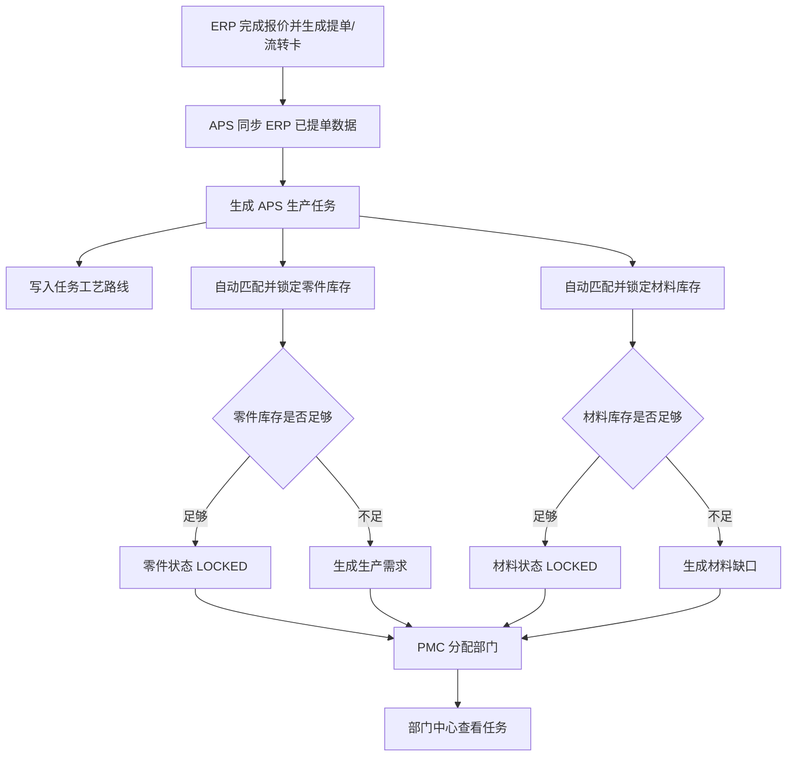

# APS 核心业务流程

编写日期：2026-06-13  
适用系统：生产准备与排产辅助 APS 系统  
适用范围：ERP 同步、库存锁定、材料缺口、PMC 分配、部门中心、基础数据维护  

本文用于交接 APS 的核心业务流程，说明数据如何从 ERP 进入 APS、APS 如何自动形成任务和库存占用、PMC 如何分配部门，以及释放和删除操作的业务影响。

## 1. 角色和职责

| 角色 | 当前系统角色 | 主要职责 |
| --- | --- | --- |
| 管理员 | `ADMIN` | 当前可使用全部 APS 功能 |
| PMC | 后续待拆分 | 同步任务、查看待分配、分配部门、释放分配 |
| 仓库 | 后续待拆分 | 维护零件库存、材料库存，确认或释放锁定 |
| 部门人员 | 后续待拆分 | 查看部门中心任务 |
| ERP 系统 | 接口源系统 | 提供工艺字典和已提单生产数据 |

当前系统只实现管理员角色，后续可在现有 `@RequireRole` 和前端路由基础上拆分 PMC、仓库、部门等角色。

## 2. 主流程总览



## 3. 核心状态

### 3.1 任务分配状态

| 状态 | 含义 |
| --- | --- |
| `PENDING` | 未分配部门 |
| `ASSIGNED` | 已分配部门 |

### 3.2 零件库存状态

| 状态 | 含义 |
| --- | --- |
| `LOCKED` | 零件库存完全满足 |
| `PARTIAL_LOCKED` | 部分零件库存满足，剩余需要生产 |
| `NEED_PRODUCTION` | 没有可用零件库存，需要生产 |
| `UNLOCKED` | 尚未执行或未产生零件锁定 |

### 3.3 材料库存状态

| 状态 | 含义 |
| --- | --- |
| `LOCKED` | 材料库存完全满足 |
| `PARTIAL_LOCKED` | 部分材料满足，剩余缺料 |
| `SHORTAGE` | 材料不足或无库存 |
| `NOT_REQUIRED` | 任务没有材料需求或材料需求重量为 0 |
| `UNLOCKED` | 尚未执行或未产生材料锁定 |

### 3.4 部门任务状态

| 状态 | 含义 |
| --- | --- |
| `ACTIVE` | 当前有效部门任务 |
| `RELEASED` | 已释放的历史部门任务 |

## 4. 流程一：ERP 工艺同步

### 4.1 入口

| 页面 | 路由 |
| --- | --- |
| 工艺管理 | `/processes` |

### 4.2 输入

| 输入 | 说明 |
| --- | --- |
| 工艺类型 | 可同步全部、工时工艺 `WORK_HOUR` 或非工时工艺 `NON_WORK_HOUR` |
| 同步按钮 | 触发 APS 调 ERP 工艺接口 |

### 4.3 系统处理

1. APS 调用 ERP：

```text
GET {APS_ERP_BASE_URL}/api/aps/source/processes
```

2. 如果选择工艺类型，会追加：

```text
?processType=WORK_HOUR
?processType=NON_WORK_HOUR
```

3. APS 使用 `APS_ERP_AUTH_TOKEN` 访问 ERP。
4. 后端将 ERP 工艺 upsert 到 `aps_process`。

### 4.4 输出

| 输出 | 说明 |
| --- | --- |
| receivedCount | ERP 返回工艺数量 |
| importedCount | APS 实际导入或更新数量 |
| processType | 本次同步类型 |

### 4.5 注意事项

1. 机台能力只能选择已经同步到 APS 的工艺。
2. ERP 工艺名称变更后，APS 需要重新同步。
3. ERP-APS token 不一致时，同步会失败。

## 5. 流程二：ERP 已提单数据同步

### 5.1 入口

| 页面 | 路由 |
| --- | --- |
| ERP 同步 | `/sync` |

### 5.2 前置条件

1. ERP 已完成报价。
2. ERP 已生成交付提单和工艺流转卡。
3. ERP 已开放 `/api/aps/source/delivery-items`。
4. APS 的 `APS_ERP_BASE_URL` 指向 ERP 后端地址。
5. APS 的 `APS_ERP_AUTH_TOKEN` 与 ERP 的 `ERP_APS_SOURCE_TOKEN` 一致。

### 5.3 输入

| 输入 | 来源 | 说明 |
| --- | --- | --- |
| 同步按钮 | APS 页面 | 触发同步 |
| limit | 后端配置或请求参数 | 每次从 ERP 拉取的分页大小，默认 200，最大 500 |
| afterTicketId | APS 自动计算 | 从已同步最大 ERP 提单 ID 之后继续拉取 |

### 5.4 ERP 输出字段

APS 同步任务时读取 ERP 提单和流转卡相关数据，包括：

| 数据 | 说明 |
| --- | --- |
| ERP 提单 ID | APS 去重依据 |
| RFQ 和订单信息 | RFQ、客户、内部项目号、客户订单号、客户项目号 |
| 零件信息 | 图号、版本、描述、数量、单位、类型 |
| 材料信息 | 材料名称、材料类型、材料毛重、材料需求重量 |
| 工艺路线 | 工艺名称、排序、工时、费用、原始行 |
| 交期 | 开工日期、交付日期、客户或内部交期 |
| 图纸 | 图纸 URL 和查看 URL |

### 5.5 APS 处理

APS 后端 `ApsSyncService` 对每条 ERP 记录执行：

1. 创建同步运行记录 `aps_erp_sync_run`。
2. 新增或跳过 `aps_work_item`，以 `erp_ticket_id` 去重。
3. 写入 `aps_work_item_process` 工艺路线。
4. 计算工艺路线文本和签名。
5. 锁定零件库存。
6. 锁定材料库存。
7. 更新任务的零件库存状态和材料库存状态。
8. 记录同步成功、失败、导入数量、跳过数量。

### 5.6 输出

| 输出 | 说明 |
| --- | --- |
| syncRunId | 本次同步记录 ID |
| startAfterTicketId | 本次同步起始 ERP 提单 ID |
| nextAfterTicketId | 下次继续同步的位置 |
| receivedCount | 从 ERP 接收数量 |
| importedCount | APS 导入数量 |
| skippedCount | APS 跳过数量 |
| productionRequirementCount | 生成生产需求数量 |
| materialShortageCount | 生成材料缺口数量 |
| importedItems | 本次导入任务摘要 |

### 5.7 关键规则

1. `aps_work_item.erp_ticket_id` 唯一，重复 ERP 提单不会重复导入。
2. 单条 ERP 数据缺少提单 ID 或图号时会跳过或报错。
3. 同步以增量方式按最大已同步提单 ID 继续。
4. 如果需要全量重做，不能只点同步，需要清理 APS 数据或使用新库。

## 6. 流程三：零件库存自动锁定

### 6.1 匹配规则

APS 根据以下字段匹配零件库存：

| 字段 | 说明 |
| --- | --- |
| 客户 | `customer_name` |
| 图号 | `part_no` |
| 版本 | `version` |

匹配到 `aps_part_inventory` 后，优先锁定已入库库存，再锁定在产库存。

### 6.2 锁定顺序

```text
需求数量
  -> 先锁定可用已入库数量
  -> 仍不足则锁定可用在产数量
  -> 仍不足则生成生产需求
```

### 6.3 写入数据

| 表 | 内容 |
| --- | --- |
| `aps_part_inventory_lock` | 任务级零件锁定汇总 |
| `aps_part_inventory_lock_detail` | 入库或在产单号级锁定明细 |
| `aps_production_requirement` | 不足部分的生产需求 |
| `aps_part_inventory` | 增加已锁定数量 |
| `aps_part_inventory_pending_stock` | 在产库存明细增加锁定数量 |
| `aps_work_item` | 更新零件库存状态 |

### 6.4 状态计算

| 情况 | 状态 |
| --- | --- |
| 需求数量为 0 | `LOCKED` |
| 库存完全满足 | `LOCKED` |
| 部分库存满足 | `PARTIAL_LOCKED` |
| 无库存满足 | `NEED_PRODUCTION` |

### 6.5 注意事项

1. 零件库存必须在同步前维护，才能自动锁定。
2. 客户、图号、版本不一致会导致无法匹配库存。
3. 在产库存需要维护在产单号，锁定时会记录具体在产单号。

## 7. 流程四：材料库存自动锁定

### 7.1 匹配规则

APS 根据以下字段匹配材料库存：

| 字段 | 说明 |
| --- | --- |
| 材料名称 | `material_name` |
| 材料类型 | `material_type` |

材料需求重量优先使用 ERP 显式提供的材料需求重量；没有时按材料毛重乘以数量计算。

### 7.2 锁定逻辑

```text
材料需求重量
  -> 查找材料库存
  -> 锁定可用重量
  -> 不足部分生成材料缺口
```

### 7.3 写入数据

| 表 | 内容 |
| --- | --- |
| `aps_material_lock` | 任务级材料锁定 |
| `aps_material_shortage` | 不足部分材料缺口 |
| `aps_material_inventory` | 增加锁定重量 |
| `aps_work_item` | 更新材料库存状态 |

### 7.4 状态计算

| 情况 | 状态 |
| --- | --- |
| 无材料名称或需求重量为 0 | `NOT_REQUIRED` |
| 材料完全满足 | `LOCKED` |
| 材料部分满足 | `PARTIAL_LOCKED` |
| 材料完全不足 | `SHORTAGE` |

### 7.5 注意事项

1. 材料名称要与 ERP 工程核价材料一致。
2. 材料类型为空和非空是不同库存维度。
3. 材料释放会增加材料缺口，不会自动补料。

## 8. 流程五：PMC 任务分配

### 8.1 入口

| 页面 | 路由 |
| --- | --- |
| 待分配 | `/assignment/pending` |

### 8.2 前置条件

1. APS 已同步 ERP 任务。
2. 部门已维护。
3. 部门状态为启用。
4. 部门剩余工时足够。

### 8.3 输入

| 输入 | 说明 |
| --- | --- |
| 任务 ID | 单个或多个 APS 任务 |
| 部门 ID | 目标部门 |
| 分配人 | 记录操作人 |
| 备注 | 分配说明 |

### 8.4 处理逻辑

对每个任务：

1. 查询任务。
2. 查询部门并锁定部门记录。
3. 如果任务已有活跃分配，先释放旧分配。
4. 计算任务所需工时。
5. 校验部门剩余工时是否足够。
6. 增加部门占用工时。
7. 写入 `aps_department_assignment`。
8. 写入 `aps_department_task`。
9. 更新 `aps_work_item.assignment_status` 和分配部门信息。

### 8.5 输出

| 输出 | 说明 |
| --- | --- |
| 分配记录 | 任务分配到哪个部门、占用多少工时 |
| 部门产能 | 占用工时增加，剩余工时减少 |
| 任务状态 | 从待分配变为已分配 |

### 8.6 注意事项

1. 批量分配是逐个任务执行；其中某个任务失败时应查看后端返回。
2. 部门月可用工时不足会拒绝分配。
3. 分配不改变零件库存锁定和材料库存锁定。

## 9. 流程六：释放分配

### 9.1 入口

| 页面 | 路由 |
| --- | --- |
| 已分配 | `/assignment/assigned` |

### 9.2 处理逻辑

释放任务分配时：

1. 查询任务。
2. 找到当前活跃分配。
3. 如果该分配已经计入部门产能，则从部门占用工时扣回。
4. 将部门任务标记为已释放。
5. 将分配记录标记为已释放。
6. 将任务重新标记为待分配。

### 9.3 影响范围

| 数据 | 影响 |
| --- | --- |
| `aps_department.occupied_hours` | 减少任务工时 |
| `aps_department_assignment` | 当前分配变为释放状态 |
| `aps_department_task` | 当前任务变为已释放 |
| `aps_work_item` | 回到待分配 |

### 9.4 注意事项

释放分配不会释放零件库存和材料库存。库存释放需要在对应锁定记录页面处理，或删除 APS 任务时统一释放。

## 10. 流程七：确认或释放零件锁定

### 10.1 确认锁定

仓库确认零件锁定时：

1. 选择锁定明细。
2. 后端校验该明细仍是待处理状态。
3. 标记为已确认。
4. 返回确认数量。

确认动作不归还库存，也不生成生产需求。

### 10.2 释放锁定

释放零件锁定时：

1. 找到锁定明细。
2. 校验仍未处理。
3. 判断是已入库锁定还是在产锁定。
4. 归还 `aps_part_inventory` 锁定数量。
5. 如果是在产锁定，同时归还对应在产单号锁定数量。
6. 更新锁定汇总数量和状态。
7. 标记明细为已释放。
8. 增加 `aps_production_requirement`。
9. 更新任务零件库存状态。

### 10.3 注意事项

1. 释放锁定会增加需要生产数量。
2. 已确认或已释放的锁定不能重复处理。
3. 如果生产需求已有记录，释放数量会累加到已有需求。

## 11. 流程八：确认或释放材料锁定

### 11.1 确认锁定

仓库确认材料锁定时：

1. 选择材料锁定记录。
2. 后端校验该记录仓库状态仍为待处理。
3. 标记为已确认。
4. 返回确认重量。

### 11.2 释放锁定

释放材料锁定时：

1. 找到材料锁定记录。
2. 校验仍未处理。
3. 将已锁定重量归还材料库存。
4. 将释放重量加入缺口重量。
5. 标记锁定为已释放。
6. 新增或累加 `aps_material_shortage`。
7. 更新任务材料库存状态。

### 11.3 注意事项

1. 释放材料锁定意味着这部分材料不能用于该任务，需要采购或补料。
2. 释放后当前页面只展示缺口，不负责采购闭环。

## 12. 流程九：删除 APS 任务

### 12.1 入口

| 页面 | 路由 |
| --- | --- |
| ERP 同步 | `/sync` |
| 待分配 | `/assignment/pending` |

### 12.2 处理逻辑

删除 APS 任务时，后端会：

1. 查询任务。
2. 释放活跃部门分配并归还占用工时。
3. 释放零件库存锁定。
4. 释放材料库存锁定。
5. 删除材料缺口。
6. 删除 `aps_work_item`，级联删除相关工艺、锁定、生产需求等。

### 12.3 风险

1. 删除任务会影响库存锁定、部门产能和缺口数据。
2. 如果任务已经进入真实生产，不应随意删除。
3. 删除不是 ERP 删除，ERP 源数据仍存在；后续同步可能再次导入未同步过的提单。

## 13. 流程十：零件库存维护

### 13.1 新增库存

1. 选择客户。
2. 输入图号、版本。
3. 创建库存记录。
4. 后续同步任务时按客户、图号、版本匹配。

### 13.2 新增库存数量

| 操作 | 结果 |
| --- | --- |
| 直接入库 | 增加 `in_stock_qty` |
| 新增在产 | 增加或创建在产单号明细，并刷新 `in_production_qty` |

### 13.3 在产转入库

1. 选择在产单号。
2. 输入转入数量。
3. 减少该在产单号数量。
4. 增加已入库数量。
5. 刷新库存汇总。

### 13.4 修改库存

1. 可修改已入库数量。
2. 可修改指定在产单号数量。
3. 数量不能低于已锁定数量。

## 14. 流程十一：材料库存维护

1. 新增材料库存记录。
2. 修改库存重量和安全库存。
3. 删除无锁定的材料库存。
4. 同步任务时按材料名称和材料类型自动匹配。

规则：

1. 材料库存重量不能小于锁定重量。
2. 同一材料名称和材料类型不能重复。
3. 删除有锁定重量的材料会被拒绝。

## 15. 流程十二：部门和机台能力维护

### 15.1 部门维护

1. 新增生产部门或外协部门。
2. 设置月可用工时。
3. PMC 分配任务时占用部门工时。
4. 释放分配时归还工时。

### 15.2 产能调整

| 操作 | 说明 |
| --- | --- |
| 调整产能 | 对月可用工时做增减 |
| 重置产能 | 设置新的月可用工时，并清空占用统计 |

注意：月可用工时不能小于已占用工时。

### 15.3 机台能力

1. 先同步 ERP 工艺。
2. 维护部门下机台。
3. 给机台绑定可加工工艺。
4. 同一机台不能重复绑定同一工艺。

## 16. 业务验收建议顺序

建议上线前按以下顺序验收 APS：

1. 管理员登录并修改初始密码。
2. 从 ERP 同步工艺。
3. 新增生产部门和外协部门。
4. 新增机台并绑定工艺能力。
5. 维护一条零件库存和一条材料库存。
6. 在 ERP 中确认有已提单订单。
7. APS 同步 ERP 已提单数据。
8. 查看任务是否生成。
9. 查看零件锁定、生产需求。
10. 查看材料锁定、材料缺口。
11. 对待分配任务分配部门。
12. 在部门中心查看任务详情。
13. 释放分配，确认部门工时归还。
14. 释放零件锁定，确认生产需求增加。
15. 释放材料锁定，确认材料缺口增加。
16. 做 APS 数据库备份和恢复演练。

## 17. 交接重点

1. APS 的源数据来自 ERP 提单，不从 ERP 询价单或报价单直接生成任务。
2. APS 同步会自动产生库存锁定和缺口，因此正式同步前要准备好库存主数据。
3. 任务分配会占用部门工时，释放分配会归还工时。
4. 库存锁定释放和部门分配释放是两个不同动作。
5. 当前 APS 只是生产准备和分配辅助系统，生产完成、采购到料、真正排程算法还需后续扩展。

