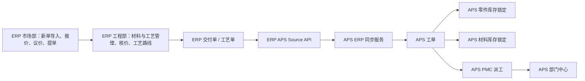

# ERP与APS数据流转说明

本文档说明 ERP 与 APS 两个系统之间的数据边界、同步方向、接口、字段映射、业务状态变化和异常处理。它用于交接团队理解两个系统如何协同工作，避免后续开发时错误地让两个系统直接共用表或重复维护同一份业务主数据。

## 1. 总体关系

ERP 是订单、报价、工艺核价和交付单据的来源系统。APS 是生产计划、库存锁定、材料锁定、部门派工和机台能力维护系统。

两个系统的关系：

- ERP 负责市场部、工程部、订单交付单和工艺核价。
- APS 从 ERP 拉取已形成交付项的数据，生成 APS 工单。
- APS 从 ERP 拉取工艺主数据，维护 APS 侧工艺能力基础数据。
- APS 不直接写 ERP 数据库。
- ERP 不直接写 APS 数据库。
- 两个系统通过 HTTP API 交互。
- 两个系统各自有独立数据库、独立用户权限、独立备份恢复。

## 2. 数据流转架构



## 3. 系统边界

### 3.1 ERP 负责的数据

ERP 负责维护：

- 客户询价单。
- 报价项目和报价版本。
- 图纸文件。
- 工程材料和工艺核价数据。
- 报价单。
- 交期。
- 市场部提单。
- 交付单。
- 工艺单。
- ERP 用户和权限。
- ERP 字典：材料、工艺、加价费率、额外费用项。

ERP 对 APS 暴露的是“可同步数据视图”，不是让 APS 直接访问 ERP 表。

### 3.2 APS 负责的数据

APS 负责维护：

- APS 工单。
- ERP 同步批次。
- 工单工序快照。
- 零件库存。
- 零件锁定记录。
- 零件生产需求。
- 材料库存。
- 材料锁定记录。
- 材料缺口。
- 部门。
- 部门产能。
- 部门派工。
- 部门任务。
- 机台。
- 机台工艺能力。
- APS 用户和权限。

APS 同步到的 ERP 数据进入 APS 后，作为排产和库存占用快照使用。ERP 后续修改不应直接改 APS 数据，除非重新设计同步策略。

## 4. 同步方向

| 方向 | 发起方 | 接口 | 数据内容 | 当前是否实现 |
| --- | --- | --- | --- | --- |
| ERP -> APS | APS 主动拉取 | ERP `/api/aps/source/delivery-items` | ERP 交付项、零件、材料、交期、工序快照 | 已实现 |
| ERP -> APS | APS 主动拉取 | ERP `/api/aps/source/processes` | ERP 工时类工艺、非工时类费用项 | 已实现 |
| APS -> ERP | 无 | 无 | APS 派工、库存锁定结果回写 ERP | 当前未实现 |
| 共享数据库 | 无 | 无 | 两系统直接读写同一表 | 不采用 |

## 5. 对接配置

### 5.1 ERP 侧配置

ERP 环境变量：

```env
ERP_APS_SOURCE_TOKEN=
```

作用：

- ERP 校验 APS 调用 `/api/aps/source/**` 接口的服务端 Token。
- Token 可通过 `Authorization: Bearer <token>` 传入。
- 也支持 `X-APS-Auth-Token` 头传入。

### 5.2 APS 侧配置

APS 环境变量：

```env
APS_ERP_BASE_URL=
APS_ERP_AUTH_TOKEN=
APS_ERP_SYNC_PAGE_SIZE=200
```

作用：

- `APS_ERP_BASE_URL`：ERP 后端内网地址。
- `APS_ERP_AUTH_TOKEN`：APS 调用 ERP 接口时携带的 Token。
- `APS_ERP_SYNC_PAGE_SIZE`：每次拉取 ERP 交付项的分页大小。

### 5.3 Token 一致要求

正式部署时必须满足：

```text
ERP_APS_SOURCE_TOKEN == APS_ERP_AUTH_TOKEN
```

真实 Token 不应写入代码仓库或交接文档，应由部署人员通过安全渠道交付。

## 6. ERP 对 APS 暴露的接口

| 接口 | 方法 | 调用方 | 作用 |
| --- | --- | --- | --- |
| `/api/aps/source/processes` | GET | APS | 获取 ERP 工艺主数据 |
| `/api/aps/source/delivery-items` | GET | APS | 分页获取 ERP 交付项 |

这些接口位于 ERP 后端：

```text
D:\Code\quote-system\src\main\java\com\machining\quote\controller\ApsSourceController.java
```

### 6.1 工艺同步接口

请求：

```text
GET {ERP_BASE_URL}/api/aps/source/processes?processType=WORK_HOUR
GET {ERP_BASE_URL}/api/aps/source/processes?processType=NON_WORK_HOUR
```

请求头：

```text
Authorization: Bearer <APS_ERP_AUTH_TOKEN>
```

返回字段：

| 字段 | 说明 |
| --- | --- |
| `sourceId` | ERP 侧工艺或费用项 ID |
| `processName` | 工艺名称或费用项名称 |
| `processType` | `WORK_HOUR` 或 `NON_WORK_HOUR` |
| `calcType` | 核算类型，例如工时或非工时费用 |
| `sortNo` | ERP 侧排序号 |

ERP 来源：

- `dict_process` -> 工时类工艺。
- `dict_extra_fee_item` -> 非工时类费用项。

APS 落库：

- `aps_process`。

### 6.2 交付项同步接口

请求：

```text
GET {ERP_BASE_URL}/api/aps/source/delivery-items?afterTicketId=100&limit=200
```

参数：

| 参数 | 说明 |
| --- | --- |
| `afterTicketId` | 只取大于该 ERP 交付单 ID 的数据，用于增量同步 |
| `limit` | 本次最多返回数量，默认 100，最大 500 |

返回批次字段：

| 字段 | 说明 |
| --- | --- |
| `success` | ERP 查询是否成功 |
| `records` | 交付项列表 |
| `count` | 当前批次返回数量 |
| `nextAfterTicketId` | 下一批起点 |
| `hasMore` | 是否还有下一批 |

ERP 来源：

- `order_delivery_ticket`。
- `order_rfq`。
- `item_quote_version`。
- `order_process_sheet`。

APS 落库：

- `aps_erp_sync_run`。
- `aps_work_item`。
- `aps_work_item_process`。
- `aps_part_inventory_lock`。
- `aps_part_inventory_lock_detail`。
- `aps_production_requirement`。
- `aps_material_lock`。
- `aps_material_shortage`。

## 7. 交付项字段映射

### 7.1 主身份字段

| ERP 输出字段 | APS 接收字段 | APS 落库字段 | 说明 |
| --- | --- | --- | --- |
| `ticketId` | `ticketId` | `aps_work_item.erp_ticket_id` | ERP 交付单 ID，是 APS 同步去重主依据 |
| `rfqId` | `rfqId` | `aps_work_item.erp_rfq_id` | ERP 询价单 ID |
| `itemId` | `itemId` | `aps_work_item.erp_item_id` | ERP 报价项目 ID |
| `sourceProcessSheetId` | `sourceProcessSheetId` | `aps_work_item.erp_process_sheet_id` | ERP 工艺单 ID |
| `processSnapshotSource` | `processSnapshotSource` | `aps_work_item.process_snapshot_source` | 工艺快照来源 |

### 7.2 客户与订单字段

| ERP 输出字段 | APS 落库字段 | 说明 |
| --- | --- | --- |
| `customerName` | `customer_name` | 客户名称 |
| `orderStatus` | `order_status` | ERP 订单状态快照 |
| `internalProjectNo` | `internal_project_no` | 内部项目号 |
| `customerOrderNo` | `customer_order_no` | 客户订单号 |
| `customerProjectNo` | `customer_project_no` | 客户项目号 |
| `projectNo` | `project_no` | 项目号 |
| `orderType` | `order_type` | 订单类型 |
| `itemType` | `item_type` | 普通件或装配件等项目类型 |

说明：ERP 当前 DTO 中仍有 `rfqNo`，但 APS 现行数据结构已移除 RFQ 编号作为主流转字段。后续如需要重新在 APS 展示 RFQ 编号，应新增 APS 字段和迁移，而不是临时拼接。

### 7.3 零件字段

| ERP 输出字段 | APS 落库字段 | 说明 |
| --- | --- | --- |
| `partNo` | `part_no` | 零件号，不能为空 |
| `version` | `version` | 版本 |
| `description` | `description` | 零件描述 |
| `qty` | `qty` | 交付数量 |
| `sourceItemQty` | `source_item_qty` | ERP 项目原始数量 |
| `unit` | `unit` | 单位 |
| `surfaceTreatment` | `surface_treatment` | 表面处理 |
| `partNetWeight` | `part_net_weight_kg` | 单件净重 |

### 7.4 材料字段

| ERP 输出字段 | APS 落库字段 | 说明 |
| --- | --- | --- |
| `materialName` | `material_name` | 工程材料名称 |
| `materialType` | `material_type` | 材料形态或类型 |
| `materialGrossWeight` | `material_gross_weight_kg` | 单件材料毛重 |
| `materialDemandWeight` | `material_demand_weight_kg` | 总需求重量 |
| `materialData` | `material_data` | ERP 材料计算 JSON 快照 |

材料需求重量规则：

1. ERP 如果传入 `materialDemandWeight` 且大于 0，APS 直接使用该值。
2. 否则 APS 使用 `materialGrossWeight * qty` 计算。

### 7.5 交期字段

| ERP 输出字段 | APS 落库字段 | 说明 |
| --- | --- | --- |
| `leadTime` | `lead_time` | ERP 工程交期 |
| `quoteLeadTime` | `quote_lead_time` | 报价交期 |
| `internalTargetLeadTime` | `internal_target_lead_time` | 内部目标交期 |
| `startDate` | `start_date` | 开始日期 |
| `deliveryDate` | `delivery_date` | 交付日期 |
| `arrangeType` | `arrange_type` | 排产或安排类型 |
| `remark` | `remark` | 备注 |

### 7.6 图纸字段

| ERP 输出字段 | APS 落库字段 | 说明 |
| --- | --- | --- |
| `drawingUrl` | `drawing_url` | ERP 相对或绝对图纸地址 |
| `drawingViewUrl` | `drawing_view_url` | ERP 转换后的可访问图纸地址 |

`drawingViewUrl` 由 ERP 根据 `ERP_PUBLIC_BASE_URL` 转为完整访问地址。APS 只保存快照，不负责维护 ERP 图纸文件。

### 7.7 工序字段

ERP 每个交付项包含 `processRows`。

| ERP 输出字段 | APS 落库字段 | 说明 |
| --- | --- | --- |
| `sortNo` | `aps_work_item_process.sort_no` | 工序排序 |
| `processName` | `process_name` | 工序名称 |
| `calcType` | `calc_type` | 核算类型 |
| `sourceType` | `source_type` | 来源类型 |
| `inputVal` | `input_val` | 输入值 |
| `workHours` | `work_hours` | 工时 |
| `unitRate` | `unit_rate` | 单价 |
| `lineCost` | `line_cost` | 行成本 |
| 整行 JSON | `raw_row` | 原始工序行快照 |

APS 还会根据工序名称生成：

- `process_route_text`：例如 `下料 > CNC > 表面处理`。
- `process_route_signature`：路线文本的 MD5，用于路线分组和筛选。

## 8. ERP 到 APS 的同步流程

### 8.1 工艺同步流程

1. 用户在 APS 工艺管理页面点击从 ERP 同步。
2. APS 调用 ERP `/api/aps/source/processes`。
3. ERP 返回工时类工艺或非工时费用项。
4. APS 写入或更新 `aps_process`。
5. APS 机台能力页面使用 `aps_process` 作为可选工艺来源。

### 8.2 交付项同步流程

1. 用户在 APS ERP 同步页面点击同步。
2. APS 查询当前已同步的最大 `erp_ticket_id`。
3. APS 创建一条 `aps_erp_sync_run`。
4. APS 调用 ERP `/api/aps/source/delivery-items`。
5. ERP 按 `order_delivery_ticket.id` 升序返回一批交付项。
6. APS 对每条交付项执行导入。
7. APS 写入 `aps_work_item`。
8. APS 写入 `aps_work_item_process`。
9. APS 根据零件库存生成零件锁定和生产需求。
10. APS 根据材料库存生成材料锁定和材料缺口。
11. APS 更新工单库存状态。
12. APS 更新同步批次结果。

## 9. 同步去重规则

APS 使用 ERP 交付项 ID 去重：

```text
aps_work_item.erp_ticket_id
```

规则：

- 已经同步过的 `ticketId` 不再重复生成工单。
- 下一次同步从当前最大 `erp_ticket_id` 后继续拉取。
- 如果 ERP 旧交付项被修改，当前 APS 不会自动覆盖旧 APS 工单。

后续如果需要支持 ERP 修改后重新同步，应设计“版本号、更新时间、手动重同步、差异对比、覆盖策略”，不能直接在现有增量同步上简单覆盖。

## 10. APS 同步后的业务状态

### 10.1 APS 工单状态

ERP 交付项进入 APS 后成为 `aps_work_item`。

关键状态：

- `stock_status`：零件库存锁定结果。
- `material_status`：材料库存锁定结果。
- `assignment_status`：派工状态。

### 10.2 零件锁定状态

| 状态 | 说明 |
| --- | --- |
| `LOCKED` | 零件库存或在产数量满足需求 |
| `PARTIAL_LOCKED` | 部分满足，剩余需要生产 |
| `NEED_PRODUCTION` | 没有可锁定库存，需要生产 |

APS 生成：

- `aps_part_inventory_lock`。
- `aps_part_inventory_lock_detail`。
- 需要生产时生成 `aps_production_requirement`。

### 10.3 材料锁定状态

| 状态 | 说明 |
| --- | --- |
| `LOCKED` | 材料库存满足需求 |
| `PARTIAL_LOCKED` | 部分材料满足 |
| `SHORTAGE` | 材料不足 |

APS 生成：

- `aps_material_lock`。
- 材料不足时生成 `aps_material_shortage`。

### 10.4 派工状态

ERP 同步只生成待分配任务，不直接派工。

后续由 APS PMC 模块：

1. 查询待分配工单。
2. 选择部门。
3. 校验部门启用状态和剩余产能。
4. 生成派工记录。
5. 部门中心看到任务。

## 11. 两系统数据不会自动回写

当前设计中：

- APS 派工结果不会自动回写 ERP。
- APS 库存锁定结果不会自动回写 ERP。
- APS 材料缺口不会自动回写 ERP。
- ERP 修改交付项后不会自动覆盖 APS 已同步工单。

这样做的好处：

- 两系统职责清晰。
- 避免跨系统写入导致数据互相污染。
- APS 可以保留当时同步的生产计划快照。
- ERP 仍然保持订单和报价的主系统地位。

如后续需要回写，应新增专门接口和状态流转，不建议直接操作对方数据库。

## 12. 异常与处理

### 12.1 Token 不一致

现象：

- APS 同步 ERP 失败。
- ERP 返回 401。

处理：

- 确认 ERP 的 `ERP_APS_SOURCE_TOKEN`。
- 确认 APS 的 `APS_ERP_AUTH_TOKEN`。
- 两者必须一致。
- 确认 APS 请求使用 `Authorization: Bearer <token>`。

### 12.2 ERP 地址不可达

现象：

- APS 同步报连接失败。

处理：

- 检查 `APS_ERP_BASE_URL`。
- Docker 部署时，如果 ERP 在宿主机，可使用 `http://host.docker.internal:8080`。
- 如果 ERP 在另一台服务器，使用 ERP 后端内网地址。
- 确认防火墙允许 APS 后端访问 ERP 后端端口。

### 12.3 ERP 交付项缺少零件号

现象：

- APS 导入某条交付项失败。

原因：

- APS 要求 `partNo` 不能为空。

处理：

- 回 ERP 补齐对应交付项的零件号。
- 或在后续版本中明确缺少零件号的业务处理规则。

### 12.4 材料名称为空

现象：

- APS 不生成有效材料锁定。

原因：

- APS 以 `materialName + materialType` 匹配材料库存。

处理：

- 回 ERP 工程核价中补齐工程材料。
- 或确认该零件无需材料锁定。

### 12.5 工序为空

现象：

- APS 工单生成，但工序列表为空。

原因：

- ERP 工艺单或报价项目没有有效工艺路线。

处理：

- 在 ERP 工程部补齐工艺。
- 在 APS 重新同步的策略需另行设计；当前增量同步不会覆盖已导入工单。

## 13. 后续扩展建议

如果企业后续需要更完整的 ERP 与 APS 闭环，可以按以下顺序扩展：

1. ERP 交付项更新时间字段。
2. APS 手动重同步指定 ERP 交付项。
3. APS 与 ERP 差异对比页面。
4. APS 派工状态回写 ERP。
5. APS 材料缺口回写 ERP 采购待办。
6. APS 完工状态回写 ERP。
7. 跨系统统一账号或单点登录。

扩展时建议仍坚持“API 对接，不共享数据库”的原则。
