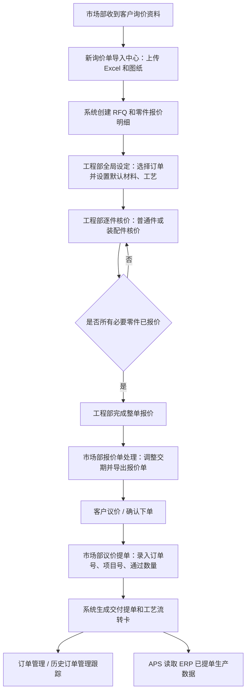

# ERP 核心业务流程

编写日期：2026-06-13  
适用系统：机加工报价 ERP 系统  
适用范围：市场询价导入、工程核价、报价单处理、议价提单、订单管理、历史订单管理  

本文用于交接 ERP 系统的业务主流程。重点说明业务从哪里开始、由谁处理、每一步输入输出是什么、系统状态如何变化、异常情况如何处理。本文依据当前代码和页面整理，不包含尚未实现的设想功能。

## 1. 业务角色

| 角色 | 系统角色代码 | 主要职责 |
| --- | --- | --- |
| 管理员 | `ADMIN` | 维护用户、报价模板，可访问全部业务页面 |
| 市场部 | `MARKET` | 导入询价单、处理报价单、确认议价结果、生成提单、管理订单 |
| 工程部 | `ENGINEER` | 维护材料工艺字典、设置整单默认核价配置、逐件核价、完成整单报价 |
| APS 系统 | 接口令牌访问 | 从 ERP 读取工艺和已提单生产数据，供排产系统使用 |

## 2. 核心对象

| 对象 | 数据表 | 说明 |
| --- | --- | --- |
| 询价订单 / RFQ | `order_rfq` | 一次客户询价或报价订单的主记录 |
| 零件报价明细 | `item_quote_version` | 订单内每个零件、版本、数量、材料、工艺、价格、交期等 |
| 交付提单 | `order_delivery_ticket` | 客户确认后生成的内部交付任务 |
| 工艺流转卡 | `order_process_sheet` | 给生产环节使用的零件工艺路线文件 |
| 材料字典 | `dict_material` | 工程核价材料、密度、价格 |
| 工艺字典 | `dict_process` | 工时类工艺及数量阶梯单价 |
| 百分比费用 | `dict_markup_fee` | 利润、管理费、税费等百分比加成 |
| 非工时费用 | `dict_extra_fee_item` | 表面处理、运输、热处理等直接费用项 |
| 装配关系 | `item_assembly_relation` | 装配件父件与子件关系 |
| 用户 | `erp_user` | ERP 登录用户和权限 |
| 系统任务 | `system_task` | 长耗时刷新、导出等任务记录 |

## 3. 主流程总览

ERP 主流程从市场部导入客户询价开始，到生成生产提单和工艺流转卡结束。



## 4. 订单状态流转

### 4.1 订单状态

| 状态 | 进入条件 | 主要处理人 | 下一步 |
| --- | --- | --- | --- |
| 待工程部评估 | 市场部成功导入新询价单 | 工程部 | 全局设定、逐件核价 |
| 已报价 | 工程部完成整单报价 | 市场部 | 报价单处理、客户议价 |
| 部分已提单 | 部分零件或部分数量已生成提单 | 市场部 | 继续提单或查看生产输出 |
| 已生成提单 | 订单可提单内容已生成提单 | 市场部 / APS | 生产执行、APS 排产 |

### 4.2 零件状态

| 状态 | 进入条件 | 说明 |
| --- | --- | --- |
| 待核价 | 导入询价单后创建零件 | 工程部尚未完成该零件核价 |
| 已报价 | 单个零件提交核价成功 | 有最终含税单价和合计金额 |
| 已部分提单 | 零件部分数量已生成提单 | 后续可继续提剩余数量 |
| 已生成提单 | 零件可通过数量已完成提单 | 进入生产输出阶段 |

### 4.3 状态维护原则

1. 页面不直接决定最终状态，状态由后端服务根据订单、零件、提单、流转卡数据统一刷新。
2. 删除提单、重置生产输出等操作会触发状态回退。
3. 已报价订单的金额不会因为字典价格调整自动变化，必须由工程部手动刷新核价或重新提交核价。

## 5. 流程一：客户询价导入

### 5.1 参与角色

| 角色 | 操作 |
| --- | --- |
| 市场部 | 填写客户名称，上传客户询价 Excel 和图纸 PDF |
| 系统 | 解析 Excel，创建 RFQ，匹配图纸，生成零件明细 |

### 5.2 操作入口

| 页面 | 路由 |
| --- | --- |
| 市场部：新询价单导入中心 | `/market` |

### 5.3 前置条件

1. 市场部账号或管理员账号已登录。
2. 客户询价 Excel 已准备好。
3. 如客户提供图纸，PDF 文件应尽量按图号命名，便于自动匹配。

### 5.4 输入

| 输入 | 来源 | 用途 |
| --- | --- | --- |
| 客户名称 / 代码 | 市场部录入 | 订单归属、客户筛选、历史重复件识别 |
| 客户询价 Excel | 客户资料 | 解析零件、数量、材料、交期等 |
| 图纸 PDF | 客户资料 | 与零件图号绑定，供工程部核价查看 |

客户询价 Excel 关键字段：

| Excel 字段 | 系统字段 | 说明 |
| --- | --- | --- |
| 图号 | `partNo` | 零件唯一识别核心字段 |
| 物料描述 | `description` | 零件名称或描述 |
| 材料名称 | `materialName` | 客户提供材料名称 |
| 表面处理 | `surfaceTreatment` | 表面处理要求 |
| 版本 | `version` | 图纸版本 |
| 数量 | `qty` | 报价数量 |
| 单位 | `unit` | 数量单位 |
| 交货周期 | `leadTime` | 客户要求交期 |
| 备注 | `remark` | 客户备注 |

### 5.5 系统处理

1. 后端生成新的 RFQ 编号。
2. 写入 `order_rfq` 主订单，初始状态为“待工程部评估”。
3. 按 Excel 行写入 `item_quote_version` 零件明细，初始状态为“待核价”。
4. 上传文件保存到后端配置的上传目录。
5. 系统尝试从 PDF 文件名解析图号，并与零件图号匹配。
6. 生成图纸匹配报告返回前端。

### 5.6 输出

| 输出 | 使用人 | 说明 |
| --- | --- | --- |
| RFQ 编号 | 市场部、工程部 | 后续所有流程的订单标识 |
| 零件报价明细 | 工程部 | 用于工程核价 |
| 图纸匹配报告 | 市场部、工程部 | 判断是否需要补图 |
| 缺失图纸清单 | 市场部 | 后续联系客户补图 |
| 未匹配图纸清单 | 市场部 | 判断图纸命名是否有误 |

### 5.7 异常处理

| 异常 | 处理建议 |
| --- | --- |
| Excel 格式错误 | 按系统要求模板整理表头和数据后重新导入 |
| 客户名称录入不统一 | 上线前制定客户名称规范，减少重复客户 |
| 图纸未匹配 | 检查 PDF 文件名是否包含正确图号，必要时在订单管理补图 |
| 非 PDF 文件 | 不作为正式图纸上传 |

## 6. 流程二：工程全局设定

### 6.1 参与角色

| 角色 | 操作 |
| --- | --- |
| 工程部 | 选择待评估订单，查看零件和重复件，设置默认材料、默认形态、默认工艺路线 |
| 系统 | 保存订单级工程配置，供逐件核价页面使用 |

### 6.2 操作入口

| 页面 | 路由 |
| --- | --- |
| 工程部：全局设定 | `/engineering` |

### 6.3 前置条件

1. 订单已由市场部导入。
2. 订单状态通常为“待工程部评估”。
3. 工程部基础材料和工艺字典已经维护。

### 6.4 输入

| 输入 | 是否必需 | 用途 |
| --- | --- | --- |
| 待核价订单 | 是 | 确定本次工程评估对象 |
| 默认材料 | 否 | 给后续零件核价提供默认材料 |
| 默认毛坯形态 | 否 | 给后续零件核价提供默认形态 |
| 默认工艺路线 | 否 | 给后续零件核价提供初始工艺路线 |
| 工艺输入值 | 否 | 给默认工艺提供工时或费用默认值 |

### 6.5 系统处理

1. 查询订单下全部零件。
2. 查询历史报价数据，生成重复件分析。
3. 读取材料、工艺、非工时费用字典。
4. 保存订单级工程配置到 `order_rfq.engineer_config`。

### 6.6 输出

| 输出 | 说明 |
| --- | --- |
| 零件列表 | 工程部了解整单零件数量、图纸、版本等 |
| 重复件建议 | 给工程部判断是否可以参考历史报价 |
| 全局配置 | 逐件核价时作为默认值加载 |

### 6.7 业务规则

1. 全局设定只是默认值，不是最终核价结果。
2. 每个零件仍需进入逐件核价确认。
3. 重复件分析只提供参考，不自动替代工程师判断。
4. 材料和工艺选择已改为弹出表格选择，适合字典数据增多后的搜索和确认。

## 7. 流程三：普通零件逐件核价

### 7.1 参与角色

| 角色 | 操作 |
| --- | --- |
| 工程部 | 打开零件核价控制台，录入材料、尺寸、重量、工艺路线、工时或费用 |
| 系统 | 计算材料成本、工艺成本、百分比费用、最终含税单价和合计金额 |

### 7.2 操作入口

| 页面 | 路由 |
| --- | --- |
| 工程部：逐件工艺路线与核价中心 | `/pricing` |

### 7.3 前置条件

1. 已选择 RFQ 订单。
2. 订单内存在待核价零件。
3. 材料字典和工艺字典可用。

### 7.4 输入

| 输入 | 用途 |
| --- | --- |
| 核价类型：普通件 | 决定使用普通材料和工艺成本计算 |
| 工程材料 | 匹配材料库单价和密度 |
| 毛坯形态 | 决定取板材、棒材或管材价格 |
| 尺寸 | 辅助计算材料毛重 |
| 材料毛重 | 计算材料成本 |
| 零件净重 | 写入工艺流转卡，供生产参考 |
| 工艺路线 | 计算加工成本并输出到流转卡 |
| 工艺输入值 | 工时类表示工时，非工时类表示金额 |

### 7.5 系统计算

普通件核价计算可理解为：

```text
材料成本 = 材料毛重 × 对应形态材料单价
工艺成本 = 各工时类工艺输入值 × 对应数量阶梯单价 + 非工时费用
基础成本 = 材料成本 + 工艺成本
百分比费用 = 基础成本 × 各启用百分比费率
含税单价 = 基础成本 + 百分比费用
单项合计 = 含税单价 × 报价数量
```

实际结果以后端 `EngineerService` 计算返回为准。

### 7.6 输出

| 输出 | 落库字段或用途 |
| --- | --- |
| 工程材料 | `engineeringMaterialName` |
| 材料毛重 | `materialGrossWeight` |
| 零件净重 | `partNetWeight` |
| 材料数据 | `materialData` JSON |
| 工艺路线 | `processRoute` JSON |
| 费用数据 | `feeData` JSON |
| 基础成本 | `baseCost` |
| 含税单价 | `finalUnitPrice` |
| 单项合计 | `finalTotalPrice` |
| 零件状态 | 更新为“已报价” |

### 7.7 异常处理

| 异常 | 处理建议 |
| --- | --- |
| 材料无法匹配 | 到材料与工艺管理维护材料，再重新核价 |
| 工艺无法匹配 | 到材料与工艺管理维护工艺或非工时费用项 |
| 数量阶梯单价为空 | 补全工艺价格区间 |
| 重量明显异常 | 核查尺寸单位是否按米录入 |
| 已报价后材料价格变化 | 使用一键刷新核价或重新提交核价 |

## 8. 流程四：装配件核价

### 8.1 参与角色

| 角色 | 操作 |
| --- | --- |
| 工程部 | 选择父件，切换为装配件核价，选择子件和子件用量，录入装配费 |
| 系统 | 校验子件报价状态和装配关系，计算父件报价 |

### 8.2 前置条件

1. 父件和子件必须属于同一个 RFQ。
2. 子件必须已完成报价。
3. 装配关系不能形成循环。
4. 同一个父件下不能重复选择同一个子件。

### 8.3 输入

| 输入 | 说明 |
| --- | --- |
| 核价类型：装配件 | 表示该零件按装配件逻辑报价 |
| 子件 | 从当前 RFQ 已有零件中选择 |
| 子件用量 | 每件父件消耗的子件数量 |
| 装配费 | 每件父件的装配费用 |

### 8.4 系统计算

```text
子件成本合计 = Σ 子件含税单价 × 每件父件用量
基础成本 = 子件成本合计 + 装配费
装配费附加费用 = 对装配费应用指定百分比费用
装配件含税单价 = 基础成本 + 装配费附加费用
装配件合计 = 装配件含税单价 × 父件报价数量
```

### 8.5 输出

| 输出 | 说明 |
| --- | --- |
| 装配父子关系 | 写入 `item_assembly_relation` |
| 装配费 | 写入父件 `assembly_fee` |
| 子件汇总 | 写入父件材料数据 JSON |
| 装配件工艺路线 | 系统将装配费作为非工时费用写入工艺路线 |
| 父件含税单价 | 写入父件 `finalUnitPrice` |
| 父件状态 | 更新为“已报价” |

### 8.6 业务规则

1. 子件没报价时不能作为装配件子件。
2. 父件不能把自己作为子件。
3. 不能形成 A 包含 B、B 又包含 A 的循环关系。
4. 子件报价变化后，相关装配父件需要刷新报价。

## 9. 流程五：完成整单报价

### 9.1 参与角色

| 角色 | 操作 |
| --- | --- |
| 工程部 | 检查整单零件报价，点击完成整单报价 |
| 系统 | 刷新订单状态，使市场部可以进入报价处理 |

### 9.2 输入

| 输入 | 说明 |
| --- | --- |
| RFQ ID | 当前订单 |
| 已报价零件 | 订单内已完成报价的零件 |

### 9.3 系统处理

1. 校验订单和零件状态。
2. 汇总零件报价结果。
3. 将订单状态更新为“已报价”。
4. 市场部报价处理页面可读取该订单。

### 9.4 输出

| 输出 | 说明 |
| --- | --- |
| 订单状态 | 更新为“已报价” |
| 报价明细 | 市场部可查看和导出 |
| 后续入口 | 报价单处理生成、议价确认与提单生成 |

### 9.5 交接注意

1. 工程部应在确认所有必要零件已报价后再完成整单报价。
2. 如果发现报价错误，可回到逐件核价页面修改，然后重新完成或刷新报价。
3. 完成整单报价不会自动生成客户报价单，需要市场部导出。

## 10. 流程六：报价单处理与导出

### 10.1 参与角色

| 角色 | 操作 |
| --- | --- |
| 市场部 | 选择已报价订单，核对价格和交期，调整报价交期，导出报价单 |
| 系统 | 读取报价明细，生成 Excel 报价单 |

### 10.2 操作入口

| 页面 | 路由 |
| --- | --- |
| 市场部：报价单处理生成 | `/quote-process` |

### 10.3 前置条件

1. 订单状态为“已报价”。
2. 零件已经有含税单价。
3. 如使用模板报价单，管理员已经上传有效报价单模板。

### 10.4 输入

| 输入 | 说明 |
| --- | --- |
| 已报价订单 | 需要导出报价单的 RFQ |
| 选中零件 | 批量调整交期时使用 |
| 交期调整天数 | 对选中零件整体提前或延后 |
| 指定交期 | 对选中零件设置统一报价交期 |
| 单行交期 | 对单个零件精细调整 |

### 10.5 输出

| 输出 | 说明 |
| --- | --- |
| 报价明细列表 | 市场部核对图号、版本、价格、交期 |
| 标准报价单 | 后端生成 Excel |
| 简版报价单 | 后端生成简化 Excel |
| 模板明细报价单 | 按管理员上传模板导出 |
| 模板简版报价单 | 按管理员上传模板导出 |
| 客户交期报价单 | 按客户交期相关格式导出 |

### 10.6 业务规则

1. 报价处理页面不负责重新核价。
2. 金额以工程核价结果为准。
3. 交期调整会写回零件报价明细，影响后续导出。
4. 模板导出依赖报价单模板，模板格式错误会导致导出失败。

## 11. 流程七：客户议价确认与提单

### 11.1 参与角色

| 角色 | 操作 |
| --- | --- |
| 市场部 | 根据客户确认结果选择通过零件和数量，填写订单号、项目号、开工日期等 |
| 系统 | 生成交付提单和工艺流转卡，刷新订单和零件状态 |

### 11.2 操作入口

| 页面 | 路由 |
| --- | --- |
| 市场部：议价确认与提单生成 | `/release` |

### 11.3 前置条件

1. 订单已经报价。
2. 客户已经确认部分或全部零件下单。
3. 市场部知道客户订单号、内部项目号、通过数量等信息。

### 11.4 输入

| 输入 | 说明 |
| --- | --- |
| RFQ | 当前提单订单 |
| 内部项目号 | 企业内部生产项目编号，必填 |
| 客户订单号 | 客户正式订单号，必填 |
| 客户项目号 | 客户项目编号，可选 |
| 开工日期 | 生产计划开始日期，未填时后端默认当前日期 |
| 安排类型 | 计划、加急、备货等，未填时默认计划 |
| 内部目标交期 | 内部生产目标日期，可优先用于生产交付日期 |
| 通过数量 | 客户确认下单数量，必须大于 0 且不超过可提数量 |
| 备注 | 写入提单和流转卡 |

### 11.5 系统处理

1. 校验订单和零件。
2. 校验零件已经报价。
3. 校验内部项目号和客户订单号。
4. 校验通过数量不能超过允许数量。
5. 生成 `order_delivery_ticket` 提单。
6. 生成 `order_process_sheet` 工艺流转卡。
7. 根据提单数量刷新零件状态。
8. 根据零件状态刷新订单状态。

### 11.6 输出

| 输出 | 说明 |
| --- | --- |
| 提单列表 | 市场和生产可查看交付任务 |
| 工艺流转卡列表 | 生产可查看材料、工艺、数量、交期 |
| 订单状态 | 部分已提单或已生成提单 |
| 零件状态 | 已部分提单或已生成提单 |
| 导出文件 | 可导出提单和工艺流转卡 |

### 11.7 业务规则

1. 提单是 ERP 向生产和 APS 输出的重要节点。
2. 生成提单时会同步生成流转卡。
3. 流转卡中的材料和工艺来自工程核价结果。
4. 重复提单会受后端限制，不能超过可提数量。
5. 删除提单或流转卡会影响生产输出，正式环境应谨慎操作。

## 12. 流程八：订单管理和补图

### 12.1 参与角色

| 角色 | 操作 |
| --- | --- |
| 市场部 | 查询订单、查看详情、补充图纸、重置生产输出 |
| 系统 | 根据图纸文件名匹配零件，刷新订单详情 |

### 12.2 操作入口

| 页面 | 路由 |
| --- | --- |
| 市场部：订单管理 | `/orders` |

### 12.3 查询流程

1. 市场部按客户、关键字、分页条件查询订单。
2. 页面展示 RFQ、状态、零件数、报价数、缺图数、提单数、流转卡数。
3. 点击详情查看订单文件、零件、提单、流转卡。

### 12.4 补图流程

| 步骤 | 说明 |
| --- | --- |
| 1 | 在订单详情中选择补充图纸 |
| 2 | 上传一个或多个 PDF |
| 3 | 后端按文件名解析图号 |
| 4 | 找到对应零件且该零件没有图纸时绑定 |
| 5 | 返回已绑定、已存在、未匹配、非 PDF 跳过等结果 |

### 12.5 重置生产输出流程

重置生产输出用于删除订单已生成的提单和工艺流转卡，并刷新订单状态。此操作适用于测试、误操作或客户变更导致需要重新提单的场景。

| 影响对象 | 说明 |
| --- | --- |
| `order_delivery_ticket` | 删除该订单提单 |
| `order_process_sheet` | 删除该订单流转卡 |
| `item_quote_version` | 刷新零件提单状态 |
| `order_rfq` | 刷新订单状态 |

### 12.6 风险提示

1. 生产部门已经使用提单或流转卡时，不应随意重置。
2. 补图不会覆盖已有图纸，如果确实需要替换图纸，应先制定替换规则再开发。
3. 订单查询结果依赖客户名称录入规范。

## 13. 流程九：历史订单管理和删除

### 13.1 参与角色

| 角色 | 操作 |
| --- | --- |
| 市场部 | 查询历史订单、查看详情 |
| 管理员或具备入口的用户 | 删除确认无用的历史或测试订单 |

### 13.2 操作入口

| 页面 | 路由 |
| --- | --- |
| 市场部：历史订单管理 | `/history-orders` |

### 13.3 查询流程

1. 按客户或关键字查询订单。
2. 查看订单主信息、零件、提单、流转卡。
3. 用于追溯历史报价、客户询价记录和生产输出。

### 13.4 删除流程

删除订单会删除订单主记录及关联数据，且可选删除文件。后端处理顺序通常包括：

1. 删除工艺流转卡。
2. 删除交付提单。
3. 删除零件报价明细。
4. 删除订单主表。
5. 根据参数删除订单文件目录。

### 13.5 风险提示

1. 删除订单不可逆，必须依赖数据库和文件备份恢复。
2. 真实业务订单不建议删除，应通过状态或归档管理。
3. 删除前应确认 APS 或其他系统没有依赖该订单生产数据。

## 14. 流程十：基础字典维护

### 14.1 参与角色

| 角色 | 操作 |
| --- | --- |
| 工程部 | 维护材料、工艺、费用项 |
| 管理员 | 可协助维护和检查 |

### 14.2 操作入口

| 页面 | 路由 |
| --- | --- |
| 工程部：材料与工艺管理 | `/material-process` |

### 14.3 材料维护流程

1. 新增或编辑材料名称、材料类型、备注。
2. 维护板材、棒材、管材的密度和单价。
3. 核价页按材料名称和毛坯形态读取对应价格。
4. 价格变更后，已报价订单不会自动重算。

### 14.4 工艺维护流程

1. 新增或编辑工艺名称。
2. 维护不同数量区间的工时单价。
3. 核价时根据零件数量落入价格区间。
4. 工艺名称变更可能影响历史报价追溯，应谨慎。

### 14.5 费用维护流程

| 费用类型 | 用途 |
| --- | --- |
| 百分比费用 | 对基础成本按比例加成 |
| 非工时费用工艺 | 作为核价中直接费用项 |

### 14.6 维护原则

1. 字典是核价基础，应由工程负责人统一维护。
2. 正式环境不建议频繁删除字典记录。
3. 如果必须调整名称，应同步通知工程核价人员和交接文档维护人员。

## 15. 流程十一：用户和权限维护

### 15.1 参与角色

| 角色 | 操作 |
| --- | --- |
| 管理员 | 新增、编辑、停用、删除用户，重置密码 |

### 15.2 操作入口

| 页面 | 路由 |
| --- | --- |
| 系统管理：用户权限 | `/users` |

### 15.3 流程

1. 管理员新增用户，选择角色并设置初始密码。
2. 用户首次登录或重置密码后按要求修改密码。
3. 岗位调整时修改角色。
4. 用户离职时优先停用账号。
5. 确认无历史依赖时才删除非保护账号。

### 15.4 权限结果

| 角色 | 页面权限 |
| --- | --- |
| 管理员 | 全部页面 |
| 市场部 | 市场导入、报价处理、议价提单、订单管理、历史订单 |
| 工程部 | 工程全局设定、逐件核价、材料与工艺管理 |

### 15.5 安全注意

1. 管理员账号数量应少。
2. 初始密码和重置密码后应强制用户改密。
3. 正式环境不应长期使用默认密码。
4. 用户权限同时由前端路由和后端接口控制。

## 16. 流程十二：报价单模板维护

### 16.1 参与角色

| 角色 | 操作 |
| --- | --- |
| 管理员 | 上传和替换报价单模板 |
| 市场部 | 使用模板导出报价单 |

### 16.2 操作入口

| 页面 | 路由 |
| --- | --- |
| 系统管理：报价单模板 | `/quote-template` |

### 16.3 流程

1. 管理员准备 Excel 报价单模板。
2. 确认第 8 行包含系统要求表头。
3. 上传模板。
4. 市场部在报价处理页面导出模板报价单。
5. 若导出失败，优先检查模板表头和文件格式。

### 16.4 风险提示

1. 模板直接影响客户报价文件格式。
2. 模板更新后应使用测试订单导出验证。
3. 模板文件应随上传目录一起备份。

## 17. 与 APS 的数据输出流程

ERP 向 APS 输出的是生产排产需要的基础数据。当前 APS 通过 ERP 后端接口读取，而不是直接读 ERP 数据库。

### 17.1 输出接口

| 接口 | 用途 |
| --- | --- |
| `/api/aps/source/processes` | APS 读取 ERP 工艺列表 |
| `/api/aps/source/delivery-items` | APS 读取 ERP 已提单交付数据 |

### 17.2 鉴权方式

APS 访问 ERP 源数据接口时，可使用 ERP 配置的 `ERP_APS_SOURCE_TOKEN`。令牌可通过 Bearer Token 或指定请求头传递。部署时必须保证 APS 侧 `APS_ERP_AUTH_TOKEN` 与 ERP 侧 `ERP_APS_SOURCE_TOKEN` 一致。

### 17.3 输出节点

只有 ERP 生成提单和流转卡之后，APS 才有稳定的生产排产数据可读取。也就是说：

```text
客户询价导入 -> 工程核价 -> 完成报价 -> 市场提单 -> APS 同步生产数据
```

### 17.4 注意事项

1. APS 不应直接修改 ERP 订单、报价、提单数据。
2. ERP 是报价和提单数据源，APS 是计划排产系统。
3. 如果 ERP 重置生产输出或删除订单，APS 同步数据可能发生变化。
4. 生产上线前应固定 ERP 和 APS 的接口令牌配置。

## 18. 常见异常场景

| 场景 | 可能原因 | 处理方式 |
| --- | --- | --- |
| 市场部看不到订单 | 订单未导入成功、筛选条件不匹配、权限错误 | 清空筛选条件，检查导入结果和登录角色 |
| 工程部看不到待核价订单 | 订单状态异常或导入失败 | 到订单管理确认 RFQ 是否存在 |
| 图纸无法打开 | 图纸未上传、文件路径丢失、权限或反代配置错误 | 在订单管理补图，检查上传目录和后端文件接口 |
| 材料选择不到 | 材料字典未维护或已删除 | 到材料与工艺管理新增或启用材料 |
| 工艺选择不到 | 工艺字典未维护或未启用 | 到材料与工艺管理维护工艺 |
| 核价金额为 0 或异常 | 材料重量、单价、工时输入、阶梯价格缺失 | 检查材料和工艺输入 |
| 报价单导出失败 | 模板不存在、模板表头错误、订单未报价 | 上传正确模板，确认订单状态 |
| 不能生成提单 | 零件未报价、数量不合法、内部项目号或客户订单号缺失 | 补齐必填项并确认报价状态 |
| APS 同步不到数据 | ERP 未生成提单、令牌不一致、ERP 地址配置错误 | 检查提单、`ERP_APS_SOURCE_TOKEN` 和 APS 配置 |

## 19. 业务验收建议顺序

上线前建议按以下顺序完整走通一单：

1. 管理员登录，确认用户和报价模板页面可用。
2. 工程部维护至少一种材料、一条工时工艺、一条百分比费用。
3. 市场部导入一份客户询价 Excel。
4. 上传至少一个能匹配图号的 PDF 图纸。
5. 工程部进入全局设定，选择材料和默认工艺。
6. 工程部对一个普通件完成核价。
7. 如有装配件，先对子件核价，再对父件装配核价。
8. 工程部完成整单报价。
9. 市场部进入报价单处理，调整交期并导出报价单。
10. 市场部进入议价提单，录入内部项目号和客户订单号，生成提单。
11. 导出提单和工艺流转卡。
12. 到订单管理查看订单状态、提单、流转卡。
13. 如需要，APS 同步 ERP 已提单数据。
14. 重启容器后确认订单、文件、模板仍然存在。

## 20. 交接重点

1. ERP 主线不是单纯的报价页面，而是“询价导入 -> 工程核价 -> 市场报价 -> 提单生产输出”的闭环。
2. 工程核价的数据质量决定报价单和流转卡质量。
3. 材料、工艺、费用字典是核价基础，应作为企业级主数据维护。
4. 提单和工艺流转卡是 ERP 输出给生产和 APS 的关键节点。
5. 删除订单、重置生产输出、删除字典属于高风险操作，需要权限、备份和操作确认。

