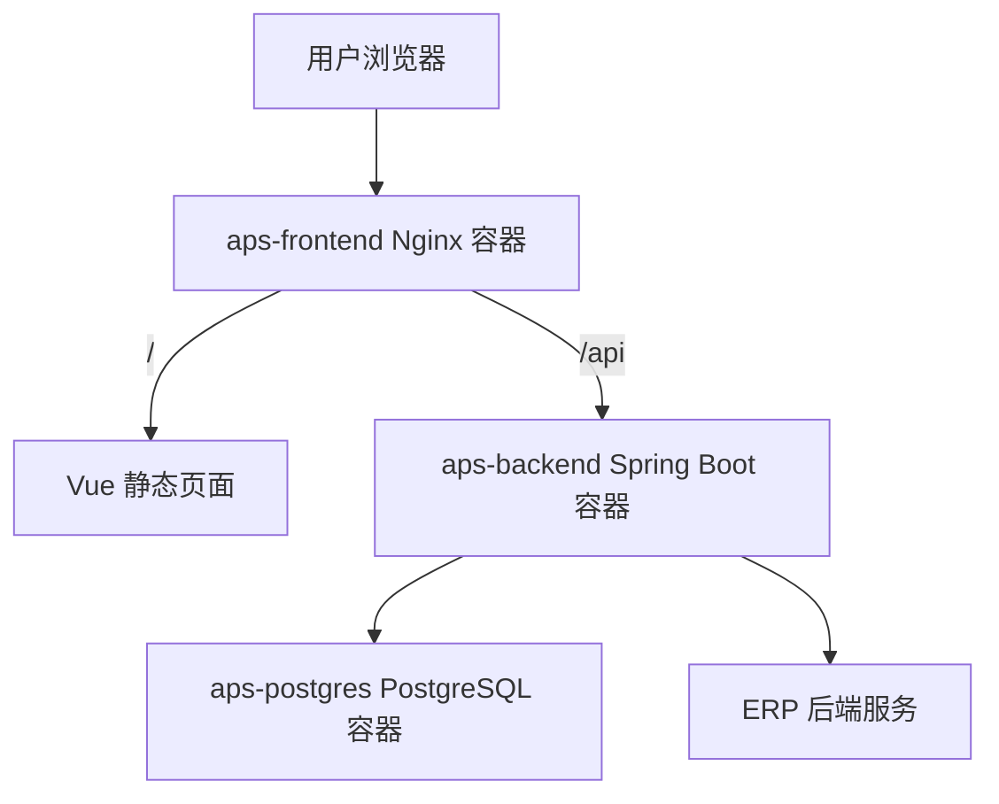

# APS 部署说明

编写日期：2026-06-13  
适用系统：生产准备与排产辅助 APS 系统  
部署方式：Docker Compose  
部署根目录：`D:\Code`  

本文依据当前文件整理：

- `D:\Code\docker-compose.aps.yml`
- `D:\Code\aps.env.example`
- `D:\Code\aps-system\Dockerfile`
- `D:\Code\aps-frontend\Dockerfile`
- `D:\Code\aps-frontend\nginx.conf`
- `D:\Code\aps-system\src\main\resources\application.yaml`

## 1. 部署架构

APS 当前使用三容器部署：



当前 Compose 服务：

| 服务 | 容器名 | 说明 |
| --- | --- | --- |
| `aps-postgres` | `aps-postgres` | APS PostgreSQL 数据库 |
| `aps-backend` | `aps-backend` | APS 后端 |
| `aps-frontend` | `aps-frontend` | APS 前端 Nginx |

默认端口：

| 服务 | 宿主机端口 | 说明 |
| --- | --- | --- |
| 前端 | `127.0.0.1:8095` | 暴露给外层 Nginx 或本机访问 |
| 后端 | 不映射 | 仅 Docker 网络内访问 |
| 数据库 | 不映射 | 仅 Docker 网络内访问 |

## 2. 启动命令

APS 使用独立环境变量文件：

```text
D:\Code\aps.env
```

首次部署时从示例复制：

```powershell
cd D:\Code
Copy-Item .\aps.env.example .\aps.env
notepad .\aps.env
```

启动：

```powershell
cd D:\Code
docker compose --env-file aps.env -f docker-compose.aps.yml up -d --build
```

查看状态：

```powershell
docker compose --env-file aps.env -f docker-compose.aps.yml ps
```

查看日志：

```powershell
docker compose --env-file aps.env -f docker-compose.aps.yml logs -f
```

停止：

```powershell
docker compose --env-file aps.env -f docker-compose.aps.yml down
```

## 3. 环境变量

### 3.1 数据库变量

| 变量 | 说明 | 生产要求 |
| --- | --- | --- |
| `APS_POSTGRES_DB` | 数据库名 | 默认 `aps` 可用 |
| `APS_POSTGRES_USER` | 数据库用户 | 默认 `aps` 可用 |
| `APS_POSTGRES_PASSWORD` | 数据库密码 | 必须强随机 |
| `APS_POSTGRES_VOLUME_NAME` | PostgreSQL volume 名称 | 正式库建议 `aps_postgres_data_prod` |

正式上线如果使用干净新库，应设置新的 volume 名称，例如：

```env
APS_POSTGRES_VOLUME_NAME=aps_postgres_data_prod
```

### 3.2 前端变量

| 变量 | 说明 | 默认 |
| --- | --- | --- |
| `APS_FRONTEND_BIND` | 前端绑定地址 | `127.0.0.1` |
| `APS_FRONTEND_PORT` | 前端宿主机端口 | `8095` |

前端 Docker 构建使用：

```yaml
args:
  VITE_API_BASE_URL: ""
```

因此生产环境前端请求同域 `/api`，由前端 Nginx 转发到 `aps-backend:8091`。

### 3.3 后端变量

| 变量 | 说明 | 生产要求 |
| --- | --- | --- |
| `APS_AUTH_ENABLED` | 是否开启鉴权 | 正式环境必须 `true` |
| `APS_JWT_SECRET` | JWT 签名密钥 | 必须强随机 |
| `APS_JWT_TTL_MINUTES` | 登录有效期 | 默认 720 分钟 |
| `APS_CORS_ALLOWED_ORIGINS` | 允许跨域来源 | 正式改为真实访问地址 |

### 3.4 ERP 对接变量

| 变量 | 说明 | 生产要求 |
| --- | --- | --- |
| `APS_ERP_BASE_URL` | ERP 后端内网地址 | 指向生产 ERP 后端 |
| `APS_ERP_AUTH_TOKEN` | APS 访问 ERP 的 token | 必须与 ERP 的 `ERP_APS_SOURCE_TOKEN` 一致 |
| `APS_ERP_SYNC_PAGE_SIZE` | ERP 同步分页大小 | 默认 200，最大 500 |

Docker Desktop 本机联调时，APS 容器访问宿主机 ERP 可使用：

```env
APS_ERP_BASE_URL=http://host.docker.internal:8080
```

如果 ERP 在另一台服务器，应改成 ERP 后端的内网地址。

### 3.5 日志和资源变量

| 变量 | 默认 |
| --- | --- |
| `APS_LOG_MAX_SIZE` | `20m` |
| `APS_LOG_MAX_FILE` | `5` |
| `APS_POSTGRES_MEM_LIMIT` | `1g` |
| `APS_POSTGRES_CPUS` | `1.0` |
| `APS_BACKEND_MEM_LIMIT` | `1g` |
| `APS_BACKEND_CPUS` | `1.0` |
| `APS_FRONTEND_MEM_LIMIT` | `256m` |
| `APS_FRONTEND_CPUS` | `0.5` |

## 4. 数据卷

当前 APS 只有一个核心数据卷：

| Volume | 用途 |
| --- | --- |
| `${APS_POSTGRES_VOLUME_NAME:-aps_postgres_data}` | APS PostgreSQL 数据 |

注意：

1. `docker compose down` 不删除数据卷。
2. `docker compose down -v` 会删除 APS 数据库，正式环境禁止随意执行。
3. APS 目前没有 ERP 那样的业务上传文件目录，核心数据都在 PostgreSQL。

## 5. 后端部署细节

后端 Dockerfile：

```text
D:\Code\aps-system\Dockerfile
```

构建阶段：

| 阶段 | 镜像 |
| --- | --- |
| build | `maven:3.9-eclipse-temurin-17` |
| runtime | `eclipse-temurin:17-jre` |

运行特点：

1. 后端容器内部端口为 `8091`。
2. 后端以非 root 用户 `aps` 运行。
3. 使用 `JAVA_TOOL_OPTIONS=-Duser.timezone=Asia/Shanghai`。
4. 启动时由 Flyway 执行数据库迁移。

后端健康检查：

```text
GET /api/health
```

Compose 健康检查：

```text
curl -fsS http://localhost:8091/api/health
```

## 6. 前端部署细节

前端 Dockerfile：

```text
D:\Code\aps-frontend\Dockerfile
```

构建阶段：

| 阶段 | 镜像 |
| --- | --- |
| build | `node:22-alpine` |
| runtime | `nginx:1.27-alpine` |

Nginx 配置：

```text
D:\Code\aps-frontend\nginx.conf
```

主要规则：

| 路径 | 说明 |
| --- | --- |
| `/` | Vue 单页应用，回退到 `index.html` |
| `/api/` | 代理到 `http://aps-backend:8091` |
| `/health` | 前端容器健康检查，返回 `ok` |

## 7. 启动顺序

Compose 启动顺序：

1. `aps-postgres` 启动。
2. PostgreSQL 健康检查通过。
3. `aps-backend` 启动。
4. 后端执行 Flyway 迁移。
5. 后端健康检查通过。
6. `aps-frontend` 启动。
7. 前端健康检查通过。

## 8. 正式上线配置建议

### 8.1 新库初始化

APS 正式上线建议使用新数据库 volume：

```env
APS_POSTGRES_VOLUME_NAME=aps_postgres_data_prod
```

这样会初始化干净生产库。因为当前 APS 旧数据不重要，可以重新录入，正式环境不建议复用开发库 volume。

### 8.2 端口安全

当前 APS Compose 默认只暴露前端：

```text
127.0.0.1:8095
```

后端和数据库不映射宿主机端口。正式部署建议保持这个模式，由外层 Nginx 或网关访问前端端口。

### 8.3 HTTPS

APS 容器内部使用 HTTP，正式 HTTPS 交给外层 Nginx 或网关：

```text
https://aps.企业域名 -> http://127.0.0.1:8095
```

部署人员需要处理证书、域名和外层反向代理。项目代码不需要为了 HTTPS 做额外修改。

### 8.4 ERP 对接

正式部署前必须确认：

1. ERP 已部署并可由 APS 后端访问。
2. ERP 开启 `/api/aps/source/processes` 和 `/api/aps/source/delivery-items`。
3. APS 的 `APS_ERP_BASE_URL` 是生产 ERP 内网地址。
4. APS 的 `APS_ERP_AUTH_TOKEN` 与 ERP 的 `ERP_APS_SOURCE_TOKEN` 一致。

## 9. 常用维护命令

查看状态：

```powershell
docker compose --env-file aps.env -f docker-compose.aps.yml ps
```

查看后端日志：

```powershell
docker compose --env-file aps.env -f docker-compose.aps.yml logs -f aps-backend
```

查看前端日志：

```powershell
docker compose --env-file aps.env -f docker-compose.aps.yml logs -f aps-frontend
```

查看数据库日志：

```powershell
docker compose --env-file aps.env -f docker-compose.aps.yml logs -f aps-postgres
```

重启后端：

```powershell
docker compose --env-file aps.env -f docker-compose.aps.yml restart aps-backend
```

重启前端：

```powershell
docker compose --env-file aps.env -f docker-compose.aps.yml restart aps-frontend
```

进入数据库容器：

```powershell
docker compose --env-file aps.env -f docker-compose.aps.yml exec aps-postgres psql -U aps -d aps
```

## 10. 部署验收

部署后至少检查：

| 检查项 | 预期 |
| --- | --- |
| 容器状态 | `aps-postgres`、`aps-backend`、`aps-frontend` 正常运行 |
| 后端健康检查 | `/api/health` 正常 |
| 前端健康检查 | `/health` 返回 `ok` |
| 前端页面 | `http://127.0.0.1:8095` 可打开 |
| 登录 | 管理员可登录 |
| ERP 工艺同步 | 可同步 ERP 工艺 |
| ERP 提单同步 | 可同步已提单数据 |
| 数据持久化 | 重启容器后数据不丢 |
| 备份 | `backup-aps.ps1` 可生成 `db\aps.sql` |
| 恢复演练 | `restore-drill-aps.ps1` 可通过 |

## 11. 常见问题

### 11.1 前端能打开但接口失败

排查：

1. `aps-backend` 是否 healthy。
2. 前端 Nginx `/api/` 是否代理到 `aps-backend:8091`。
3. 浏览器是否保存了过期 token。
4. `APS_CORS_ALLOWED_ORIGINS` 是否正确。

### 11.2 ERP 同步失败

排查：

1. `APS_ERP_BASE_URL` 是否可从 `aps-backend` 容器访问。
2. `APS_ERP_AUTH_TOKEN` 是否与 ERP 一致。
3. ERP 是否已生成提单。
4. ERP `/api/aps/source/delivery-items` 是否可访问。

### 11.3 登录失败

排查：

1. 账号是否启用。
2. 密码是否已被修改。
3. 是否继承了旧数据库 volume。
4. `APS_JWT_SECRET` 是否在重启后保持稳定。

### 11.4 数据库看起来还是旧数据

原因通常是仍在使用旧 Docker volume。正式新库应更换：

```env
APS_POSTGRES_VOLUME_NAME=aps_postgres_data_prod
```

然后重新启动 Compose。

