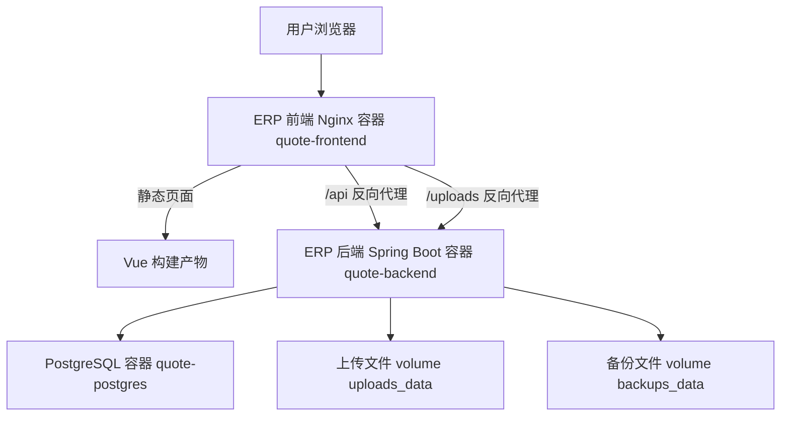

# ERP 部署说明

编写日期：2026-06-13  
适用系统：机加工报价 ERP 系统  
部署方式：Docker Compose  
当前部署根目录：`D:\QPO-Operations-Management-System`

本文用于交接 ERP 系统的部署方式。内容依据当前 `D:\QPO-Operations-Management-System\docker-compose.yml`、`D:\QPO-Operations-Management-System\erp.env`、`quote-backend/Dockerfile`、`quote-frontend/Dockerfile`、`quote-frontend/nginx.conf` 和后端 `application.yaml` 整理。

注意：本文不记录当前 `erp.env` 中的真实数据库密码、JWT 密钥和 ERP-APS 接口令牌。实际交接时应通过安全方式单独交付或在正式环境重新生成。

## 1. 部署架构

当前 ERP 使用三容器架构：



当前 Compose 服务：

| 服务 | 容器名 | 镜像 / 构建方式 | 端口 |
| --- | --- | --- | --- |
| `postgres` | `quote-postgres` | `postgres:15` | 宿主机 `127.0.0.1:5432` -> 容器 `5432` |
| `backend` | `quote-backend` | 从 `quote-backend/Dockerfile` 构建 | 宿主机 `127.0.0.1:8080` -> 容器 `8080` |
| `frontend` | `quote-frontend` | 从 `quote-frontend/Dockerfile` 构建 | 宿主机 `127.0.0.1:8088` -> 容器 `80` |

当前访问地址：

| 项目 | 地址 |
| --- | --- |
| ERP 前端 | `http://127.0.0.1:8088` |
| 后端健康检查 | `http://127.0.0.1:8080/api/health` |
| PostgreSQL | `127.0.0.1:5432` |

## 2. 当前 Docker Compose 文件

Compose 文件位置：

```text
D:\QPO-Operations-Management-System\docker-compose.yml
```

当前 Compose 项目名：

```yaml
name: quote-system
```

启动命令：

```powershell
cd D:\QPO-Operations-Management-System
docker compose --env-file erp.env up -d --build
```

查看服务：

```powershell
docker compose --env-file erp.env ps
```

查看日志：

```powershell
docker compose --env-file erp.env logs -f
```

停止服务：

```powershell
docker compose --env-file erp.env down
```

只停止容器但保留数据卷：

```powershell
docker compose --env-file erp.env stop
```

## 3. 需要的基础镜像

当前 ERP 构建和运行会使用以下镜像：

| 镜像 | 用途 |
| --- | --- |
| `maven:3.9-eclipse-temurin-17` | 后端构建阶段，编译 Spring Boot JAR |
| `eclipse-temurin:17-jre` | 后端运行阶段 |
| `node:22-alpine` | 前端构建阶段，执行 `npm ci` 和 `npm run build` |
| `nginx:1.27-alpine` | 前端运行阶段，提供静态页面和反向代理 |
| `postgres:15` | PostgreSQL 数据库 |

如服务器不能联网拉镜像，需要提前导入这些镜像。

## 4. 目录和文件说明

| 路径 | 说明 |
| --- | --- |
| `D:\QPO-Operations-Management-System\docker-compose.yml` | ERP Docker Compose 主文件 |
| `D:\QPO-Operations-Management-System\erp.env` | ERP 部署环境变量文件，包含真实密码和密钥 |
| `D:\QPO-Operations-Management-System\quote-backend` | ERP 后端 Spring Boot 工程 |
| `D:\QPO-Operations-Management-System\quote-backend\Dockerfile` | 后端镜像构建文件 |
| `D:\QPO-Operations-Management-System\quote-backend\src\main\resources\application.yaml` | 后端配置入口 |
| `D:\QPO-Operations-Management-System\quote-backend\src\main\resources\db\migration` | Flyway 数据库迁移脚本 |
| `D:\QPO-Operations-Management-System\quote-frontend` | ERP 前端 Vue 工程 |
| `D:\QPO-Operations-Management-System\quote-frontend\Dockerfile` | 前端镜像构建文件 |
| `D:\QPO-Operations-Management-System\quote-frontend\nginx.conf` | 前端容器 Nginx 配置 |
| `D:\QPO-Operations-Management-System\backups` | 当前本机已有的手动备份目录，不等同于 Compose volume |

## 5. 环境变量文件

ERP 当前使用独立环境变量文件：

```text
D:\QPO-Operations-Management-System\erp.env
```

启动时必须显式指定：

```powershell
docker compose --env-file erp.env up -d --build
```

### 5.1 数据库变量

| 变量 | 当前用途 | 生产建议 |
| --- | --- | --- |
| `POSTGRES_DB` | PostgreSQL 数据库名 | 保持明确，例如 `postgres` 或 `erp` |
| `POSTGRES_USER` | PostgreSQL 用户名 | 可保留 `postgres`，也可改为专用用户 |
| `POSTGRES_PASSWORD` | PostgreSQL 密码 | 必须使用强随机密码，不能使用默认值 |
| `POSTGRES_BIND` | 数据库端口绑定地址 | 当前为 `127.0.0.1`，生产建议继续只绑定本机或取消映射 |
| `POSTGRES_PORT` | 宿主机数据库端口 | 当前为 `5432` |

### 5.2 后端变量

| 变量 | 当前用途 | 生产建议 |
| --- | --- | --- |
| `BACKEND_BIND` | 后端端口绑定地址 | 当前为 `127.0.0.1`；如只由前端容器访问，可取消端口映射 |
| `BACKEND_PORT` | 宿主机后端端口 | 当前为 `8080` |
| `ERP_JWT_SECRET` | JWT 签名密钥 | 必须使用强随机值，长度至少 32 字符以上 |
| `ERP_JWT_TTL_MINUTES` | 登录令牌有效期 | 当前 720 分钟，可按企业安全要求调整 |
| `ERP_CORS_ALLOWED_ORIGINS` | 允许访问后端的前端来源 | 生产应改成真实域名，例如 `https://erp.example.com` |
| `ERP_APS_SOURCE_TOKEN` | APS 读取 ERP 数据的接口令牌 | 必须与 APS 侧 `APS_ERP_AUTH_TOKEN` 一致 |
| `ERP_TASK_CORE_POOL_SIZE` | 后台任务核心线程数 | 默认 2，通常够用 |
| `ERP_TASK_MAX_POOL_SIZE` | 后台任务最大线程数 | 默认 4，调大前评估 CPU 和数据库压力 |
| `ERP_TASK_QUEUE_CAPACITY` | 后台任务队列容量 | 默认 50 |
| `ERP_TASK_OUTPUT_DIR` | 后台任务输出目录 | 当前默认 `/data/backups/tasks/` |

### 5.3 前端变量

| 变量 | 当前用途 | 生产建议 |
| --- | --- | --- |
| `FRONTEND_BIND` | 前端端口绑定地址 | 当前为 `127.0.0.1`，供外层 Nginx 或本机访问 |
| `FRONTEND_PORT` | 宿主机前端端口 | 当前为 `8088` |

前端 Docker 构建参数：

```yaml
args:
  VITE_API_BASE_URL: ""
```

这表示生产构建后前端使用相对路径访问接口，即浏览器访问：

```text
/api
```

然后由前端容器内的 Nginx 转发到后端容器：

```text
http://backend:8080/api
```

### 5.4 日志和资源变量

| 变量 | 当前用途 |
| --- | --- |
| `LOG_MAX_SIZE` | 单个容器日志文件最大大小，当前默认 `20m` |
| `LOG_MAX_FILE` | 日志文件保留个数，当前默认 `5` |
| `POSTGRES_MEM_LIMIT` | PostgreSQL 容器内存限制 |
| `POSTGRES_CPUS` | PostgreSQL 容器 CPU 限制 |
| `BACKEND_MEM_LIMIT` | 后端容器内存限制 |
| `BACKEND_CPUS` | 后端容器 CPU 限制 |
| `FRONTEND_MEM_LIMIT` | 前端容器内存限制 |
| `FRONTEND_CPUS` | 前端容器 CPU 限制 |

## 6. 数据卷说明

当前 Compose 定义了三个命名 volume：

| Volume | 挂载位置 | 说明 |
| --- | --- | --- |
| `postgres_data` | `/var/lib/postgresql/data` | PostgreSQL 数据目录 |
| `uploads_data` | 后端 `/data/uploads`，前端只读 `/data/uploads` | 上传的询价文件、图纸、模板等 |
| `backups_data` | 后端 `/data/backups` | 后端备份、任务输出等 |

重要说明：

1. `docker compose down` 不会删除 volume。
2. `docker compose down -v` 会删除 volume，正式环境禁止随意执行。
3. 数据库数据不在项目源码目录里，而在 Docker volume 中。
4. 上传文件和模板同样依赖 volume，需要和数据库一起备份。

查看 volume：

```powershell
docker volume ls | Select-String quote-system
```

## 7. 后端部署细节

后端 Dockerfile 是两阶段构建：

1. 使用 Maven 镜像编译：

```text
maven:3.9-eclipse-temurin-17
```

2. 使用 JRE 镜像运行：

```text
eclipse-temurin:17-jre
```

后端容器启动命令：

```text
java -jar /app/app.jar
```

后端关键配置：

| 配置 | 当前值或来源 | 说明 |
| --- | --- | --- |
| `SERVER_PORT` | Compose 固定为 `8080` | 后端容器内部端口 |
| `DB_URL` | `jdbc:postgresql://postgres:5432/${POSTGRES_DB}` | 通过 Compose 服务名连接数据库 |
| `ERP_UPLOAD_DIR` | `/data/uploads/` | 上传文件目录 |
| `ERP_BACKUP_DIR` | `/data/backups/` | 备份目录 |
| `ERP_AUTH_ENABLED` | `true` | 生产开启登录鉴权 |
| `FLYWAY_ENABLED` | `true` | 启动时执行 Flyway 迁移 |
| `SQL_INIT_MODE` | `never` | 不使用 Spring SQL 初始化 |
| `TZ` | `Asia/Shanghai` | 容器时区 |
| `JAVA_TOOL_OPTIONS` | `-Duser.timezone=Asia/Shanghai` | JVM 时区 |

后端健康检查：

```text
GET /api/health
```

Compose 健康检查命令：

```text
curl -fsS http://localhost:8080/api/health
```

## 8. 前端部署细节

前端 Dockerfile 是两阶段构建：

1. 使用 Node 镜像构建 Vue 静态文件：

```text
node:22-alpine
```

2. 使用 Nginx 镜像提供页面和反向代理：

```text
nginx:1.27-alpine
```

前端 Nginx 配置文件：

```text
D:\QPO-Operations-Management-System\quote-frontend\nginx.conf
```

当前 Nginx 规则：

| 路径 | 处理方式 |
| --- | --- |
| `/` | 提供 Vue 单页应用，找不到静态资源时回退到 `index.html` |
| `/api/` | 代理到 `http://backend:8080/api/` |
| `/uploads/` | 代理到 `http://backend:8080/uploads/` |

上传大小限制：

```nginx
client_max_body_size 100m;
```

这与后端 `multipart.max-request-size=100MB` 对齐。

## 9. 启动流程

### 9.1 首次启动

```powershell
cd D:\QPO-Operations-Management-System
docker compose --env-file erp.env up -d --build
```

启动顺序：

1. PostgreSQL 容器启动。
2. PostgreSQL 健康检查通过。
3. 后端容器启动。
4. 后端连接数据库并执行 Flyway 迁移。
5. 后端健康检查通过。
6. 前端容器启动。
7. 前端健康检查通过。

### 9.2 查看状态

```powershell
docker compose --env-file erp.env ps
```

预期三个服务均为运行状态，且健康状态为 healthy。

### 9.3 健康检查

后端：

```powershell
curl http://127.0.0.1:8080/api/health
```

前端：

```powershell
curl http://127.0.0.1:8088
```

浏览器访问：

```text
http://127.0.0.1:8088
```

## 10. 更新部署

代码更新后重新构建：

```powershell
cd D:\QPO-Operations-Management-System
docker compose --env-file erp.env up -d --build
```

只看后端日志：

```powershell
docker compose --env-file erp.env logs -f backend
```

只看前端日志：

```powershell
docker compose --env-file erp.env logs -f frontend
```

只看数据库日志：

```powershell
docker compose --env-file erp.env logs -f postgres
```

如果只改了前端代码，仍可直接运行同一条 `up -d --build`。Compose 会按需要重建镜像。

## 11. 正式上线配置建议

### 11.1 HTTPS

当前 ERP 容器内部使用 HTTP。正式上线建议由服务器外层 Nginx、网关或负载均衡处理 HTTPS：

```text
https://erp.企业域名
        |
外层 Nginx / 网关 HTTPS
        |
http://127.0.0.1:8088
        |
ERP 前端 Nginx 容器
        |
Docker 内部 HTTP
```

这种做法适合企业内网系统，前提是：

1. 只有外层 Nginx 暴露给用户。
2. 后端和数据库不暴露到公网。
3. Docker 内部网络和宿主机端口受服务器防火墙保护。

### 11.2 端口收口

当前本机配置：

| 服务 | 当前绑定 |
| --- | --- |
| 前端 | `127.0.0.1:8088` |
| 后端 | `127.0.0.1:8080` |
| 数据库 | `127.0.0.1:5432` |

这已经不是公网暴露。更严格的生产做法：

1. 保留前端 `127.0.0.1:8088`，供外层 Nginx 反代。
2. 后端 `8080` 不映射到宿主机，只允许前端容器通过 Docker 网络访问。
3. PostgreSQL `5432` 不映射到宿主机，只允许后端容器访问。

如果部署人员需要临时维护数据库，可短时间绑定到 `127.0.0.1`，维护完成后恢复关闭或仅本机绑定。

### 11.3 生产环境变量

正式环境必须检查：

| 配置 | 要求 |
| --- | --- |
| `POSTGRES_PASSWORD` | 强随机密码 |
| `ERP_JWT_SECRET` | 强随机密钥，不能使用默认值 |
| `ERP_CORS_ALLOWED_ORIGINS` | 改成真实访问域名 |
| `ERP_APS_SOURCE_TOKEN` | 与 APS 的 `APS_ERP_AUTH_TOKEN` 一致 |
| `POSTGRES_BIND` | 保持 `127.0.0.1` 或取消端口映射 |
| `BACKEND_BIND` | 保持 `127.0.0.1` 或取消端口映射 |
| `FRONTEND_BIND` | 有外层 Nginx 时保持 `127.0.0.1` |

生成随机密钥示例：

```powershell
[Convert]::ToBase64String((1..48 | ForEach-Object { Get-Random -Maximum 256 }))
```

Linux 示例：

```bash
openssl rand -base64 48
```

### 11.4 `.env` 文件保密

`erp.env` 包含真实数据库密码、JWT 密钥、ERP-APS 接口令牌，必须按密钥文件管理：

1. 不上传公开代码仓库。
2. 不在群聊、邮件正文中明文发送。
3. 交接给部署人员时使用企业认可的安全渠道。
4. 如怀疑泄露，应立即更换 `POSTGRES_PASSWORD`、`ERP_JWT_SECRET`、`ERP_APS_SOURCE_TOKEN`。

## 12. 日志和重启策略

当前 Compose 已配置：

```yaml
restart: unless-stopped
```

含义：

1. 容器异常退出时 Docker 会自动重启。
2. 服务器重启后 Docker 会自动拉起容器。
3. 如果管理员手动 `docker compose stop`，Docker 不会强行重启。

日志轮转：

| 配置 | 当前默认 |
| --- | --- |
| `max-size` | `20m` |
| `max-file` | `5` |

单容器最多保留约：

```text
20MB × 5 = 100MB
```

资源限制：

| 服务 | 内存默认 | CPU 默认 |
| --- | --- | --- |
| PostgreSQL | `1g` | `1.0` |
| 后端 | `1g` | `1.0` |
| 前端 | `256m` | `0.5` |

正式服务器如果并发增加，应结合实际 CPU、内存、数据库连接数调整，而不是只增大应用线程数。

## 13. 数据库迁移

ERP 使用 Flyway 管理数据库结构。

迁移脚本位置：

```text
D:\QPO-Operations-Management-System\quote-backend\src\main\resources\db\migration
```

后端启动时：

1. 连接 PostgreSQL。
2. 检查 Flyway 历史表。
3. 执行尚未执行的迁移脚本。
4. 启动应用服务。

交接注意：

1. 不要手工修改已经上线执行过的 Flyway 脚本。
2. 新增表或字段应新增更高版本迁移脚本。
3. 正式环境升级前应先备份数据库。
4. Flyway 失败时后端通常无法正常启动，应先看后端日志。

## 14. 验证清单

部署完成后至少检查：

| 检查项 | 预期 |
| --- | --- |
| `docker compose ps` | `postgres`、`backend`、`frontend` 均运行 |
| PostgreSQL 健康检查 | healthy |
| 后端健康检查 | `/api/health` 返回正常 |
| 前端页面 | `http://127.0.0.1:8088` 可访问 |
| 登录 | 管理员、市场部、工程部账号可按权限登录 |
| 上传 Excel | 可导入新询价单 |
| 上传 PDF | 可绑定图纸 |
| 工程核价 | 可提交单件报价 |
| 报价单导出 | 可下载 Excel |
| 提单生成 | 可生成提单和流转卡 |
| 重启容器 | 数据、图纸、模板不丢失 |

## 15. 常用维护命令

查看所有服务状态：

```powershell
docker compose --env-file erp.env ps
```

查看实时日志：

```powershell
docker compose --env-file erp.env logs -f
```

重启后端：

```powershell
docker compose --env-file erp.env restart backend
```

重启前端：

```powershell
docker compose --env-file erp.env restart frontend
```

进入后端容器：

```powershell
docker exec -it quote-backend sh
```

进入数据库容器：

```powershell
docker exec -it quote-postgres psql -U postgres -d postgres
```

查看数据库 volume：

```powershell
docker volume ls | Select-String quote-system
```

## 16. 常见问题

### 16.1 前端能打开但接口失败

排查顺序：

1. 查看后端容器是否 healthy。
2. 查看前端 Nginx 是否正确代理 `/api/`。
3. 检查 `VITE_API_BASE_URL` 是否为空字符串，确保生产走同域 `/api`。
4. 查看后端日志是否有鉴权、CORS 或数据库错误。

### 16.2 后端启动失败

常见原因：

1. `POSTGRES_PASSWORD` 与数据库实际密码不一致。
2. PostgreSQL 未健康。
3. Flyway 迁移失败。
4. `ERP_JWT_SECRET` 为空、默认值或过短。
5. 端口被占用。

排查命令：

```powershell
docker compose --env-file erp.env logs backend
docker compose --env-file erp.env logs postgres
```

### 16.3 上传文件失败

排查顺序：

1. 确认文件大小不超过 100MB。
2. 确认前端 Nginx `client_max_body_size` 为 100m。
3. 确认后端 multipart 限制为 50MB 单文件、100MB 请求。
4. 查看后端 `/data/uploads` volume 是否可写。

### 16.4 登录后立即跳回登录页

可能原因：

1. JWT 密钥重启前后变更，旧 token 失效。
2. 用户被停用。
3. 浏览器本地保存了旧 token。
4. 系统要求强制改密。

处理方式：

1. 清理浏览器本地登录状态后重新登录。
2. 管理员检查用户状态。
3. 确认 `ERP_JWT_SECRET` 正式环境保持稳定。

### 16.5 APS 读取 ERP 数据失败

排查顺序：

1. ERP 是否可访问 `/api/aps/source/processes` 和 `/api/aps/source/delivery-items`。
2. APS 配置的 `APS_ERP_BASE_URL` 是否指向 ERP 后端可达地址。
3. APS 配置的 `APS_ERP_AUTH_TOKEN` 是否与 ERP 的 `ERP_APS_SOURCE_TOKEN` 一致。
4. ERP 是否已经生成提单，未提单订单不会形成稳定 APS 生产数据。

## 17. 交接给部署人员的重点

部署人员接手时应确认：

1. 已拿到完整源码目录和 `docker-compose.yml`。
2. 已拿到或重新生成 `erp.env`。
3. 已确认 `erp.env` 中没有默认密码和默认密钥。
4. 已确认数据库、后端、前端端口只绑定本机或内网。
5. 已确认外层 HTTPS 反向代理方案。
6. 已确认 PostgreSQL、上传文件、模板文件有备份方案。
7. 已完成至少一次容器重启验证。
8. 已完成至少一次数据库备份和恢复演练。
